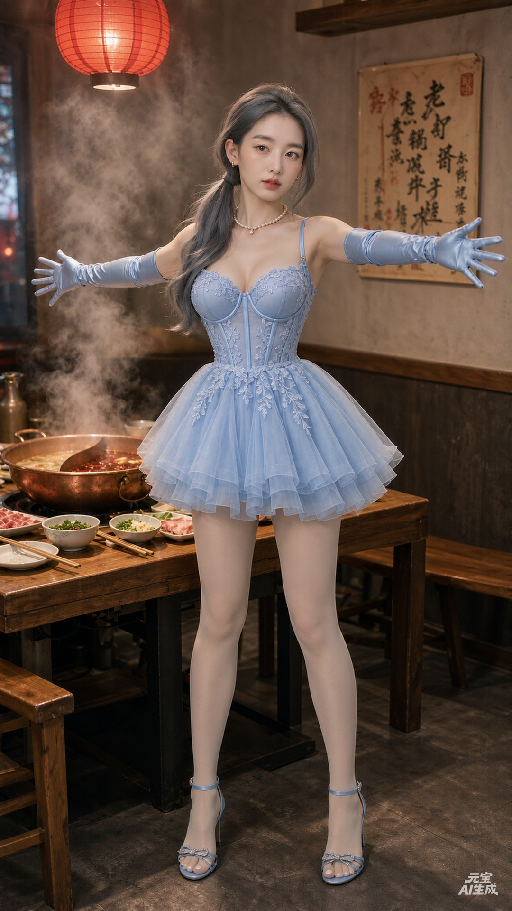

## 终稿提示词

```text
第一张图定本轮整套穿搭的版型、配色、面料与配饰，第二张图定骨相五官与同一张脸，第三张图定本张的站坐骨架、重心、脊线肩髋与四肢折角；脸、衣、发型、姿势由各自底图承担，第三张图的双手落点按本文重摆。本张是老铜锅涮肉店里的一段，画内只有她一位清晰成年人物，镜头是他的眼睛，他坐在桌对面。

9:16 竖版满画幅，画面从顶到底由人物、道具与光填满，整套画面连贯铺满，四条边即裁切边。

老铜锅涮肉店的一张木桌：中间一口红铜鸳鸯锅，红汤那半翻着细泡、白汤那半浮着几片姜与枸杞，锅口一团白气慢慢往上散；两只青瓷小碟里麻酱、香菜末、葱花各一小堆，竹筷搁在筷架上，一只白瓷盘码着薄薄的肥牛卷、一碟毛肚、一小壶温黄酒，桌面木纹被热气熏得发润；窗玻璃上一层薄薄雾气，头顶一盏红灯笼把暖光落下来，墙上斜挂一块手写菜单木牌，木凳与邻桌沉进暖褐里。低饱和三色：雾霾蓝、暖褐、灯笼红。

唐唐的脸：鹅蛋脸、骨相柔和、鼻梁细直、眼尾微微上扬、唇形饱满、眉色浅棕，四张同一张脸；一位唐唐，成年头身比，身形由束身杯型与合身剪裁写实呈现，腰线收得干净、腿线修长；一具身体轮廓，左右各一只手臂、各五根手指，两条腿各自连续，两只脚各自完整。

她站在木桌这一侧，两腿分开与肩同宽稳稳站定，两只戴长手套的手臂向桌两侧舒展开、十指各自分开，像把一整桌菜亮给他看又像轻轻一摊说点太多啦；上身微微朝锅那侧送过去，头正对桌对面、眼睛落在他脸上，唇角弯一点；红铜锅就在画面正中偏下，白气从两只手腕之间升起来，麻酱碟、肥牛卷白瓷盘、竹筷与温黄酒壶在桌面排开，灯笼暖光把银白刺绣与珍珠项链照出细亮。镜头与她眼高齐平、离地 158cm、距约 2.6m，平视取发顶到两只凉鞋鞋跟全身，象牙白丝袜从蓬蓬裙摆下经大腿、膝、小腿、脚背连续到凉鞋里的脚尖。本张不出现他的局部。

雾霾蓝缎面蕾丝刺绣细肩带束身短连衣裙，杯型上身压着银白枝蔓刺绣，细肩带，腰窝收进一整圈银白蕾丝，下面多层雾霾蓝薄纱蓬蓬短裙齐平收在大腿中段，裙摆一层一层散开；同色雾霾蓝缎面过肘长手套，两只手套各自完整、五指分开；一只雾霾蓝金链蝴蝶结小方包；颈上一串小珍珠项链，耳垂一对细哑金小耳圈；奶白圆甲、甲缘一道极细雾金弧线，左右各五根手指各自分开。
象牙白匀透连裤丝袜，细密哑光织纹，从髋经膝、小腿、脚背连续包到脚尖，脚尖由同色袜面完整包住，五趾轮廓各自分明，与浅蓝缎面一字带细跟凉鞋的鞋口平顺衔接；两只浅蓝缎面一字带细跟凉鞋都好好穿在脚上、踝带一道细带、四张同一双，鞋跟落在木地板与凳脚之间。
低侧马尾束在右颈侧、束点压在耳垂下方两指、马尾长过两侧肩胛骨下缘一掌，正中骨缝中分线从发际点直推到头顶顶点，左侧一缕别耳后露出整条左耳廓与耳垂、右侧薄发帘自然垂落压住右肩带起点，束点绕一圈极细雾金细链并垂一颗米粒珍珠贴着耳后走，马尾从耳下开始大弧度松弛 S 弯、像赴约前用手拨出来的弯，发尾削成参差羽尾自然垂落、后颈碎发留两指长自然贴着颈窝第二道横纹走，发色雾感冷调亚麻灰棕、底色压到六度、发中到发尾再褪半度成披了一层淡雾蓝的浅烟棕，在每一张里完全相同。
四张同一套衣服、同一款发型、同一款美甲、同一双鞋、同一层腿部覆盖、同一张脸。
```

## 一句点评

两手一摊把整桌菜亮给他看，铜锅白气从腕间升起来
