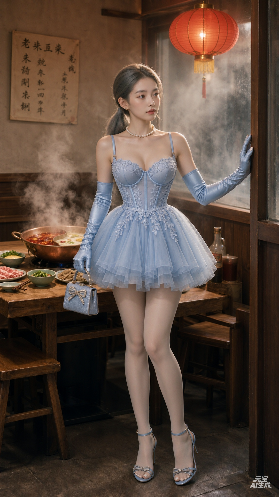
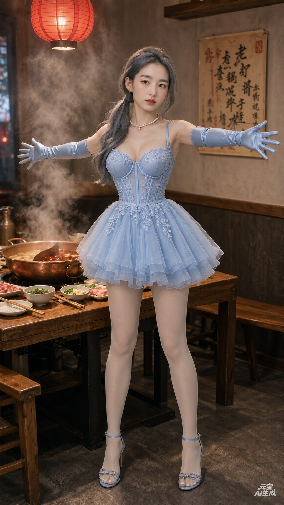
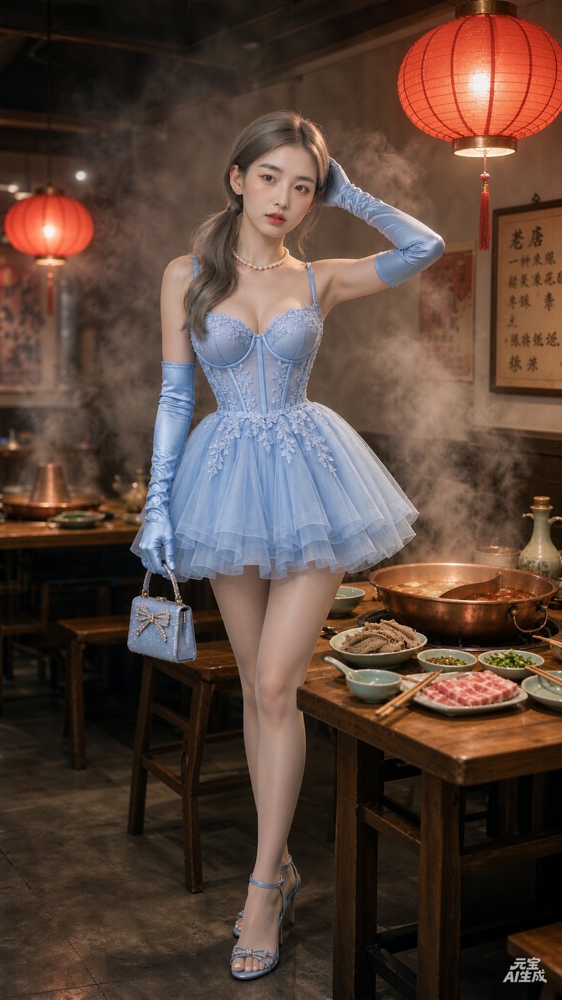

# R012 · 吃火锅不吃米线啦

- 轮次目录：`20261126l_lovers-hotpot`
- 来源：`lovers`
- 日期：2026-11-26
- 穿搭：`HOT-0001`
- 四张线稿：`hotpot_s3_1_front`、`hotpot_s3_2_open`、`hotpot_s3_3_side_seat`、`hotpot_s3_4_rise`
- 画幅：1080×1920（9:16），纯画面，工具水印随图保留

## 四张

| 序 | 机位 | 图 | 终稿提示词 |
|---|---|---|---|
| 01 | front |  | [01_front.md](01_front.md) |
| 02 | side |  | [02_side.md](02_side.md) |
| 03 | seat |  | [03_seat.md](03_seat.md) |
| 04 | close |  | [04_close.md](04_close.md) |

## 这一段说了什么

1. 你说不吃米线啦？那铜锅我可点红汤了，钱包你收好，今天我负责好看就行。
2. 毛肚七上八下，你别抢我筷子呀；等会儿那家换豆子的，明天再陪我去嘛。

## 现场记录

- 01_front：店门木框全身站定，颈肩平顺，金链小方包垂在髋侧
- 02_side：双臂舒展对应张开骨架，铜锅居中，象牙白丝袜整段连续
- 03_seat：侧坐撑座面，男主局部为一只推皮夹的手，头脸不入画
- 04_close：起身拢发、单脚后点，四张统一同一层腿部覆盖
- 槽 1 为本地候选蓝缎蓬蓬裙人台图，腿部未画出，腿层由四份文字正向定

> 原图 PNG 永不转码、永不覆盖；预览用 `` 缩放原图。
> 另有 `essay.md` 为本轮第一人称文章留证。
