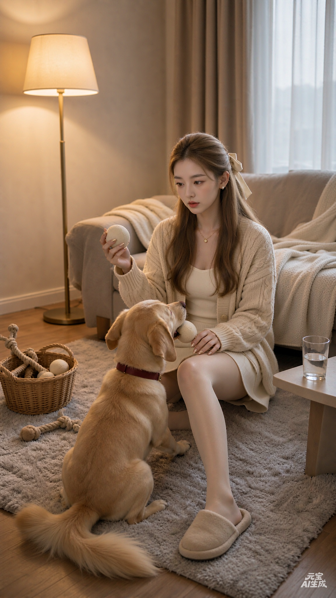

## 终稿提示词

```text
第一张图定本轮整套穿搭的版型、配色、面料与配饰，第二张图定骨相五官与同一张脸，第三张图定本张的骨架、重心、脊线肩髋与四肢折角；脸、衣、发型、姿势由各自底图承担，第三张图的双手落点按本文重摆。本张是自家客厅傍晚陪狗玩的一段，画内只有她与一只暖金色大狗，镜头是他的眼睛，他临时走开一会儿。

9:16 竖版满画幅，画面从顶到底由她、狗、地垫与光填满，整套画面连贯铺满，四条边即裁切边。

自家客厅傍晚，浅灰长绒地垫铺在木地板上，画左一盏暖黄落地灯把光压成一团，画右窗纱透进一点薄暮余白；地垫角一只藤编小篮装着两只狗咬绳与一只米白布偶球，半杯温水搁在矮几上，沙发上搭着一条奶白薄毯，木地板与墙角沉进暖褐里。低饱和三色：奶油杏、暖灰、蜜糖金。

一只暖金色大狗，垂耳、脖上一圈酒红项圈、蓬松尾巴扫在地垫上，嘴里叼着米白布偶球，四张同一只狗、同一圈酒红项圈；画内只有她与这只狗。

唐唐的脸：鹅蛋脸、骨相柔和、鼻梁细直、眼尾微微上扬、唇形饱满、眉色浅棕，四张同一张脸；一位唐唐，成年头身比，身形由针织开衫与合身剪裁写实呈现，腰线收得干净、腿线修长；一具身体轮廓，左右各一只手臂、各五根手指，两条腿各自连续，两只脚各自完整。

她侧坐在地垫上、一条腿屈起、另一条腿顺着地垫舒展出去、脚尖轻点绒面，右手把布偶球举到肩侧逗狗、五指分开，左手护着裙摆按在膝上；大黄仰头看球、前爪离地一点。镜头离地 100cm、距约 1.9m，平视取发顶到舒展那只脚的脚尖，浅杏丝袜从髋经屈起的膝、小腿、脚背整段连续到拖鞋里的脚尖。

奶油杏色粗针麻花针织开衫，宽松落肩、前襟敞开、袖口堆到腕骨，里面一件奶白罗纹针织细吊带短裙、裙摆齐平收在大腿中段；颈上一枚细哑金小圆牌项链，耳垂一对米粒珍珠耳钉；奶白圆甲、甲缘一道极细暖金弧线，左右各五根手指各自分开；一只燕麦色毛绒小圆包搁在地垫角。
浅杏珠光薄透连裤丝袜，细密哑光织纹，从髋经膝、小腿、脚背连续包到脚尖，脚尖由同色袜面完整包住，五趾轮廓各自分明，与燕麦色毛绒软底拖鞋的鞋口平顺衔接；两只燕麦色毛绒软底拖鞋都好好穿在脚上、四张同一双，鞋底落在浅灰长绒地垫上。
慵懒低半扎发，上半束在枕骨正下方、用一枚奶油杏缎面小发圈绕两圈固定，下半披散到两侧肩胛骨下缘齐平，正中骨缝中分线从发际点直推到头顶顶点，左右耳侧各留一缕两指宽的碎发自然垂落贴着颊边、露出两边耳廓与耳垂，发尾从耳下开始大弧度松弛 S 弯、像随手抓出来的弯，发色雾感暖蜜茶棕、底色压到六度、发中到发尾再褪半度成沾了层奶油光的浅栗棕，在每一张里完全相同。
四张同一套衣服、同一款发型、同一款美甲、同一双鞋、同一层腿部覆盖、同一只狗、同一张脸。
```

## 一句点评

侧坐举球逗狗，一条腿顺着地垫舒展出去
