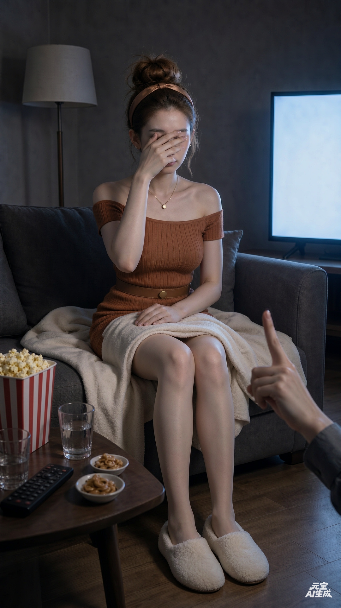

## 终稿提示词

```text
第一张图定本轮整套穿搭的版型、配色、面料与配饰，第二张图定骨相五官与同一张脸，第三张图定本张的骨架、重心、脊线肩髋与四肢折角；脸、衣、发型、姿势由各自底图承担，第三张图的双手落点按本文重摆。本张是自家客厅深夜关灯看片的一段，画内只有她一位清晰成年人物，镜头是他的眼睛，他神秘兮兮让她猜。

9:16 竖版满画幅，画面从顶到底由人物、毯子、道具与光填满，整套画面连贯铺满，四条边即裁切边。

自家客厅深夜，顶灯关了，画右一台电视屏幕把冷蓝白光斜斜推过来，在深灰沙发绒面与木地板上铺出一层薄亮；茶几上一只红白条纹爆米花纸桶、两只玻璃杯、一只遥控器、一小碟海盐焦糖，奶白薄毯堆在沙发扶手上；画左只剩一盏落地灯熄掉后的铜杆轮廓，窗帘与墙角沉进暖灰褐里。低饱和三色：赤陶棕、屏幕冷蓝、暖灰褐。

唐唐的脸：鹅蛋脸、骨相柔和、鼻梁细直、眼尾微微上扬、唇形饱满、眉色浅棕，四张同一张脸；一位唐唐，成年头身比，身形由一字领罗纹与合身剪裁写实呈现，腰线收得干净、腿线修长；一具身体轮廓，左右各一只手臂、各五根手指，两条腿各自连续，两只脚各自完整。

她坐直了一点，右手抬起来轻轻捂住眼睛、五指并拢留出一道指缝偷看画右屏幕，左手按在膝头的毯子上、五指分开；嘴唇抿着又忍不住往上弯一点，高丸子头的羽碎发在屏幕冷蓝里翘着。**他的一只手从画面右下角伸进来、食指轻轻竖起做噤声状、其余四指自然收拢、腕接深灰衬衫袖口、头脸完全在画外、与她自己的两只手相隔一拳**；屏幕冷蓝落在那只手的指节与她露出的肩线上。镜头离地 100cm、距约 1.9m，平视取丸子顶到两只羊羔绒短靴，暖砂丝光从髋经膝、小腿、脚背整段连续到短靴绒口里的脚尖。

赤陶棕羊绒一字露肩罗纹连衣短裙，领口横开在锁骨下、两肩整段露出，细罗纹从领口一路走到裙摆，腰间一道同色腰带压一枚细哑金圆扣，裙摆齐平收在大腿中段；颈上一枚细哑金小圆牌项链，耳垂一对米粒珍珠耳钉；奶白圆甲、甲缘一道极细暖金弧线，左右各五根手指各自分开；一只奶白羊羔绒小圆包搁在沙发角。
暖砂珠光薄透连裤丝袜，细密哑光织纹，从髋经膝、小腿、脚背连续包到脚尖，脚尖由同色袜面完整包住，五趾轮廓各自分明，与奶白羊羔绒软底短靴的绒口平顺衔接；两只奶白羊羔绒软底短靴都好好穿在脚上、四张同一双，绒底落在深灰沙发前的木地板上。
蓬松高丸子头束在头顶顶点偏后一掌处、丸子松松绕两圈收成一小团，发根一圈赤陶棕缎面细发带压住碎发，正中骨缝中分线从发际点直推到头顶顶点，左右耳侧各留一缕两指宽的碎发自然垂落贴着颊边、露出两边耳廓与耳垂，丸子边缘抽出一指长的羽碎发自然翘着，发色雾感暖栗棕、底色压到六度、发中到发尾再褪半度成沾了层赤陶光的浅茶棕，在每一张里完全相同。
四张同一套衣服、同一款发型、同一款美甲、同一双鞋、同一层腿部覆盖、同一条奶白薄毯、同一张脸。
```

## 一句点评

捂眼从指缝偷看，他一只手竖食指噤声
