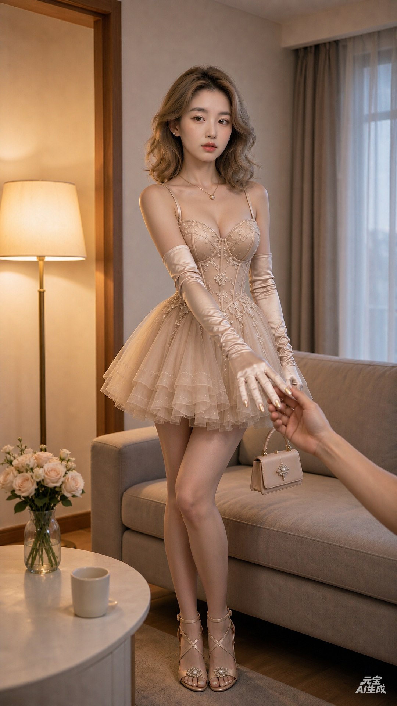

## 终稿提示词

```text
第一张图定本轮整套穿搭的版型、配色、面料与配饰，第二张图定骨相五官与同一张脸，第三张图定本张的骨架、重心、脊线肩髋与四肢折角；脸、衣、发型、姿势由各自底图承担，第三张图的双手落点按本文重摆。本张是自家玄关连客厅傍晚的一段，画内只有她一位清晰成年人物，镜头是他的眼睛，他问她会不会撒娇。

9:16 竖版满画幅，画面从顶到底由人物、道具与光填满，整套画面连贯铺满，四条边即裁切边。

自家玄关连客厅傍晚，画左一盏暖黄落地灯把米白光斜斜推过来，画右窗纱留一层薄暮余白，米灰墙、浅灰沙发一角、矮几上一杯温水与一小束浅粉玫瑰、门框木棱被灯描出一道暖边；低饱和三色：裸米香槟、暖黄、灰褐。

唐唐的脸：鹅蛋脸、骨相柔和、鼻梁细直、眼尾微微上扬、唇形饱满、眉色浅棕，四张同一张脸；一位唐唐，成年头身比，腰线由鱼骨竖向收得干净、曲线从锁骨经腰到胯一线清楚，腿线修长；一具身体轮廓，左右各一只手臂、各五根手指，两条腿各自连续，两只脚各自完整。

她站在浅灰沙发前，重心落左腿、上身微微侧向画右，两腿一前一后轻轻错开、脚尖点地，右手往前伸、**五指各自分开捏住从画面右下角伸进来的他一只手往自己这边带**，左手垂在髋侧轻贴长手套缎面、五指分开，仰脸看向镜头，下巴微抬、颈肩平顺连续、锁骨整段落在暖黄灯里、唇角收着一点软；**他一只手从画面右下角清清楚楚伸进画面、五指各自分开、掌心朝上、腕接深灰衬衫袖口、占约一成画幅、头脸完全在画外、与她自己的两只手相隔一拳**；裸米小方包搁在沙发角。镜头离地 100cm、距约 2.4m，平视取发顶到两只凉鞋，蜜桃丝光从髋经膝、小腿、脚背整段连续到凉鞋鞋口里的脚尖。

裸米香槟缎面鱼骨束身吊带迷你连衣裙，心形杯沿一整圈米白珠绣与细金线刺绣、细肩带，鱼骨竖向收腰把腰线收得干净，杯内一层同色不透明缎面衬里，上衣完整覆盖胸口，肌肤由衣物遮住；腰下接多层裸米薄网纱蓬短裙，裙摆齐平收在大腿中段，网纱只作外层装饰；过肘裸米缎面长手套，左右各五根手指各自分开；一只裸米小方包、包盖一枚米白珠饰；颈上一枚细哑金小圆牌，耳垂一对米粒珍珠；奶白圆甲、甲缘一道极细暖金弧线。
蜜桃珠光薄透连裤丝袜，细密哑光织纹，从髋经膝、小腿、脚背连续包到脚尖，脚尖由同色袜面完整包住，五趾轮廓各自分明，与裸米交叉绑带细高跟凉鞋的鞋口平顺衔接；两只裸米交叉绑带细高跟凉鞋都好好穿在脚上、踝带交叉绕到脚背、四张同一双。
及肩下两指的蓬松波浪卷发，三七分缝线从发际点斜推到头顶，右侧一缕别到耳后完整露出右耳与耳垂、左侧发帘自然垂落压到颊边，右耳后别一枚米杏缎面小蝴蝶结发夹只露出一点缎光，卷度从颧骨下方开始的大弧度松 S 弯、发尾削成参差羽尾外翘一指，发色雾感蜜茶浅棕、底色压到六度、发中到发尾再褪半度成沾了层暖杏光的浅茶金，在每一张里完全相同。
四张同一套衣服、同一款发型、同一款美甲、同一双鞋、同一层腿部覆盖、同一只小方包、同一张脸。
```

## 一句点评

坐沙发边拽住他一截深灰衬衫袖口往自己带
