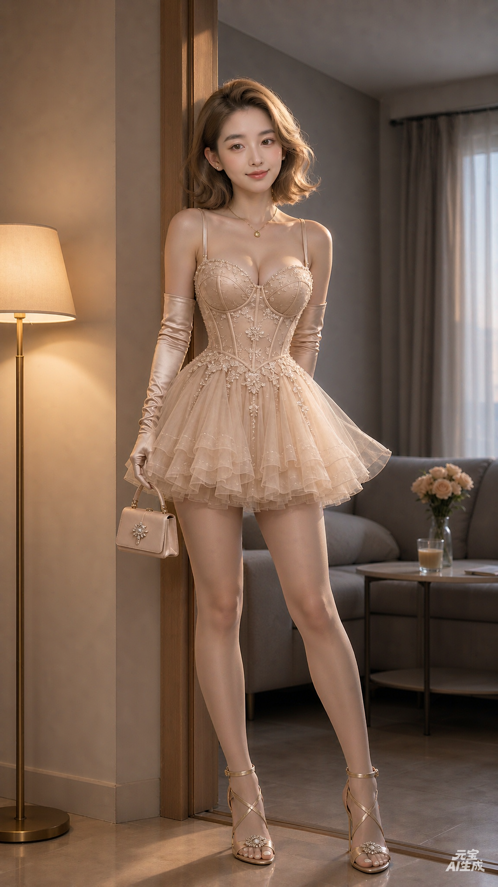
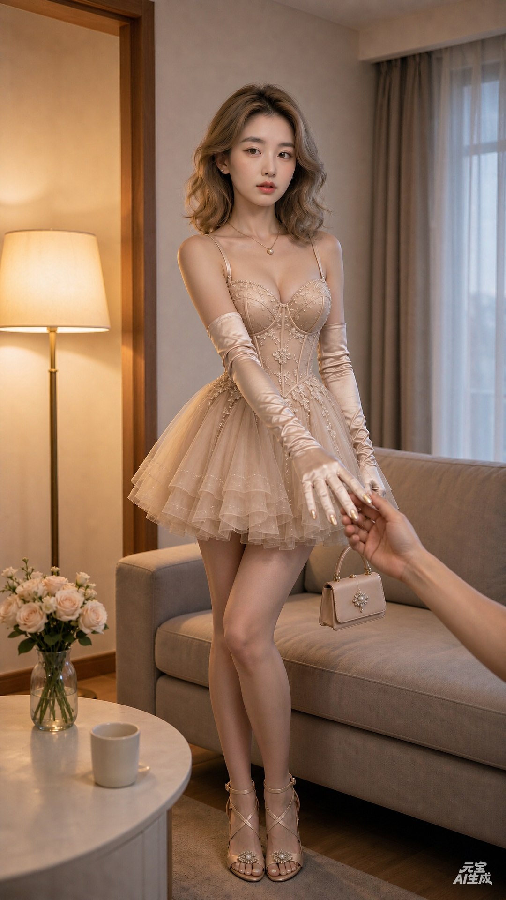
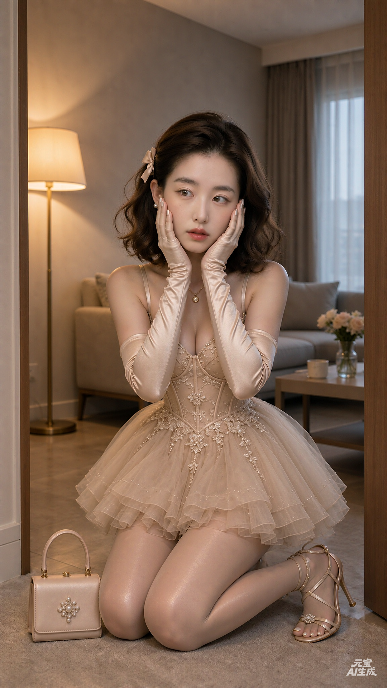
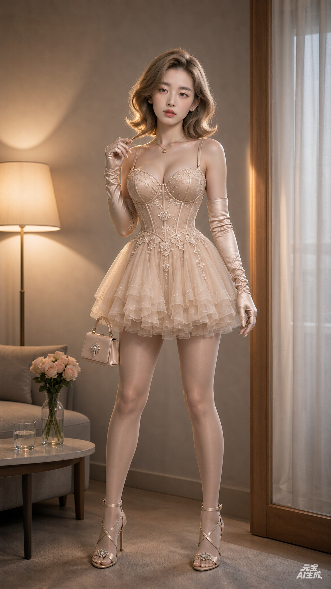

# R015 · 你会撒娇吗

- 轮次目录：`20261126o_lovers-sajiao-coquette`
- 来源：`lovers`
- 日期：2026-11-26
- 穿搭：`SAJ-0001`
- 四张线稿：`full_sexy_P001_front#tuned`、`full_sexy_P015_diag#mirror#tuned`、`full_sexy_P004_front#tuned`、`full_sexy_P013_front#tuned`
- 画幅：1080×1920（9:16），纯画面，工具水印随图保留

## 四张

| 序 | 机位 | 图 | 终稿提示词 |
|---|---|---|---|
| 01 | front |  | [01_front.md](01_front.md) |
| 02 | side |  | [02_side.md](02_side.md) |
| 03 | seat |  | [03_seat.md](03_seat.md) |
| 04 | close |  | [04_close.md](04_close.md) |

## 这一段说了什么

1. 会不会？我歪个头你就知道啦～长手套都举酸了，你倒是先哄我一句呀。
2. 等会儿那家换豆子的，你陪我去嘛，不许又说困。

## 现场记录

- 01_front：远机位全身，S 形重心，暖黄落地灯在画左
- 02_side：男主局部为一截深灰衬衫袖口与手腕，头脸不入画
- 03_seat：前倾捧脸，膝前丝光柔亮
- 04_close：勾发尾回眸，两只凉鞋完整落在下沿内
- 槽 1 由 --fresh 远端直取 PTY-0025（裸米鱼骨束身吊带＋薄纱蓬短裙＋长手套＋珠饰小方包＋交叉绑带细高跟），人台没画腿，腿层由四份文字单定
- 槽 3 四张为库里原线稿镜像/裁切微调产物，去重账记 #tuned
- 第 3 步审提示词 Agent 按 18 岁男大老色批人设给出正向补写句：腰线收得干净／曲线从锁骨经腰到胯／S 形重心／锁骨整段落光／膝前柔亮／回眸眼尾／若隐若现落光，全部采纳并逐字写进四份
- 接住上轮「这大型我不喜欢」：本轮改贴身收腰＋短裙摆＋腿线修长，不取厚钝直筒廓形
- 6.8 终审：第2张初判不合格（站姿与定稿坐姿不符、男主局部未出现），许愿式1次修不动；回流第6步换槽3_2为 full_sexy_P015_diag 镜像微调、局部解冻第2份定稿为站姿＋「他一只手」打头，三槽重生成
- 6.8 终审四张全合格；第2张经许愿式1次＋回流换骨架重生成修到合格；男主手出现，深灰袖口未渲出按合法落点放行

> 原图 PNG 永不转码、永不覆盖；预览用 `` 缩放原图。
> 另有 `essay.md` 为本轮第一人称文章留证。
