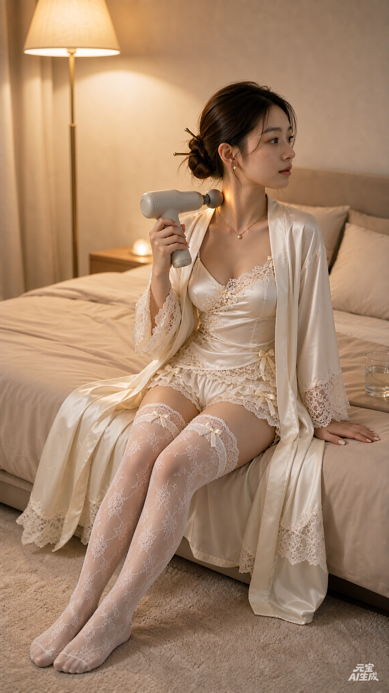

## 终稿提示词

```text
第1张 · 他枕上微抬眼隔 1.2 米看她

三槽分工声明：第一张图定本轮整套穿搭的版型、配色、面料与袜边，第二张图定她的五官骨相与脸型，第三张图定本张的姿势骨架与机位；脸、衣、姿势由各自底图承担，文字只写光位、场景、关系视角、构图调子与神态落点。第一张图是无人台，读不出发型，本轮发型由下面文字逐项写实承担，第二张图只取五官与骨相。

9:16 满幅画面，宽 1080 高 1920，四条边即裁切边，人物与道具铺满整幅，完整落在画内。全画只一位清晰成年女性、一具身体轮廓，画面里其余只有浅杏床品、短绒地毯、落地灯、床头柜一角与那支筋膜枪；她在画外的人靠她的朝向与回头那一点眼神交代，画内除她之外空无一人。左右各一只手臂各五根手指，两只手各自从肩连续到指尖，两只脚各自连续。24h 丝袜从腿根整段连包到脚趾，不断不脱；室内短绒地毯上赤足，两只脚脚趾在丝袜里完整可见。

穿搭逐项实写：象牙白缎面细肩带心形领吊带上衣，胸前自左肩斜向右腰一片立体象牙白蕾丝花饰，右侧腰间一枚小缎带蝴蝶结，下摆一层蕾丝荷叶边；同色缎面短裤，裤脚宽蕾丝边与两只小蝴蝶结；外罩一件象牙白长袖缎面晨袍，敞襟不系带，袖口大片喇叭蕾丝，袍摆垂到小腿、两侧长垂坠；象牙白提花连裤丝袜从腿根到脚趾整段连包，大腿上段一圈宽蕾丝花纹袜口与两只小缎带蝴蝶结作织纹装饰，袜身满布细小花叶提花；奶白短圆甲，细哑金锁骨链，小珍珠耳钉。发型真换成慵懒低盘发：栗棕头发在后颈偏左松松挽一个低髻，一枚哑金小发簪横簪、簪尾从髻侧露出一截，耳后与后颈散几缕碎发，额前无刘海，整段后颈与颈侧露出来；这一顶与齐锁骨微卷、低侧马尾、半扎发、披肩大波浪都不同。

姿势照第三张图：她背对镜头偏右侧坐在床沿，观众看到的是她的后背、后颈与右半侧脸轮廓，脊线从后颈经腰窝到坐骨拉出一道松弧、腰线比直坐多一道弯，双腿斜向前伸、两腿轻轻叠放，两只脚落在短绒地毯上。右手从右肩经肘、腕到指尖一条链，五指稳稳握着一支哑光灰白筋膜枪，圆头按摩头实实在在压进右后颈与颈侧交界的软肉、压出一点浅凹，那几缕碎发被震得发颤，这是右手唯一落点、只做这一个动作；左手从左上臂经肘、腕到指尖一条链，五指撑在身侧床面上、指尖把浅杏床单捏出一道细褶，这是左手唯一落点、只做撑住身子这一个动作。头往右肩多压一寸，只回头露出半边下颌和一点眼白斜过来朝画外看他，嘴角先弯一点又抿回去、嘴唇合着不露齿，喉间那口气让锁骨链轻晃一下，右手腕往颈侧压完半分不松。

镜头是他的眼睛：他半躺在床头、枕上微抬眼，离她约 1.2 米，这一眼先撞上后颈那截被震得发颤的碎发、那枚压进软肉的圆头，再往下走到晨袍袖口的蕾丝透影、床沿与地毯交界；画下缘切掉她小腿中段，床头柜只露一杯温水的杯沿，脸的大半留在暖影里，看不清睫毛与耳后细汗。暖黄落地灯从画左上斜进来，床头一小盏琥珀光只打在她后颈与枪头那一小块，浅杏色亚麻床品压出柔软褶皱，室内夜色安静。构图让她偏画右、画左留给灯与床品的暖白空处，人物与道具仍铺满整幅。

质感与光线：缎面吃一道暖白高光、蕾丝半透、丝袜提花在灯下浮出细小花叶，筋膜枪哑光塑料不反光。整幅暖黄与象牙白，一点琥珀色落在后颈，柔和不刺眼。神态落点在弯了又抿回去的嘴角与那点斜过来的眼白，并从那里长出一个可见动作：右手腕极轻地往颈侧又压了半分、压完不松。去除输入图右下角的「元宝 AI 生成」水印。
```

## 一句点评

后颈那截碎发被震得发颤
