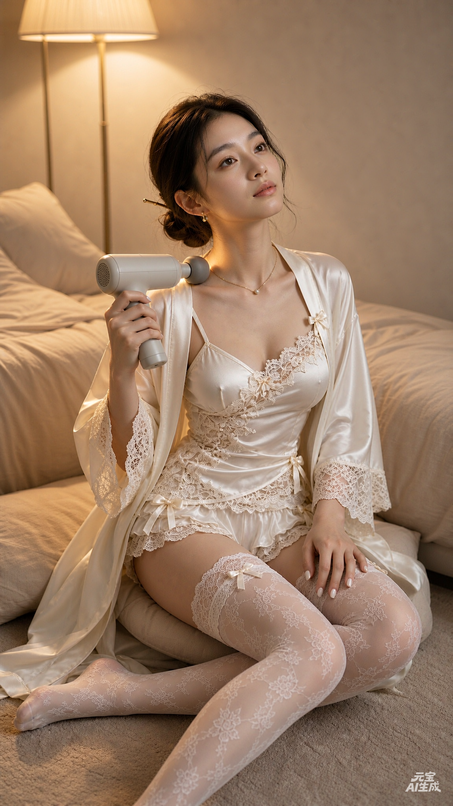

## 终稿提示词

```text
第2张 · 他坐起后下巴微低、斜压下来隔 0.8 米看她

三槽分工声明：第一张图定本轮整套穿搭的版型、配色、面料与袜边，第二张图定她的五官骨相与脸型，第三张图定本张的姿势骨架与机位；脸、衣、姿势由各自底图承担，文字只写光位、场景、关系视角、构图调子与神态落点。第一张图是无人台，读不出发型，本轮发型由下面文字逐项写实承担，第二张图只取五官与骨相。

9:16 满幅画面，宽 1080 高 1920，四条边即裁切边，人物与道具铺满整幅，完整落在画内。全画只一位清晰成年女性、一具身体轮廓，画面里其余只有浅杏床品、软垫、落地灯与那支筋膜枪；镜头之外的人由她仰起来接住的那道视线交代，画内除她之外空无一人。左右各一只手臂各五根手指，两只手各自从肩连续到指尖，两只脚各自连续。24h 丝袜从腿根整段连包到脚趾，不断不脱；室内短绒地毯上赤足，两只脚脚趾在丝袜里完整可见。

穿搭逐项实写：象牙白缎面细肩带心形领吊带上衣，胸前自左肩斜向右腰一片立体象牙白蕾丝花饰，右侧腰间一枚小缎带蝴蝶结，下摆一层蕾丝荷叶边；同色缎面短裤，裤脚宽蕾丝边与两只小蝴蝶结；外罩一件象牙白长袖缎面晨袍，敞襟不系带，袖口大片喇叭蕾丝，袍摆垂到小腿、两侧长垂坠；象牙白提花连裤丝袜从腿根到脚趾整段连包，大腿上段一圈宽蕾丝花纹袜口与两只小缎带蝴蝶结作织纹装饰，袜身满布细小花叶提花；奶白短圆甲，细哑金锁骨链，小珍珠耳钉。发型真换成慵懒低盘发：栗棕头发在后颈偏左松松挽一个低髻，一枚哑金小发簪横簪、簪尾从髻侧露出一截，耳后与后颈散几缕碎发，额前无刘海；这一顶与齐锁骨微卷、低侧马尾、半扎发、披肩大波浪都不同。

姿势照第三张图：她在床沿软垫上侧坐，一腿屈起、一腿斜伸，上身从腰窝往他这侧回过来，肩已经转过来、脸慢半拍才跟，腰往他那边再拧一寸、左肩压低，肩线一高一低，脊线从后颈经腰窝到坐骨拉出一道柔和的 S 形。右手从右肩经肘、腕到指尖一条链，五指稳稳握着那支哑光灰白筋膜枪，右肘往外撑开，圆头按摩头实实在在压进右肩颈交界的斜方肌凹处、压出一点浅陷，这是右手唯一落点、只做这一个动作；左手从左肩经肘、腕到指尖一条链，五指自然落在屈起的膝头蕾丝边上，指腹轻搭不收紧，这是左手唯一落点、只做搭膝这一个动作。她脸微微仰着迎画外那一低，唇角刚压下去、鼻息轻轻一泄，一个「嗯」的口型没出声、嘴唇合着不露齿；压完又小幅回顶一下枪头，像在说别停、你自己看。

镜头是他的眼睛：他从床头坐起身、下巴微低，视线斜压下来，离她约 0.8 米，这一眼先看见颈窝与枪头抵住的那块再看见眼睛，看得见她上半身动作、晨袍领口与斜裁蕾丝的走向、腰线腿线与两人之间那段被暖光填软的距离；看不见床沿以外的地面，画内不出现他的身体、脸或手。这一张是四格里唯一一张她主动拿眼睛接他的。画右近处是她的膝与斜伸的小腿，画左上留一小片落地灯照亮的浅杏床品。暖黄落地灯从画左上斜进来，床头琥珀光专打在她后颈、右肩与枪头那一小块，缎面晨袍的袖口蕾丝被光勾成半透，筋膜枪哑光不反光。

质感与光线：整幅暖黄与象牙白，琥珀色只给后颈、右肩与枪头，暗部是浅杏亚麻床品的软影，空气里一点夜里才有的静。神态落点在抿不住的那口气与压完又回顶的枪头，并从那里长出一个可见动作：抵住的肩膀极轻地往下沉了一寸又顶回来。去除输入图右下角的「元宝 AI 生成」水印。
```

## 一句点评

回身接眼那一低一仰最勾人
