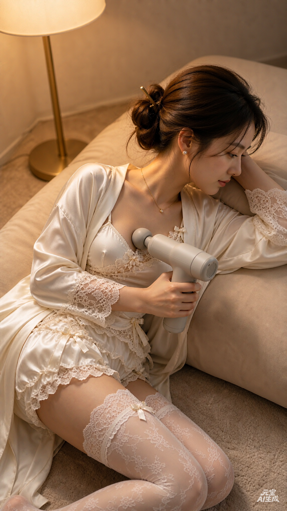

## 终稿提示词

```text
第3张 · 他俯身约 35° 斜俯、隔 0.5 米看她

三槽分工声明：第一张图定本轮整套穿搭的版型、配色、面料与袜边，第二张图定她的五官骨相与脸型，第三张图定本张的姿势骨架与机位；脸、衣、姿势由各自底图承担，文字只写光位、场景、关系视角、构图调子与神态落点。第一张图是无人台，读不出发型，本轮发型由下面文字逐项写实承担，第二张图只取五官与骨相。

9:16 满幅画面，宽 1080 高 1920，四条边即裁切边，人物与道具铺满整幅，完整落在画内。全画只一位清晰成年女性、一具身体轮廓，画面里其余只有浅杏软垫、短绒地毯、落地灯光晕与那支筋膜枪；画外的人由她让出来的整段后颈交代，画内除她之外空无一人。左右各一只手臂各五根手指，两只手各自从肩连续到指尖，两只脚各自连续。24h 丝袜从腿根整段连包到脚趾，不断不脱；室内软垫与短绒地毯上赤足，两只脚脚趾在丝袜里完整可见。

穿搭逐项实写：象牙白缎面细肩带心形领吊带上衣，胸前自左肩斜向右腰一片立体象牙白蕾丝花饰，右侧腰间一枚小缎带蝴蝶结，下摆一层蕾丝荷叶边；同色缎面短裤，裤脚宽蕾丝边与两只小蝴蝶结；外罩一件象牙白长袖缎面晨袍，敞襟不系带，袖口大片喇叭蕾丝，袍摆顺着俯卧的身子垂到软垫边、两侧长垂坠；象牙白提花连裤丝袜从腿根到脚趾整段连包，大腿上段一圈宽蕾丝花纹袜口与两只小缎带蝴蝶结作织纹装饰，袜身满布细小花叶提花；奶白短圆甲，细哑金锁骨链，小珍珠耳钉。发型真换成慵懒低盘发：栗棕头发在后颈偏左松松挽一个低髻，一枚哑金小发簪横簪、簪尾从髻侧露出一截，耳后与后颈散几缕碎发，额前无刘海，俯着时整段后颈与颈侧全露出来；这一顶与齐锁骨微卷、低侧马尾、半扎发、披肩大波浪都不同。

姿势照第三张图：她侧俯卧在软垫上，近侧膝往外打开半寸、臀线轻轻顶起一道 S，两腿微微屈起、脚尖朝画右上绷出去并交叠往画前顶一点做出透视，左臂向前伸直、额头侧贴在自己左小臂上，半张脸埋进软垫朝他这半边留一点，脊线从后颈经肩胛、腰窝一路收到臀线，晨袍沿这条线敞开铺成两片柔软的缎。右手从右肩经肘、腕到指尖一条链，五指稳稳握着那支哑光灰白筋膜枪的短柄，枪身从她右肩上方斜跨过去、圆头越过右肩落在两片肩胛之间那段脊线上，实实在在压进软肉、压出一点浅陷，肩胛随之往垫里陷一点；这支枪从右肩前的短柄到背后脊线上的圆头整支都要清清楚楚在画内，这是右手唯一落点、只做握枪抵背这一个动作。左手从左肩经肘、腕到指尖一条链，五指松松压在自己左小臂上、垫着额角，这是左手唯一落点、只做垫额这一个动作。头往软垫里偏半寸、把后颈再让出来一截，全给但不看他，露在画外的半张嘴角往上挑一点；吐气吐到一半轻轻「嘶」一声咬住下唇尖，眉心松开、眉尾挑一下，同一瞬脚尖交叠处悄悄绷直又松开。

镜头是他的眼睛：他从床侧俯身、离她后颈约 0.5 米，视角约 35° 斜俯，视线贴着后颈切进去，近端的肩胛与腰窝吃满琥珀光、远端自然虚一点，看得见整段后颈、斜跨右肩的那支哑光灰白枪、压在两肩胛之间的圆头、低髻与露出的哑金簪尾、被震得轻轻晃的碎发、缎面晨袍沿脊线铺开的褶、绷出去的脚尖与丝袜上的花叶提花；看不见她的正脸表情，只从埋进软垫那半张侧脸的嘴角读到舒服。构图让她斜铺满整幅，画上缘留给软垫边与一小截落地灯的光晕，画下缘是往画前顶来的脚与毯绒。暖黄落地灯从画左上斜铺下来，床头琥珀光顺着后颈一路滑到腰窝，缎面吃出一道长长的暖白，蕾丝半透，丝袜提花在斜光里浮出细纹。

质感与光线：整幅暖黄与象牙白，琥珀色专给后颈与脊线那一条，暗部是浅杏床品的软影，筋膜枪哑光塑料不反光。神态落点在吐到一半咬住的下唇尖与挑起的眉尾，并从那里长出一个可见动作：肩胛被压住时极轻地往软垫里陷了一点。去除输入图右下角的「元宝 AI 生成」水印。
```

## 一句点评

枪搁下后指腹点了一下后颈
