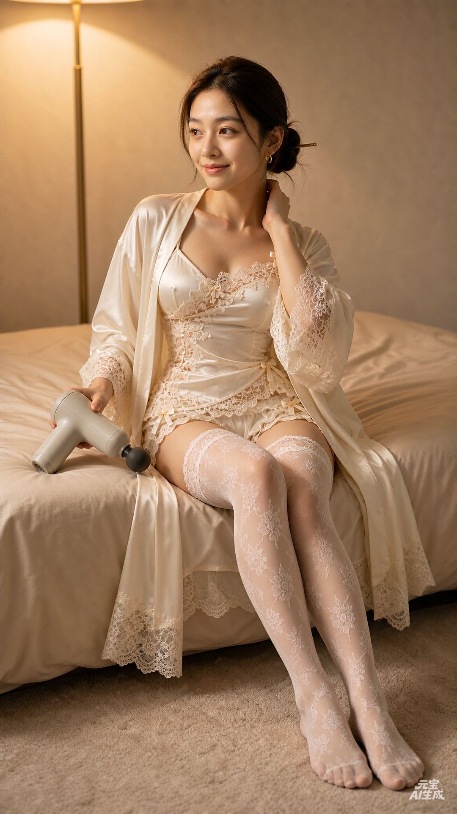

## 终稿提示词

```text
第4张 · 他凑到近前半米内看她

三槽分工声明：第一张图定本轮整套穿搭的版型、配色、面料与袜边，第二张图定她的五官骨相与脸型，第三张图定本张的姿势骨架与机位；脸、衣、姿势由各自底图承担，文字只写光位、场景、关系视角、构图调子与神态落点。第一张图是无人台，读不出发型，本轮发型由下面文字逐项写实承担，第二张图只取五官与骨相。

9:16 满幅画面，宽 1080 高 1920，四条边即裁切边，人物与道具铺满整幅，完整落在画内。全画只一位清晰成年女性、一具身体轮廓，画面里其余只有浅杏床品、短绒地毯、落地灯光晕与那支搁下的筋膜枪；画外的人由她朝这边回过来的半张脸与往上挑的视线交代，画内除她之外空无一人。左右各一只手臂各五根手指，两只手各自从肩连续到指尖，两只脚各自连续。24h 丝袜从腿根整段连包到脚趾，不断不脱；室内短绒地毯上赤足，两只脚脚趾在丝袜里完整可见。

穿搭逐项实写：象牙白缎面细肩带心形领吊带上衣，胸前自左肩斜向右腰一片立体象牙白蕾丝花饰，右侧腰间一枚小缎带蝴蝶结，下摆一层蕾丝荷叶边；同色缎面短裤，裤脚宽蕾丝边与两只小蝴蝶结；外罩一件象牙白长袖缎面晨袍，敞襟不系带，袖口大片喇叭蕾丝，袍摆顺着侧坐的身子垂到小腿、两侧长垂坠；象牙白提花连裤丝袜从腿根到脚趾整段连包，大腿上段一圈宽蕾丝花纹袜口与两只小缎带蝴蝶结作织纹装饰，袜身满布细小花叶提花；奶白短圆甲，细哑金锁骨链，小珍珠耳钉。发型真换成慵懒低盘发：栗棕头发在后颈偏左松松挽一个低髻，一枚哑金小发簪横簪、簪尾从髻侧露出一截，耳后与后颈散几缕碎发，额前无刘海；这一顶与齐锁骨微卷、低侧马尾、半扎发、披肩大波浪都不同。

姿势照第三张图：她在床沿侧坐，一腿屈起收在身前、膝头往画外他这边再送两寸，一腿斜放，脚尖点着短绒地毯，上身从腰窝往他这侧回过来，只回半张脸，肩线一高一低。右手从右肩经肘、腕到指尖一条链，五指把那支哑光灰白筋膜枪轻轻搁在身侧床面上，枪身横放、圆头朝外正好指在膝与她之间，这是右手唯一落点、只做搁下这一个动作；左手从左肩经肘、腕绕到右后颈到指尖一条链，五指虚虚按在右后颈刚才被震过的那一小块，指腹贴着皮肤、蹭到一半顿住再轻轻点一下那片浅粉，这是左手唯一落点、只按后颈这一个动作。回脸时嘴角先挑一点、眼尾压着不笑开、嘴唇合着不露齿，脸再回低一点，视线从他下巴往上挑着看他，像早就等着他凑过来这句；眉梢跟着指尖那一下再抬一线。

镜头是他的眼睛：他凑到近前、离她不到半米，这一眼看得清她眼尾那点压下来的光、右后颈上被指尖点着的一小片浅粉、低髻里横簪露出的哑金簪尾、散在颈侧的碎发、锁骨链一粒细亮、晨袍领口斜裁蕾丝的每一道边、床面那支横放的哑光灰白筋膜枪；画外的他与他的手全不入画，靠她朝这边回过来的半张脸与搁下的枪交代他在。画顶留给落地灯的光晕与一小截浅杏床品，画底是往前送来的膝头、斜放的小腿与丝袜脚背连到脚趾的那一段。暖黄落地灯从画左上斜进来，床头琥珀光专打在回过来的半张脸与右后颈，缎面吃一道暖白高光，蕾丝半透，丝袜提花在近处浮出细小花叶，搁下的筋膜枪哑光不反光。

质感与光线：整幅暖黄与象牙白，琥珀色只给脸与后颈，暗部是夜色里软掉的浅杏床品，安静得像能听见枪刚停的那一下余震。神态落点在挑起一点的嘴角与压着不笑开的眼尾，并从那里长出一个可见动作：按在右后颈的指尖蹭到一半顿住、轻轻点一下，舒服是她的，话头也是她起的。去除输入图右下角的「元宝 AI 生成」水印。
```

## 一句点评

收尾话头归她起
