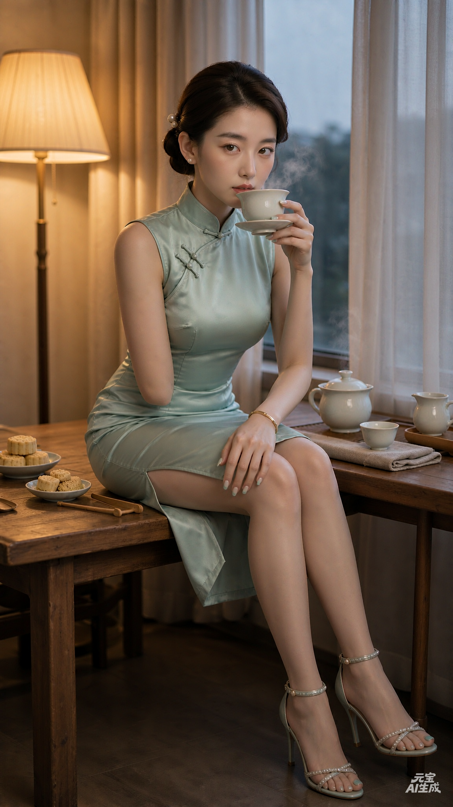

## 终稿提示词

```text
第一张图定本轮整套穿搭的版型、配色、面料与配饰，第二张图定骨相五官与同一张脸，第三张图定本张的骨架、重心、脊线肩髋与四肢折角；脸、衣、发型、姿势由各自底图承担，第三张图的双手落点按本文重摆。本张是自家窗边茶桌傍晚的一段，画内只有她一位清晰成年人物，镜头是他的眼睛，他先喝口茶。

9:16 竖版满画幅，画面从顶到底由人物、道具与光填满，整套画面连贯铺满，四条边即裁切边。

自家窗边茶桌傍晚，画左一盏暖黄落地灯把米白光斜斜推过来，画右窗纱留一层薄暮余白，老木茶桌上白瓷盖碗、公道杯、两只小茶杯、一小碟桂花糕、竹茶则与浅灰茶巾，木纹与窗格沉进暖灰褐里；低饱和三色：雾青瓷、暖黄、木褐。

唐唐的脸：鹅蛋脸、骨相柔和、鼻梁细直、眼尾微微上扬、唇形饱满、眉色浅棕，四张同一张脸；一位唐唐，成年头身比，曲线从小立领经斜襟、收腰到胯一线清楚，开衩处腿线修长，侧身时颈肩线平顺连续；一具身体轮廓，左右各一只手臂、各五根手指，两条腿各自连续，两只脚各自完整。

她侧身坐在窗边，单手端起白瓷盖碗凑到唇前轻轻吹开茶雾、五指各自分开托着碗托，另一手搭在膝头、五指分开，唇形饱满、眼尾微微上扬看向镜头，若隐若现的落光沿右斜襟三粒盘扣一路往下走到收腰处，盖碗口那缕白雾被暖黄灯照得发软。镜头离地 98cm、距约 1.8m，平视取髻顶到两只凉鞋，浅杏丝光从开衩下经膝、小腿、脚背连续到凉鞋鞋口里的脚尖。

雾青瓷缎面小立领斜襟盘扣改良旗袍式及膝短裙，右斜襟三粒细盘扣、小立领竖起整段颈子，无袖，裙身顺着身体曲线贴身收腰到胯，右侧一道开衩到膝上两指、裙摆齐膝，缎面在腰胯与开衩边缘有很浅的一层柔亮；整套旗袍完整覆盖，肌肤由衣物遮住；耳垂一对米粒珍珠，腕上一只细哑金小镯；奶白圆甲、甲缘一道极细青瓷弧线。
浅杏珠光薄透连裤丝袜，细密哑光织纹，从髋经膝、小腿、脚背连续包到脚尖，脚尖由同色袜面完整包住，五趾轮廓在薄层里各自分明，与雾青瓷珍珠踝带细高跟凉鞋的鞋口平顺衔接；两只珍珠踝带细高跟凉鞋都好好穿在脚上、踝带一圈细珍珠绕到脚背、四张同一双。
低挽圆髻贴在枕骨正后方、髻心压一枚米白珍珠小圆扣，正中骨缝中分从发际点直推到头顶顶点，两侧各一片手推波纹从额角贴着颊骨绕到耳后、完整露出两只耳朵与耳垂，左耳后别一枚细哑金小抓夹只露一点金，后颈留两指长碎发自然贴着颈窝，发色雾感深栗棕、底色压到五度、发中到髻尾再褪半度成沾了层青瓷冷光的茶褐，在每一张里完全相同。
四张同一套旗袍、同一款发型、同一款美甲、同一双鞋、同一层腿部覆盖、同一张脸。
```

## 一句点评

侧坐端盖碗吹茶雾，落光沿盘扣下行
