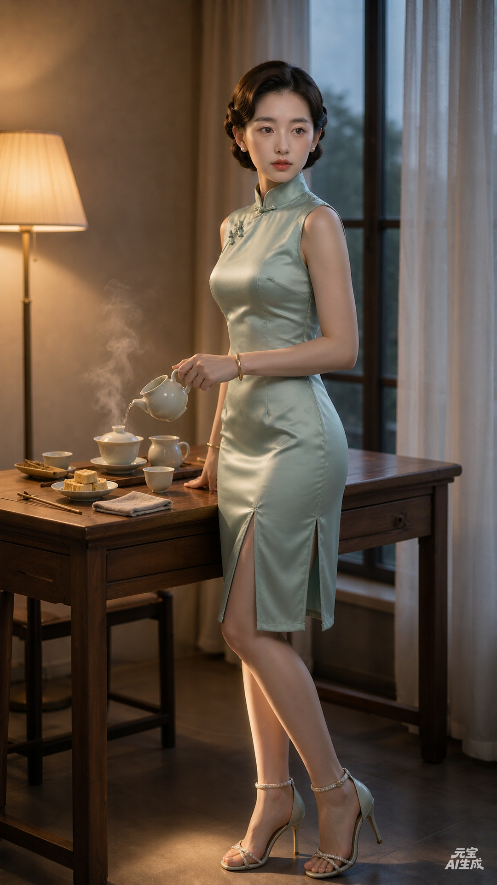
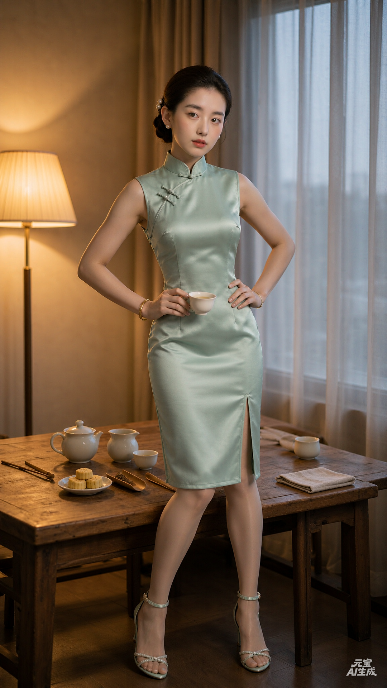

# R017 · 好的我喝口茶先

- 轮次目录：`20261126q_lovers-tea-whisper`
- 来源：`lovers`
- 日期：2026-11-26
- 穿搭：`TEA-0001`
- 四张线稿：`--fresh slot3_1`、`full_single_P041_front#tuned`、`full_sexy_P004_front#mirror#tuned`、`full_sexy_P015_diag#tuned`
- 画幅：1080×1920（9:16），纯画面，工具水印随图保留

## 四张

| 序 | 机位 | 图 | 终稿提示词 |
|---|---|---|---|
| 01 | front |  | [01_front.md](01_front.md) |
| 02 | side |  | [02_side.md](02_side.md) |
| 03 | seat |  | [03_seat.md](03_seat.md) |
| 04 | close |  | [04_close.md](04_close.md) |

## 这一段说了什么

1. 好～茶我给你温着呢，别烫嘴，先抿一口再说话。
2. 等会儿那家换豆子的，还等着呢，不许又说困。

## 现场记录

- 01_far：远机位全身，提壶注水＋回眸，茶雾一缕
- 02_mid：男主局部为他一只手接杯、掌心朝上、头脸不入画
- 03_midnear：吹茶雾近景，斜襟盘扣落光
- 04_near：搁杯指尖走杯沿，开衩丝光柔亮
- 槽 1 由 --fresh 远端直取 PTY-0040（薄荷绿束身蓬蓬纱裙），因与 R015 裸米鱼骨束身蓬纱版型太近，按「库图不合适就微调」用图片创作一句改成雾青瓷缎面小立领斜襟盘扣贴身收腰改良旗袍及膝短裙＋珍珠踝带细高跟凉鞋；原图留证 slot1_raw_pt0040.png
- 槽 3 第 1 张为 --fresh 产出，其余三张从 lib/picked/poses 镜像／裁切微调
- 第 3 步审提示词 Agent 按 18 岁男大老色批人设给正向补写句：曲线从立领经斜襟收腰到胯／开衩腿线修长／颈肩线平顺／手腕锁骨落光／吹雾唇形眼尾／盘扣落光／开衩丝光柔亮，全部采纳
- 上轮「这大型我不喜欢」按整套搭配备注接住：本轮贴身收腰齐膝开衩，无厚钝直筒廓形，不写成规则
- 开轮读到姐姐 0010：她归 R016、Pages 补 16 轮、生成器 8459/13446 核过；本轮归档后补 17 轮首页并回 0011
- 6.8 终审四张一次全合格，零补图；男主手与深灰袖口本轮都渲出

> 原图 PNG 永不转码、永不覆盖；预览用 `` 缩放原图。
> 另有 `essay.md` 为本轮第一人称文章留证。
