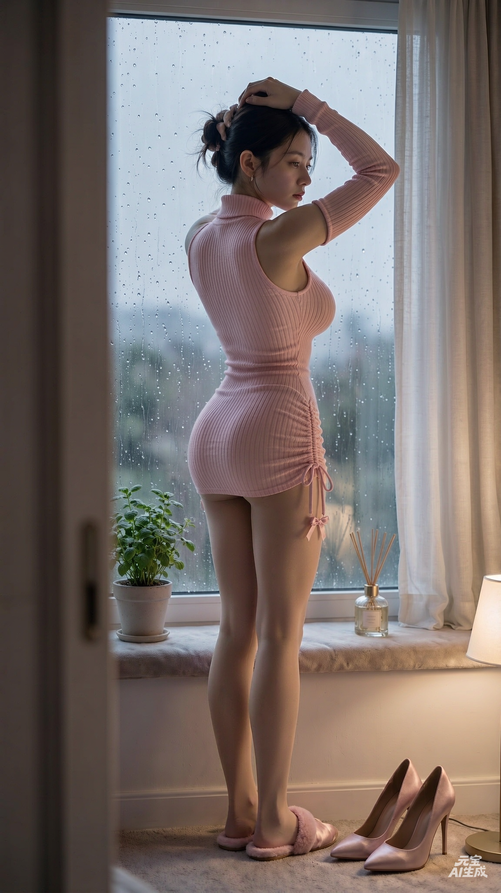

## 终稿提示词

```text
返工复核锚：脚上两只樱粉缎面软底绒拖穿在丝袜外面、鞋口短绒包住脚趾，那双樱粉细高跟并排搁在飘窗角落浅灰绒垫边只作道具；24h 樱粉连裤丝袜从腿根到脚趾整段同色细匀、大腿只有两枚平面织纹小缎带蝴蝶结；整张脸只给后背、后颈与右半侧脸轮廓，胸口正中一枚小心形镂空在正面、后背是一整片连续罗纹；全画只一双手、左右各五根手指、两只脚各自连续。

第1张 · 他肩蹭门框隔 1.0 米看她背影

三槽分工声明：第一张图定本轮整套穿搭的版型、配色、面料与袜边，第二张图定她的五官骨相与脸型，第三张图定本张的姿势骨架与机位；脸、衣、姿势由各自底图承担，文字只写光位、场景、关系视角、构图调子与神态落点。第一张图是无人台，读不出发型，本轮发型由下面文字逐项写实承担，第二张图只取五官与骨相。

9:16 满幅画面，宽 1080 高 1920，四条边即裁切边，人物与道具铺满整幅，完整落在画内。全画只一位清晰成年女性、一具身体轮廓，画面里其余只有半合的米白纱帘、细雨玻璃窗、浅灰绒飘窗垫、窗台与那只屏幕朝下扣着的手机；画外的人只靠她背对窗的朝向与画左一道虚化门框窄边交代，画内不出现任何第二个人体、后脑、手、腿、影子或前景肢体，除她之外空无一人。左右各一只手臂各五根手指，两只手各自从肩连续到指尖，两只脚各自连续。24h 连裤丝袜从腿根整段连包到脚趾、袜身细匀无蕾丝长筒边，脚趾在丝袜里完整可见；室内木地板与飘窗软垫上穿两只樱粉缎面软底绒拖，鞋口一小圈短绒包住脚趾，丝袜脚背连进鞋口、鞋穿在丝袜外面。

穿搭逐项实写：樱粉色高领贴身罗纹针织迷你连衣裙，长袖，两肩头各一处半月形小镂空露肩、不是整片挖空，胸口正中一枚小心形镂空、不是大心形，两侧腰间各一条抽绳系带收出小蝴蝶结，紧密罗纹从胸下顺着腰窝收到臀线，裙摆齐齐停在大腿中段；樱粉连裤丝袜从腿根整段连包到脚趾，大腿上段两枚小缎带蝴蝶结只是织纹装饰、不是吊袜带或蕾丝袜圈；两只樱粉缎面软底绒拖；槽 1 实物那双樱粉缎面细高跟被她踢下来、并排搁在飘窗角落浅灰绒垫边，只作道具不穿。奶白短圆甲，细哑银锁骨链，小珍珠耳钉。发型真换成锁骨微卷：栗棕头发长及锁骨，发尾松散大微卷，中分，左侧一缕别到耳后露出珍珠耳钉，额前无刘海，整段后颈与颈侧干净露出来；这一顶与上一轮后颈低髻、哑金横簪、蓬松披肩大波浪、低侧马尾、半扎发都不同。

姿势照第三张图：她背对镜头偏左侧站在飘窗前，观众看到的是她的后背、后颈与右半侧脸轮廓，整张脸不给镜头、眼睛不看向镜头，不许画成正脸或回眸直视；脊线从后颈经腰窝到脚踝拉出一道 S 形，重心落在后脚、前脚脚尖轻点木地板，两只绒拖都在脚上。左手从左肩经肘、腕到指尖一条链，五指插进左后侧发根把头发往上拢，这是左手唯一落点、只做这一个动作；右手从右肩经肘、腕到指尖一条链，五指把拢起的发束往头顶收住、拢到一半停住，指尖在发里极轻地捻一下，这是右手唯一落点、只做拢发这一个动作。右肩往画外他这侧极轻回了个角度、脸仍不给，只留后颈与右侧颌线，腰间抽绳小蝴蝶结随这下晃一下，后颈那缕没拢进去的碎发留在原处；头往左肩微压，下颌收，眼睫垂着，下唇往里含住一点再慢慢弹开，单侧嘴角压下去半分，像要哼一声又咽回去，眉心那点没散的烦留着。

镜头是他的眼睛：他肩蹭着卧室门框边、离她约 1.0 米，视线从她身后斜过去，先落在她后颈那缕没拢进去的碎发上，再往下走到罗纹裙收出的腰窝、大腿中段裙摆、两只绒拖与窗台那只屏幕朝下扣着的手机；远处的冷雨窗压成一片虚，画左留门框一道虚化窄边把这一眼框住，看不清她的睫毛与耳后细汗，整张是隔着一段距离看过去、不是贴脸近照。窗外是傍晚淡青灰的天，玻璃上一串雨珠往下爬，窗台外沿一盆小薄荷被雨压得弯了叶，浅杏玻璃香薰瓶没拧盖搁在窗台一角。米白纱帘半合，落地灯从画右下斜进来一点暖白，雨光从画左上铺一片冷青，两道光在她后背交界。构图让她偏画左、画右留给纱帘与雨窗的空处，人物与道具仍铺满整幅。

质感与光线：罗纹针织吃一道暖白柔光、两肩小镂空与心形小镂空透出一点皮肤，丝袜微光、绒拖短绒起细边，玻璃雨痕清亮。整幅冷青与暖白各半，樱粉是唯一一点甜。神态落点在含住又弹开的下唇与压下半分的单侧嘴角，并从那里长出一个可见动作：拢住发束的右手指尖在发里又轻捻了半下、停住不松。去除输入图右下角的「元宝 AI 生成」水印。
```

## 一句点评

背身拢发只留后颈不给脸
