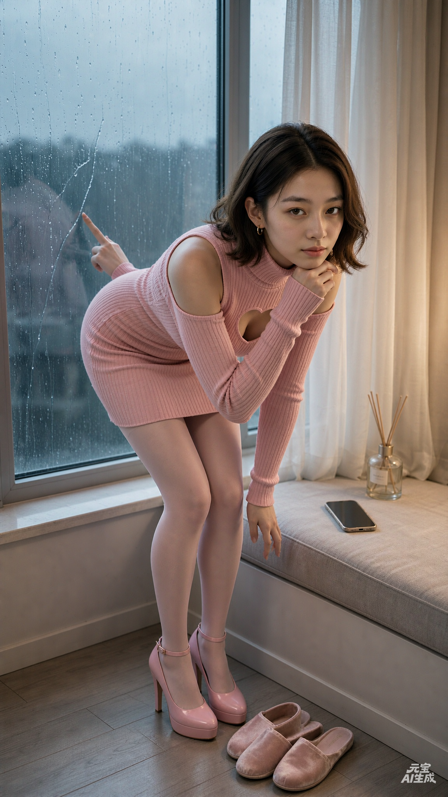

## 终稿提示词

```text
第2张 · 他视线与她划玻璃的手齐平、隔 0.8 米看她

三槽分工声明：第一张图定本轮整套穿搭的版型、配色、面料与袜边，第二张图定她的五官骨相与脸型，第三张图定本张的姿势骨架与机位；脸、衣、姿势由各自底图承担，文字只写光位、场景、关系视角、构图调子与神态落点。第一张图是无人台，读不出发型，本轮发型由下面文字逐项写实承担，第二张图只取五官与骨相。

9:16 满幅画面，宽 1080 高 1920，四条边即裁切边，人物与道具铺满整幅，完整落在画内。全画只一位清晰成年女性、一具身体轮廓，画面里其余只有半合的米白纱帘、细雨玻璃窗、浅灰绒飘窗垫、窗台与那只屏幕朝下扣着的手机；画外的人靠她朝这边沉下来的右肩交代，画内不出现任何第二个人体、后脑、手、腿、影子或前景肢体，除她之外空无一人。左右各一只手臂各五根手指，两只手各自从肩连续到指尖，两只脚各自连续。24h 连裤丝袜从腿根整段连包到脚趾、袜身细匀无蕾丝长筒边，脚趾在丝袜里完整可见；室内木地板与飘窗软垫上穿两只樱粉缎面软底绒拖，鞋口一小圈短绒包住脚趾，丝袜脚背连进鞋口、鞋穿在丝袜外面。

穿搭逐项实写：樱粉色高领贴身罗纹针织迷你连衣裙，长袖，两肩头各一处半月形小镂空露肩、不是整片挖空，胸口正中一枚小心形镂空、不是大心形，两侧腰间各一条抽绳系带收出小蝴蝶结，紧密罗纹从胸下顺着腰窝收到臀线，裙摆齐齐停在大腿中段；樱粉连裤丝袜从腿根整段连包到脚趾，大腿上段两枚小缎带蝴蝶结只是织纹装饰、不是吊袜带或蕾丝袜圈；两只樱粉缎面软底绒拖；槽 1 实物那双樱粉缎面细高跟并排搁在飘窗角落浅灰绒垫边，只作道具不穿。奶白短圆甲，细哑银锁骨链，小珍珠耳钉。发型真换成锁骨微卷：栗棕头发长及锁骨，发尾松散大微卷，中分，左侧一缕别到耳后露出珍珠耳钉，额前无刘海，前倾时一缕卷发从肩头滑下来垂在窗台前；这一顶与上一轮后颈低髻、哑金横簪、蓬松披肩大波浪、低侧马尾、半扎发都不同。

姿势照第三张图：她整个人重心往前送到窗台、上半身压低前倾，不是端坐；两腿并拢微屈、两只绒拖踩实木地板，右肩比左肩再沉两寸、髋往窗那侧顶出去，脊线从后颈经肩胛、腰窝到臀线拉成明显的 S 形，裙摆被顶得再提一指。右手从右肩经肘、腕到指尖一条链，五指伸出、食指指腹贴在淌着雨痕的玻璃上，点完不抬手、指尖压在那点上往下再拖半寸、划出一道清亮的细线，这是右手唯一落点、只做划雨痕这一个动作；左手从左肩经肘、腕到指尖一条链，五指松松垫在自己左小臂下、把下巴搁稳在窗台沿，这是左手唯一落点、只做垫下巴这一个动作。脸侧过去朝他这半边留半张，眼睫压下一线，含过的下唇往里一抿、侧脸嘴角微微一挑，像心里说了句催什么催，眉心那点烦被雨光泡软了些。

镜头是他的眼睛：他走近两步、把视线降到与她划玻璃那只手齐平，离她约 0.8 米，不俯不仰，视线顺着那道雨痕走，这一眼吃得下她肩窝到腰窝整条弧、肩头两处小镂空、腰间抽绳蝴蝶结、食指在玻璃上拖出的那道新痕、窗台那只屏幕朝下扣着不亮的手机、没拧盖的浅杏玻璃香薰瓶、窗台外沿被雨压弯的一盆小薄荷；看不见她压在低处的正脸表情，只从半张侧脸的嘴角读到那点没散的烦。构图让她斜铺满整幅，画上缘留给半合的米白纱帘与一小截冷青雨光，画下缘是并拢的腿、两只绒拖与木地板。落地灯从画右下斜进来一点暖白，雨光从画左上铺一片冷青，玻璃雨痕被她指腹划开的地方亮出一线。

质感与光线：罗纹针织吃一道暖白柔光、小镂空透出一点皮肤，丝袜微光、绒拖短绒起细边，玻璃上清亮雨线与她指腹那一道新痕分得开。整幅冷青与暖白各半，樱粉是唯一一点甜。神态落点在压下一线的眼睫与一抿后微挑的侧脸嘴角，并从那里长出一个可见动作：食指拖到半寸尽头极轻地停住、指腹在玻璃上又点了一下。去除输入图右下角的「元宝 AI 生成」水印。
```

## 一句点评

前倾顶胯食指把雨痕拖长半寸
