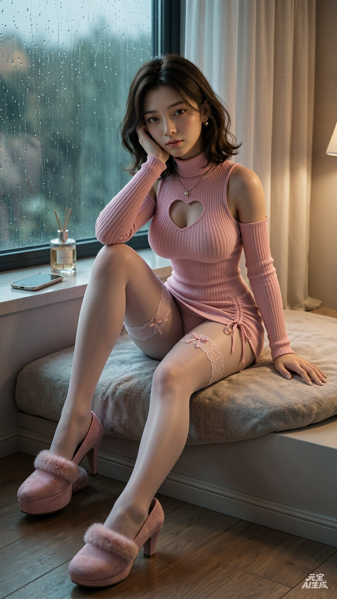

## 终稿提示词

```text
第3张 · 他手肘搁窗台略仰、隔 0.6 米望她

三槽分工声明：第一张图定本轮整套穿搭的版型、配色、面料与袜边，第二张图定她的五官骨相与脸型，第三张图定本张的姿势骨架与机位；脸、衣、姿势由各自底图承担，文字只写光位、场景、关系视角、构图调子与神态落点。第一张图是无人台，读不出发型，本轮发型由下面文字逐项写实承担，第二张图只取五官与骨相。

9:16 满幅画面，宽 1080 高 1920，四条边即裁切边，人物与道具铺满整幅，完整落在画内。全画只一位清晰成年女性、一具身体轮廓，画面里其余只有半合的米白纱帘、细雨玻璃窗、浅灰绒飘窗垫、窗台与那只屏幕朝下扣着的手机；画外的人只靠她朝这边顶过来的脸与直撞过来的那只眼交代，画内不出现任何第二个人体、后脑、手、腿、影子或前景肢体，画右下前景只留浅灰绒垫与鞋口短绒，除她之外空无一人。左右各一只手臂各五根手指，两只手各自从肩连续到指尖，两只脚各自连续。24h 连裤丝袜从腿根整段连包到脚趾、袜身细匀无蕾丝长筒边，脚趾在丝袜里完整可见；室内木地板与飘窗软垫上穿两只樱粉缎面软底绒拖，鞋口一小圈短绒包住脚趾，丝袜脚背连进鞋口、鞋穿在丝袜外面。

穿搭逐项实写：樱粉色高领贴身罗纹针织迷你连衣裙，长袖，两肩头各一处半月形小镂空露肩、不是整片挖空，胸口正中一枚小心形镂空、不是大心形，两侧腰间各一条抽绳系带收出小蝴蝶结，紧密罗纹从胸下顺着腰窝收到臀线，裙摆齐齐停在大腿中段；樱粉连裤丝袜从腿根整段连包到脚趾，大腿上段两枚小缎带蝴蝶结只是织纹装饰、不是吊袜带或蕾丝袜圈；两只樱粉缎面软底绒拖；槽 1 实物那双樱粉缎面细高跟并排搁在飘窗角落浅灰绒垫边，只作道具不穿。奶白短圆甲，细哑银锁骨链，小珍珠耳钉。发型真换成锁骨微卷：栗棕头发长及锁骨，发尾松散大微卷，中分，左侧一缕别到耳后露出珍珠耳钉，额前无刘海，坐着时几缕卷发搭在肩头与胸口小心形镂空边；这一顶与上一轮后颈低髻、哑金横簪、蓬松披肩大波浪、低侧马尾、半扎发都不同。

姿势照第三张图：她坐在浅灰绒飘窗垫上，左腿屈起、膝头立着，右腿斜放、小腿垂到垫边，脊线从后颈经腰窝到坐骨收出一道柔和的弧，上身往窗那侧偏一点。右手从右肩经肘、腕到指尖一条链，中指指节抵着自己颧骨、把脸往画外他这边轻轻顶过去一点，五指虚贴右颊与下颌角不施力，露出的那只眼从雨线上挪下来直直撞向他，这是右手唯一落点、只做托腮这一个动作；左手从左肩经肘、腕到指尖一条链，五指自然搭在立起的左膝头罗纹裙边上，指腹轻搭不收紧，这是左手唯一落点、只做搭膝这一个动作。右脚尖那只樱粉绒拖半挂不脱、鞋口短绒被脚趾顶着，晃两下停住、脚尖点一下垫子再晃，整只半挂的绒拖往画底顶进来做一点虚前景；左脚那只绒拖踩实垫边。半阖的眼睫不动，单侧嘴角往上提一丝、像话已经到嘴边，眉心松开。

镜头是他的眼睛：他手肘搁在窗台边、离她约 0.6 米，视角压到那道手肘高度、略仰着往上望她，这一眼看得清她抵着颧骨的中指指节、直撞过来的那只眼、锁骨链一粒细亮、两肩小镂空与胸口小心形镂空、罗纹在腰窝拉出的细弧、大腿上段两枚小缎带蝴蝶结织纹、半挂在脚尖晃的那只绒拖与丝袜脚背连进鞋口的那一段；玻璃上雨线在她侧脸后头淌，看不见窗外的远处。画顶留给半合的米白纱帘与一小截冷青雨光，窗台那只屏幕朝下扣着的手机与没拧盖的浅杏玻璃香薰瓶在画右近处；画右下只留浅灰绒垫与鞋口短绒，不许出现他的手、后脑、腿或任何一截人体。落地灯从画右下斜进来一点暖白，雨光从画左上铺一片冷青，两道光在她顶过来的半张脸上交界。

质感与光线：罗纹针织吃一道暖白柔光、小镂空透出一点皮肤，丝袜微光、绒拖短绒起细边，玻璃雨痕清亮，浅灰绒垫压出柔软褶皱。整幅冷青与暖白各半，樱粉是唯一一点甜。神态落点在直撞过来的那只眼与提了一丝的单侧嘴角，并从那里长出一个可见动作：半挂脚尖的绒拖晃两下停住、脚尖点了下垫子又晃起来。去除输入图右下角的「元宝 AI 生成」水印。
```

## 一句点评

托腮那只眼直撞过来拖鞋打拍子
