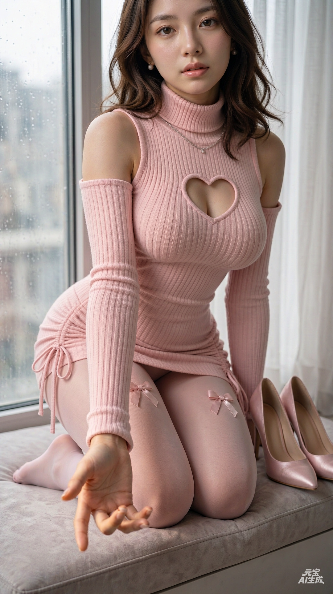

## 终稿提示词

```text
返工复核锚：前景右手手背朝上、掌心朝向地面、五指弯曲朝画外虚虚一勾、勾完停住不收，左手藏在她身后完全退出画面；两只樱粉绒拖都在脚上、樱粉细高跟并排搁角落只作道具；24h 樱粉连裤丝袜整段同色细匀、大腿只有两枚平面织纹小缎带蝴蝶结；全画只一双手、左右各五根手指、两只脚各自连续。

第4张 · 他凑到近前、贴垫面仰起不到 0.4 米看她

三槽分工声明：第一张图定本轮整套穿搭的版型、配色、面料与袜边，第二张图定她的五官骨相与脸型，第三张图定本张的姿势骨架与机位；脸、衣、姿势由各自底图承担，文字只写光位、场景、关系视角、构图调子与神态落点。第一张图是无人台，读不出发型，本轮发型由下面文字逐项写实承担，第二张图只取五官与骨相。

9:16 满幅画面，宽 1080 高 1920，四条边即裁切边，人物与道具铺满整幅，完整落在画内。全画只一位清晰成年女性、一具身体轮廓，画面里其余只有半合的米白纱帘、细雨玻璃窗、浅灰绒飘窗垫、窗台与那只屏幕朝下扣着的手机；画外的人只靠她朝这边扭回来的半张脸与勾出去的那只手交代，画内不出现任何第二个人体、后脑、手、腿、影子或前景肢体，除她之外空无一人。左右各一只手臂各五根手指，两只手各自从肩连续到指尖，两只脚各自连续。24h 连裤丝袜从腿根整段连包到脚趾、袜身细匀无蕾丝长筒边，脚趾在丝袜里完整可见；室内木地板与飘窗软垫上穿两只樱粉缎面软底绒拖，鞋口一小圈短绒包住脚趾，丝袜脚背连进鞋口、鞋穿在丝袜外面。

穿搭逐项实写：樱粉色高领贴身罗纹针织迷你连衣裙，长袖，两肩头各一处半月形小镂空露肩、不是整片挖空，胸口正中一枚小心形镂空、不是大心形，两侧腰间各一条抽绳系带收出小蝴蝶结，紧密罗纹从胸下顺着腰窝收到臀线，裙摆齐齐停在大腿中段；樱粉连裤丝袜从腿根整段连包到脚趾，大腿上段两枚小缎带蝴蝶结只是织纹装饰、不是吊袜带或蕾丝袜圈；两只樱粉缎面软底绒拖；槽 1 实物那双樱粉缎面细高跟并排搁在飘窗角落浅灰绒垫边，只作道具不穿。奶白短圆甲，细哑银锁骨链，小珍珠耳钉。发型真换成锁骨微卷：栗棕头发长及锁骨，发尾松散大微卷，中分，左侧一缕别到耳后露出珍珠耳钉，额前无刘海，扭身时几缕卷发从肩头甩到胸前、搭在小心形镂空边；这一顶与上一轮后颈低髻、哑金横簪、蓬松披肩大波浪、低侧马尾、半扎发都不同。

姿势照第三张图：她在浅灰绒飘窗垫上跪坐扭身，两腿叠着收在身侧、两只绒拖都还在脚上，膝往前蹭半寸、重心压到后坐的胯上，腰往画外他这侧拧过来、拧到肩线一高一低，脊线从后颈经腰窝到坐骨拉出一道扭出来的 S 形，裙摆被扭身带得偏过大腿外侧。右手从右肩经肘、腕到指尖一条链，抬到画框下沿前景虚一点，五指朝画外他衣领那个高度虚虚一勾、像勾住那一小块空气往回带，掌心翻成朝下，不许张成五指正面平摊，勾完不收回、停在原处等他自己凑过来，这是右手唯一落点、只做勾手这一个动作；左手从左肩经肘、腕到指尖一条链，收到身后撑住身子、手与臂都藏在她自己身体后面不入画，这是左手唯一落点、只做撑稳这一个动作。头跟着腰再拧多一分，只留眼尾到嘴角那半张脸、正脸不给镜头，下巴微收，眼尾压下来再压半分正对他，嘴角先挑一点又抿住、下唇往里咬住一点，像话已经到嘴边又故意咽回去。

镜头是他的眼睛：他凑到近前、离她不到 0.4 米，机位压到垫面高度、贴着她膝侧往上仰，这一眼看得清她压下来的眼尾、咬住一点的下唇、别到耳后那缕卷发与珍珠耳钉、锁骨链一粒细亮、两肩小镂空与胸口小心形镂空、勾出去那只手的五指指腹与奶白短圆甲；画外的他与他的手全不入画，画内不出现任何第二个人体或一截肢体。画顶半合的米白纱帘压低一指，前三张那片冷青雨光退到画角、只剩她指尖那一点琥珀似的暖，画底是叠收的腿、两只绒拖与浅灰绒垫的软褶，窗台那只屏幕朝下扣着的手机与没拧盖的浅杏玻璃香薰瓶在画左上，窗台外沿被雨压弯的一盆小薄荷露两片叶。琥珀似的一点暖只点在她指尖与下唇，收得像声音低下去。

质感与光线：罗纹针织吃一道暖白柔光、小镂空透出一点皮肤，丝袜微光、绒拖短绒起细边，玻璃雨痕清亮，浅灰绒垫压出柔软褶皱。整幅由冷青与暖白慢慢收成一点琥珀，樱粉是唯一一点甜，安静得像雨声把屋里别的东西都盖住了。神态落点在压下半分的眼尾与咬住一点的下唇，并从那里长出一个可见动作：勾出去的五指极轻地往回带了一下就停住不收，舒服是她的，话头也是她起的。去除输入图右下角的「元宝 AI 生成」水印。
```

## 一句点评

扭身勾手停在原处等他凑过来

## 覆盖留痕（2026-11-26 · 用户当面授权领回轮）

- 本张按用户当面授权提交覆盖，取本轮领回重出里自己逐张亲看后能拿到的最好一版；同名 PNG 与同名 md 一起覆盖、旧图不留仓。
- 上方 `## 终稿提示词` 正文逐字未改，判据仍以同名 md 正文为准；本段只是覆盖留痕，不进提示词、不进判据。
- 逐张自检如实：本轮严格只改四处一版：脸年轻柔和、心形镂空收小、神态放软、细高跟挪向飘窗角落；左手与高跟位置仍未完全到位。按 STD-001.2，自检没全勾不申请销项；用户已让图审·鉴放宽审查，本轮交图由复查按放宽口径判。
