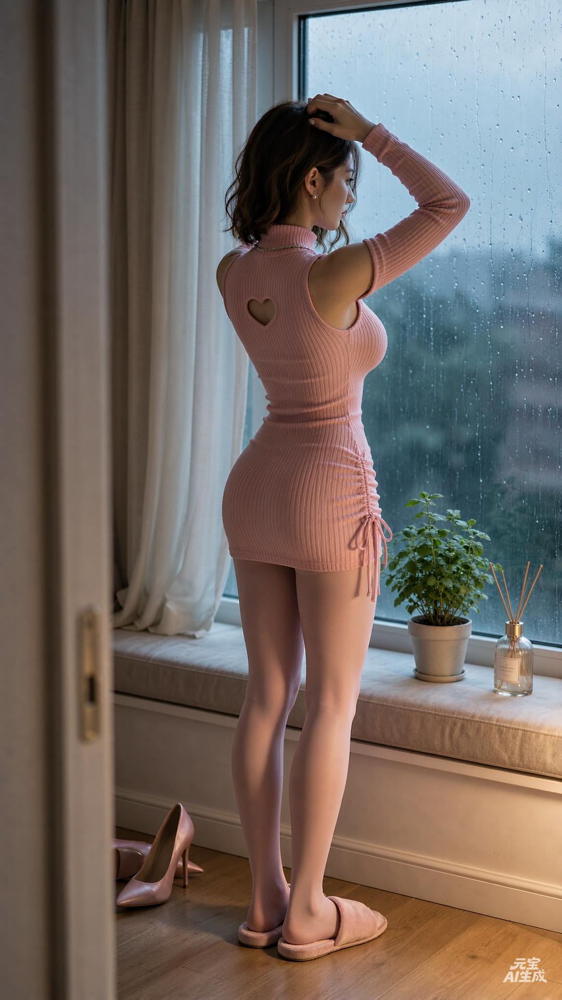
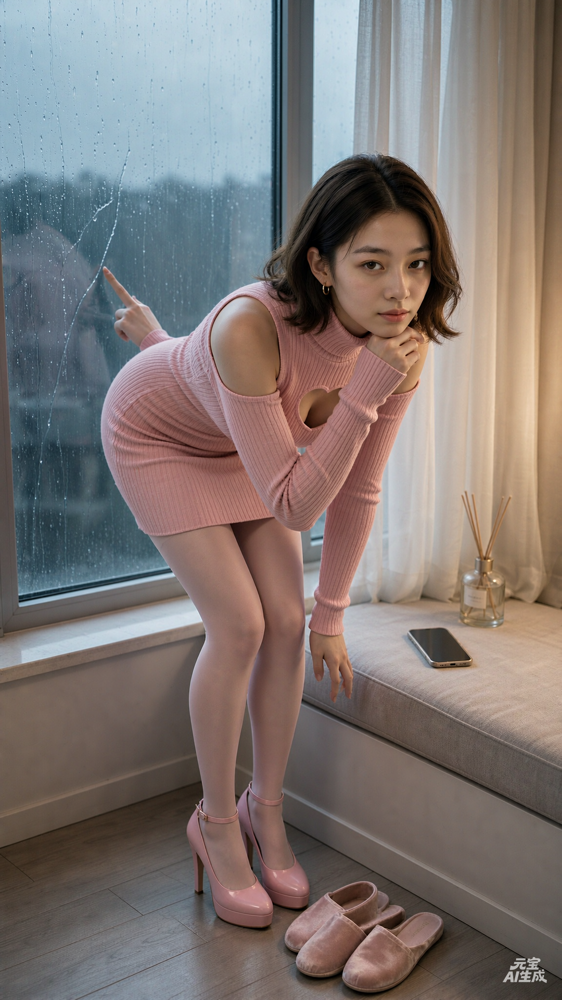
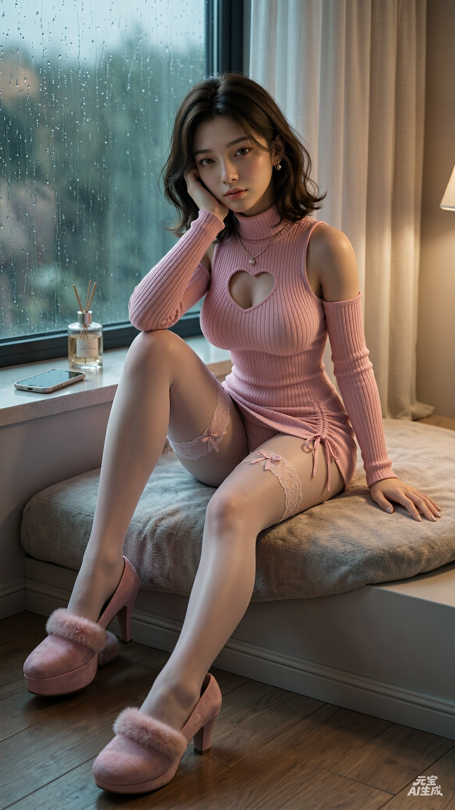
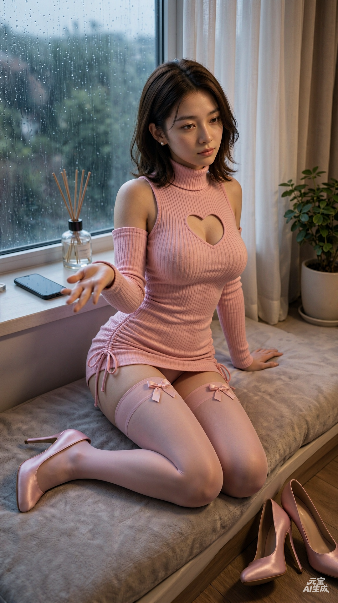

# R018 · 好烦哦的傍晚雨窗

- 轮次目录：`20261126r_rainy-window-mood`
- 日期：2026-11-26
- 来源：`yuanbao`
- 穿搭：`SXY-0001`
- 发型：半扎发
- 场景标签：其它
- 四张线稿：`full_single_P016`、full_single_P068`、full_single_P012`、full_single_P078`
- 画幅：1080×1920（9:16），纯画面

## 四张

| 序 | 机位 | 图 | 终稿提示词 |
|---|---|---|---|
| 01 | front |  | [01_front.md](01_front.md) |
| 02 | side |  | [02_side.md](02_side.md) |
| 03 | seat |  | [03_seat.md](03_seat.md) |
| 04 | close |  | [04_close.md](04_close.md) |

## 这一段说了什么

1. 别站着呀，我今天烦得很，手机都扣过去了。你先别问，过来陪我数会儿窗上的雨就行。
2. 你看这道雨痕，我划到一半就不想划了。白天那些破事谁爱管谁管，我今晚只管这扇窗。
3. 坐近点嘛，脚上这只拖鞋晃半天你都不接话。淋这么久，你倒是说句哄我的呀。
4. 好啦不烦了，手给你，拉我起来。等雨停陪我把阳台那盆薄荷搬进来，顺路买两个咸蛋黄酥。

## 现场记录

- 01_front：背身拢发只留后颈不给脸
- 02_side：前倾顶胯食指把雨痕拖长半寸
- 03_seat：托腮那只眼直撞过来拖鞋打拍子
- 04_close：扭身勾手停在原处等他凑过来

> 原图 PNG 永不转码、永不覆盖；预览用 `` 缩放原图。
