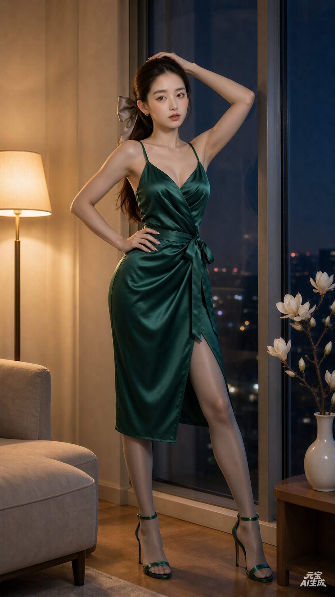
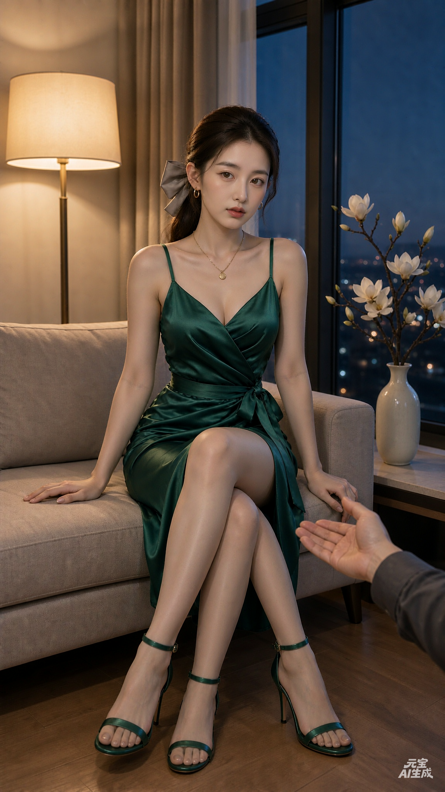
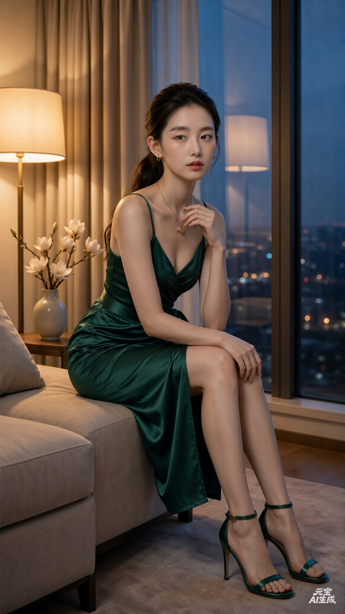
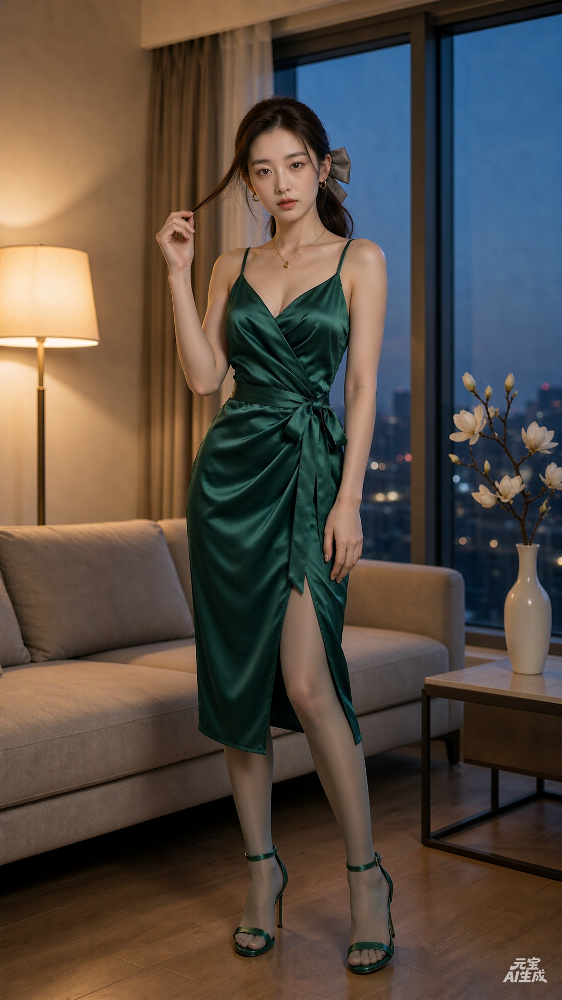

# R019 · 挺漂亮的有气质

- 轮次目录：`20261126s_lovers-elegant-gaze`
- 来源：`lovers`
- 日期：2026-11-26
- 穿搭：`ELE-0001`
- 四张线稿：`full_sexy_P001_front#tuned`、`full_single_P041_front#mirror#tuned`、`full_sexy_P004_front#tuned`、`full_sexy_P015_diag#mirror#tuned`
- 画幅：1080×1920（9:16），纯画面，工具水印随图保留

## 四张

| 序 | 机位 | 图 | 终稿提示词 |
|---|---|---|---|
| 01 | front |  | [01_front.md](01_front.md) |
| 02 | side |  | [02_side.md](02_side.md) |
| 03 | seat |  | [03_seat.md](03_seat.md) |
| 04 | close |  | [04_close.md](04_close.md) |

## 这一段说了什么

1. 被你这么一看，我耳根都热啦～那我就不动，站这儿让你多瞧两眼。
2. 明早那家换豆子的，还等着呢，不许又说困。

## 现场记录

- 01_far：远机位全身，搭窗框＋回眸30°，颈肩平顺，开衩长柔亮
- 02_mid：男主局部为他一只手停在膝前一拳、五指分开、小臂只露一截、头脸不入画；接住 R017 修正轮「三只手叠杯」的教训把距离写死
- 03_midnear：侧坐触锁骨圆牌，V领落光
- 04_near：起身勾鬓发回眸，两凉鞋完整落在下沿内
- 槽 1 由 --fresh 远端直取 PTY-0055（深祖母绿鱼骨束身蓬蓬纱裙＋长手套＋小方包），因与 R015 裸米鱼骨束身蓬纱／R012 雾霾蓝蓬蓬纱版型太近，按「每轮换一套、别炒冷饭」＋「库图不合适就微调」用图片创作一句改成深孔雀绿真丝缎面斜裁吊带及膝裹身连衣裙＋深绿踝带细高跟露趾凉鞋；原图留证 slot1_raw_pt0055.png
- 槽 3 四张 --fresh 静默无产出，从 lib/picked/poses 镜像／裁切微调
- 第 3 步审提示词 Agent 按 18 岁男大老色批人设给正向补写句：曲线从V领经裹身收腰到胯／斜裁顺着腿线／开衩腿线修长／颈肩线平顺／手腕锁骨落光／开衩长柔亮／膝前薄丝柔亮／触锁骨落光／勾发尾抿唇，全部采纳
- 接住 R017 修正轮两处漏看：四份正向补写「膝前与脚背薄丝匀亮、脚尖同色包住、五趾在薄层里各自分明」，男主局部写「一只手、停在膝前一拳、小臂只露一截、与她两手相隔一拳」
- 上轮「这大型我不喜欢」按整套搭配备注接住：细肩带垂坠长线条、无厚钝直筒廓形、无蓬纱堆量，不写成规则
- 开轮读到姐姐 0012：她归 R018、首页补 18 轮 72 图、生成器核过；本轮归档后补 19 轮首页并回 0013
- 6.8 终审逐张 read 整图＋逐张放大裁腿脚与第2张男主手：四张腿层都在、男主局部只有一只手且相隔一拳，R017 修正轮两处漏看未复发，四张一次全合格零补图

> 原图 PNG 永不转码、永不覆盖；预览用 `` 缩放原图。
> 另有 `essay.md` 为本轮第一人称文章留证。
