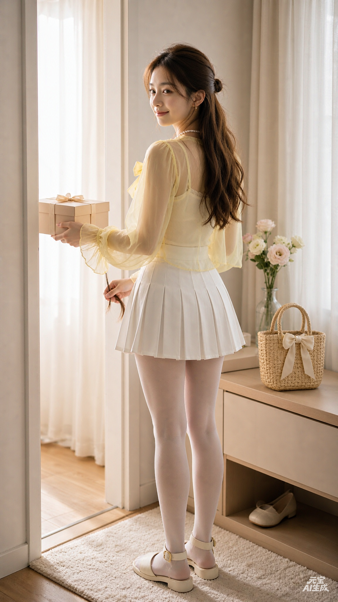

## 终稿提示词

```text
第1张 · 他在玄关收下巴略俯、隔 1.3 米看她

三槽分工声明：第一张图定本轮整套穿搭的版型、配色、面料与袜边，第二张图定她的五官骨相与脸型，第三张图定本张的姿势骨架与机位；脸、衣、姿势由各自底图承担，文字只写光位、场景、关系视角、构图调子与神态落点。第一张图是无人台，读不出发型，本轮发型由下面文字逐项写实承担，第二张图只取五官与骨相。

9:16 满幅画面，宽 1080 高 1920，四条边即裁切边，人物与道具铺满整幅，完整落在画内。全画只一位清晰成年女性、一具身体轮廓；画外的人只由从画左递进来的一角浅杏礼盒与她朝门口回过来的半边下颌、伸出去的那只手交代，画面里除她之外是玄关矮柜、浅木地板、一小块奶白短绒地毯、米白纱帘、一小瓶洋桔梗与满屋柔白日光，一眼看过去屋里就她一个人。左右各一只手臂各五根手指，两只手各自从肩连续到指尖，两只脚各自连续。24h 连裤丝袜从腿根整段连包到脚趾、袜身细匀菱格提花，脚趾在丝袜里完整可见；两只奶白软底绒拖穿在丝袜外面，鞋口一小圈短绒包住脚趾；槽 1 实物那双奶白厚底一字带金扣凉鞋收进玄关矮柜下层阴影里、只露一只鞋尖，画面里只此一双、不另摆第二双。

穿搭逐项实写：鹅黄薄透雪纺长袖短开衫，敞襟不系，前襟两道细荷叶边，左右胸口各一枚鹅黄缎带大蝴蝶结，灯笼袖、袖口一圈荷叶边收口，雪纺被日光照成半透；内搭象牙白细罗纹心形领贴身短上衣，领口一圈小蕾丝边，罗纹从胸下顺着腰窝收进去；象牙白高腰百褶迷你裙，褶子一道道分得清，裙摆齐齐停在大腿中段；奶白菱格提花连裤丝袜从腿根整段连包到脚趾；两只奶白软底绒拖；双层小珍珠颈链垂一粒珍珠吊坠，小珍珠耳钉，淡鹅黄短圆甲。发型真换成半扎发：栗棕头发上半只在耳后到后脑松松束起一小束、下半整片披到肩胛、发尾松散微卷，额前薄薄几缕碎发，耳侧各垂一缕到锁骨，后颈与颈侧干净露出来，松松半扎不是高马尾、不是丸子头、不是盘发、不是低髻；这一顶与上一轮锁骨微卷、后颈低髻、哑金横簪、蓬松披肩大波浪、低侧马尾都不同。

姿势照第三张图：她背对镜头偏右侧站在玄关短绒地毯上，上身往画外门口再转回十来度，观众看到她的后背、后颈、左半侧脸轮廓，也看得到右胸口那枚鹅黄缎带蝴蝶结与前襟一道荷叶边；整张脸不给镜头、眼睛不看向镜头，只给半边下颌与一点眼白朝门口瞟过去。脊线从后颈经腰窝到脚踝拉出一道挺而松的 S 形，重心压在后脚、胯往画外他那边顶出一线，前脚脚尖轻点地毯，两只绒拖都在脚上。右手从右肩经肘、腕到指尖一条链，五指朝画左那只正从画外递进来的浅杏礼盒虚虚伸出去、掌心微向上、指尖快要碰到盒沿，指尖抬到一半又往回勾了一下像嫌他慢，这是右手唯一落点、只做伸手接盒这一个动作；礼盒只从画左进画一角、系着鹅黄缎带，靠盒沿与她伸出的手交代画外有人，盒盖不在矮柜上。左手从左肩经肘、腕到指尖一条链，五指捏着自己垂到肩前的一缕半扎发尾，把那缕发从肩前勾到锁骨边再松开，这是左手唯一落点、只做捻发尾这一个动作。右眉先挑起、停一拍再慢慢压回一半，嘴角那一丝弯晚半秒才给出来，像在说谁气啦我早没气了、又偏要他再哄一句。

镜头是他的眼睛：他站在玄关门口、微微收下巴让视线自上往下压约 10°，离她约 1.3 米，这一眼先撞上她回过来的半边下颌与伸出去接盒的那只手，再往下走到敞襟雪纺里透出来的罗纹腰线、顶出的一线胯、百褶裙摆、菱格提花丝袜与两只绒拖；画左一道虚化门框窄边贴着边把这一眼框住，玄关矮柜上一小瓶洋桔梗清清楚楚、下层阴影里只露一只凉鞋鞋尖，看不清她的睫毛与耳后细汗。晴天上午，米白纱帘滤过的柔白日光从画左上斜铺进来，浅木地板吃出一道长长亮边，室内一点暖木色反光从画右下托着。构图让她偏画右、画左留给门框、礼盒一角与日光，人物与道具仍铺满整幅。

质感与光线：雪纺半透起细边、缎带蝴蝶结吃一道亮，罗纹柔白、百褶裙褶影清楚，菱格提花丝袜在斜光里浮出细纹，绒拖短绒起细边，礼盒缎带柔亮。整幅柔白与鹅黄，浅木色压底，干净得像被哄好的一个上午。神态落点在挑起又压回一半的右眉与晚半秒才给的嘴角，并从那里长出一个可见动作：伸出去接盒的右手指尖往回勾了一下又停住、等盒沿自己递到指腹上。去除输入图右下角的「元宝 AI 生成」水印。
```

## 一句点评

玄关回眸指尖先勾一下再接盒，嘴上还拧着
