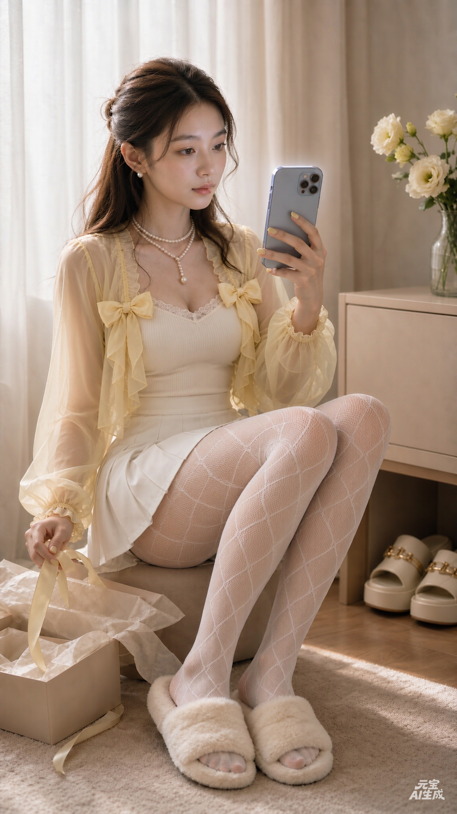

## 终稿提示词

```text
返工复核锚：两只奶白软底绒拖都穿在丝袜外面，奶白厚底一字带金扣凉鞋收进玄关矮柜下层阴影里只露一只鞋尖；两腿斜抬轻轻交叠、小腿与地面近乎平行、脚尖压低到膝高朝画右送出去；右手托着屏幕朝上正对她自己的哑光雾蓝新机、左手捏着从膝弯垂到短绒地毯上的鹅黄缎带；全画只一双手、左右各五根手指、两只脚各自连续。

第2张 · 他走近俯身、隔 1.0 米看她拆盒

三槽分工声明：第一张图定本轮整套穿搭的版型、配色、面料与袜边，第二张图定她的五官骨相与脸型，第三张图定本张的姿势骨架与机位；脸、衣、姿势由各自底图承担，文字只写光位、场景、关系视角、构图调子与神态落点。第一张图是无人台，读不出发型，本轮发型由下面文字逐项写实承担，第二张图只取五官与骨相。

9:16 满幅画面，宽 1080 高 1920，四条边即裁切边，人物与道具铺满整幅，完整落在画内。全画只一位清晰成年女性、一具身体轮廓；画外的人只由她往画外斜瞟的那一眼与敞开的礼盒盖交代，画面里除她之外是敞开的浅杏礼盒、从膝弯垂到地毯上的一段鹅黄缎带、揉软的薄包装纸、一部屏幕亮着的哑光雾蓝新手机、奶白短绒地毯、浅木地板、米白纱帘、玄关矮柜、一小瓶洋桔梗与满屋柔白日光，一眼看过去屋里就她一个人。左右各一只手臂各五根手指，两只手各自从肩连续到指尖，两只脚各自连续。24h 连裤丝袜从腿根整段连包到脚趾、袜身细匀菱格提花，脚趾在丝袜里完整可见；两只奶白软底绒拖穿在丝袜外面，鞋口一小圈短绒包住脚趾；槽 1 实物那双奶白厚底一字带金扣凉鞋收进玄关矮柜下层阴影里、只露一只鞋尖，画面里只此一双、不另摆第二双。

穿搭逐项实写：鹅黄薄透雪纺长袖短开衫，敞襟不系，前襟两道细荷叶边，左右胸口各一枚鹅黄缎带大蝴蝶结，灯笼袖、袖口一圈荷叶边收口，雪纺被日光照成半透；内搭象牙白细罗纹心形领贴身短上衣，领口一圈小蕾丝边，罗纹从胸下顺着腰窝收进去；象牙白高腰百褶迷你裙，褶子一道道分得清，裙摆齐齐停在大腿中段；奶白菱格提花连裤丝袜从腿根整段连包到脚趾；两只奶白软底绒拖；双层小珍珠颈链垂一粒珍珠吊坠，小珍珠耳钉，淡鹅黄短圆甲。发型真换成半扎发：栗棕头发上半只在耳后到后脑松松束起一小束、下半整片披到肩胛、发尾松散微卷，额前薄薄几缕碎发，耳侧各垂一缕到锁骨，俯身拆盒时一缕卷发滑到肩前，松松半扎不是高马尾、不是丸子头、不是盘发、不是低髻；这一顶与上一轮锁骨微卷、后颈低髻、哑金横簪、蓬松披肩大波浪、低侧马尾都不同。

姿势照第三张图：她坐在矮凳边、上身往后倚出一道柔和的弧，两腿斜抬轻轻交叠、脚尖压低到膝高朝画右送出去、不往高处踢，两只绒拖都还穿在脚上，脊线从后颈经腰窝到坐骨拉出一道 S 形，雪纺开衫顺着后倚敞得更开一点。右手从右肩经肘、腕到指尖一条链，五指托着那部屏幕刚亮起来的哑光雾蓝新手机、机面朝上正对她自己，指腹把机身往自己这边又转了半寸像先护住再看，这是右手唯一落点、只做托新机这一个动作；左手从左肩经肘、腕到指尖一条链，五指捏着那段解下来的鹅黄缎带的尾梢，缎带不扯直、从她膝弯垂下来拖在短绒地毯上一截，指间让尾梢轻轻扫过自己翘起的那个嘴角像要压回去没压住，这是左手唯一落点、只做捏缎带这一个动作。敞开的浅杏礼盒与揉软的薄包装纸搁在她身侧矮凳上。脸低着看屏幕，眼睫被新机的光映亮一线，眼珠往画外他那边斜瞟一线，单侧嘴角先翘起来、自己察觉了也没真压回去，下唇松开的瞬间轻轻磕了一下上排牙，嘴上还拧着、手已经诚实地把新机转向自己。

镜头是他的眼睛：他从玄关走近两步、微微俯身，离她约 1.0 米，这一眼先看见她掌心里那块亮起来的新机屏幕，再顺着垂下来的鹅黄缎带滑到膝弯、交叠斜送的脚尖与两只绒拖，中间走过被屏幕光托亮的下巴、领口小蕾丝边、敞襟雪纺里的罗纹腰线与百褶裙被抬腿带起的褶；看得清矮凳上敞开的礼盒与包装纸、柜影里那只凉鞋鞋尖，看不见手机屏幕里具体显示什么。画上缘留给米白纱帘滤下来的一大片柔白日光，画下缘是短绒地毯与浅木地板的亮边，一小瓶洋桔梗在画右近处。柔白日光从画左上斜铺进来，新机屏幕另给一小块冷白光只落在她脸与指腹上，室内暖木色从画右下托着。

质感与光线：雪纺半透起细边、缎带柔亮，罗纹柔白、百褶裙褶影清楚，菱格提花丝袜在斜光里浮出细纹，绒拖短绒起细边，新机哑光雾蓝机壳不反光、屏幕那一小块光清亮。整幅柔白与鹅黄，一点冷白落在脸上，浅木色压底。神态落点在先翘又被缎带尾梢扫过的单侧嘴角与往画外斜瞟的一线眼珠，并从那里长出一个可见动作：托着新机的右手指腹极轻地把机身往自己这边又转了半寸。去除输入图右下角的「元宝 AI 生成」水印。
```

## 一句点评

拆盒时缎带垂到绒上不扯直，冷白屏光只落脸与指腹
