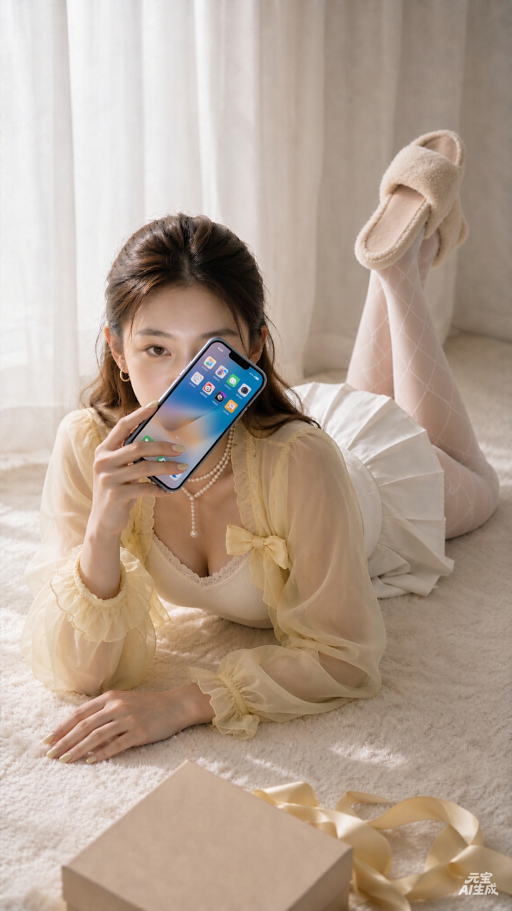

## 终稿提示词

```text
返工复核锚：全画只一部手机，正面整面亮屏朝向画外他那边、窄边框、屏光清亮，雾蓝机壳只从侧边露一线；手机整支竖着斜切过鼻梁、只留左眼从机身上沿看过去；两只奶白软底绒拖都在脚上、抬起那只只剩后半只勾着脚跟将掉未掉、脚底光洁干净，奶白厚底一字带金扣凉鞋收进玄关矮柜下层阴影里只露一只鞋尖；24h 奶白菱格提花连裤丝袜整段连包到脚趾。

第3张 · 他手撑地毯、从膝头高度略仰隔 0.55 米望她

三槽分工声明：第一张图定本轮整套穿搭的版型、配色、面料与袜边，第二张图定她的五官骨相与脸型，第三张图定本张的姿势骨架与机位；脸、衣、姿势由各自底图承担，文字只写光位、场景、关系视角、构图调子与神态落点。第一张图是无人台，读不出发型，本轮发型由下面文字逐项写实承担，第二张图只取五官与骨相。

9:16 满幅画面，宽 1080 高 1920，四条边即裁切边，人物与道具铺满整幅，完整落在画内。全画只一位清晰成年女性、一具身体轮廓；画外的人只由她举机对准的方向与机缘上沿露出来的那只眼交代，画面里除她之外是那部屏幕亮着的哑光雾蓝新手机、虚在画面下缘前景的浅杏礼盒盖与一段鹅黄缎带、奶白短绒地毯、浅木地板、米白纱帘、玄关矮柜、一小瓶洋桔梗与满屋柔白日光，一眼看过去屋里就她一个人。那部哑光雾蓝新手机整支清清楚楚在她右手里、从机身上沿到机底边框都落在画内，机身竖着挡住她半张脸。左右各一只手臂各五根手指，两只手各自从肩连续到指尖，两只脚各自连续。24h 连裤丝袜从腿根整段连包到脚趾、袜身细匀菱格提花，脚趾在丝袜里完整可见；两只奶白软底绒拖都穿在丝袜外面，鞋口一小圈短绒包住脚趾，抬起那只脚的绒拖只剩后半只勾着脚跟、将掉未掉；槽 1 实物那双奶白厚底一字带金扣凉鞋收进玄关矮柜下层阴影里、只露一只鞋尖，画面里只此一双、不另摆第二双。

穿搭逐项实写：鹅黄薄透雪纺长袖短开衫，敞襟不系，前襟两道细荷叶边，左右胸口各一枚鹅黄缎带大蝴蝶结，灯笼袖、袖口一圈荷叶边收口，趴着时雪纺顺着背脊铺成两片半透的软光；内搭象牙白细罗纹心形领贴身短上衣，领口一圈小蕾丝边，罗纹从胸下顺着腰窝收进去；象牙白高腰百褶迷你裙，褶子一道道分得清，裙摆齐齐停在大腿中段、俯卧时顺着腰线偏出一点；奶白菱格提花连裤丝袜从腿根整段连包到脚趾；两只奶白软底绒拖；双层小珍珠颈链垂一粒珍珠吊坠，小珍珠耳钉，淡鹅黄短圆甲。发型真换成半扎发：栗棕头发上半只在耳后到后脑松松束起一小束、下半整片披到肩胛、发尾松散微卷，额前薄薄几缕碎发，耳侧各垂一缕到锁骨，趴着时那小束发与几缕卷发散到肩前，松松半扎不是高马尾、不是丸子头、不是盘发、不是低髻；这一顶与上一轮锁骨微卷、后颈低髻、哑金横簪、蓬松披肩大波浪、低侧马尾都不同。

姿势照第三张图：她俯卧在奶白短绒地毯上，左肘比平撑再撑高半寸、肩线往前压，胯随右腿屈起微微侧翻、腰窝让出一弯，右小腿屈起往画右上抬、脚尖绷出去，左腿贴着地毯轻轻伸着、左脚那只绒拖踩实绒面，脊线从后颈经肩胛、腰窝到臀线拉出一道俯卧才有的弧。右手从右肩经肘、腕到指尖一条链，五指稳稳捏着那部哑光雾蓝新手机的侧边、手腕往外拧约 10 度把亮着的屏幕竖起来斜切过鼻梁正对画外他那边，机身挡住她半张脸、只留出左眼从机身上沿往他那边压过去，整支手机都在画内，这是右手唯一落点、只做举机试拍这一个动作；左手从左肩经肘、腕到指尖一条链，五指收拢撑在身前短绒地毯上、指尖点进绒里、食指轻轻翘着，把撑起的上身稳住，这是左手唯一落点、只做撑地这一个动作。浅杏礼盒盖与那段鹅黄缎带虚在画面下缘前景，两只手都不碰礼盒。露出来的左眼睫压下一线、眼尾往他那边送一下、不笑满、不直视镜头，嘴角单侧起来，像先开口说了句还气不。

镜头是他的眼睛：他坐到短绒地毯边、一只手撑着地，视线从膝头高度略仰上去，离她举机的手约 0.55 米，这一眼看得清整支竖起来的雾蓝新机与亮着的屏幕边、斜切过鼻梁的机缘、机身上沿露出来的左眼、撑在绒面上收拢的五指与翘起的食指、肩头半透雪纺、腰窝那一弯、绷出去的脚尖与菱格提花丝袜、将掉未掉的那只绒拖、踩实绒面的另一只绒拖；礼盒盖与缎带虚在画面下缘，看不见屏幕里拍到了什么。米白纱帘滤过的柔白日光从画左上斜铺下来，在她背脊与雪纺上吃出一道长亮，屏幕那一小块冷白只补到她露出来的眼与指腹，暖木色从画右下托着。

质感与光线：雪纺半透起细边、缎带柔亮，罗纹柔白、百褶裙褶影清楚，菱格提花丝袜在斜光里浮出细纹，绒拖短绒起细边，新机哑光雾蓝机壳不反光、屏幕边一线清亮。整幅柔白与鹅黄，一点冷白落在眼与指尖，浅木色压底。神态落点在机缘上沿露出来的左眼与往他那边送了一下的眼尾，并从那里长出一个可见动作：举机的右腕极轻地又往外拧了一点把镜头对准他，同时脚跟后半只绒拖一荡、将掉未掉。去除输入图右下角的「元宝 AI 生成」水印。
```

## 一句点评

俯卧举机斜切鼻梁只露一只眼，后半只鞋将掉未掉
