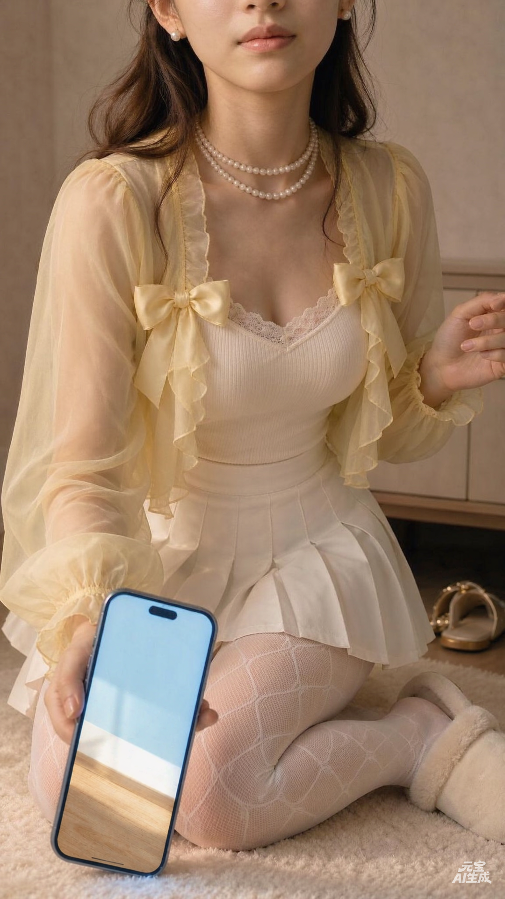

## 终稿提示词

```text
返工复核锚（STD-001.2 补销项）：脚上两只奶白软底绒拖、金扣凉鞋只收进柜影里露一只鞋尖；全画只一部正面整面亮屏手机、斜着顶到画框下沿；画顶裁到眉骨以上、只留眼尾到嘴角那一线；24h 奶白菱格提花连裤丝袜整段连包到脚趾、脚背连进绒拖鞋口。

返工复核锚：全画只一部手机，正面整面亮屏朝向画外他那边、举到画框下沿前景、屏光清亮；两只奶白软底绒拖都在脚上，奶白厚底一字带金扣凉鞋收进玄关矮柜下层阴影里只露一只鞋尖；整张脸只留眼尾到嘴角那一线、画顶裁到眉骨以上；画底是叠收的腿、两只绒拖与奶白短绒地毯的软褶；24h 奶白菱格提花连裤丝袜整段连包到脚趾。

第4张 · 他凑到近前、从膝头高度略仰隔 0.3 米看她

三槽分工声明：第一张图定本轮整套穿搭的版型、配色、面料与袜边，第二张图定她的五官骨相与脸型，第三张图定本张的姿势骨架与机位；脸、衣、姿势由各自底图承担，文字只写光位、场景、关系视角、构图调子与神态落点。第一张图是无人台，读不出发型，本轮发型由下面文字逐项写实承担，第二张图只取五官与骨相。

9:16 满幅画面，宽 1080 高 1920，四条边即裁切边，人物与道具铺满整幅，完整落在画内。全画只一位清晰成年女性、一具身体轮廓；画外的人只由她扭回来的半张脸、举到画框前朝向画外的亮屏与虚虚往回带的手交代，画面里除她之外是一部屏幕亮着、正对画外他那边而不是对着她自己的哑光雾蓝新手机、压暗半档的浅杏礼盒盖与一段鹅黄缎带、奶白短绒地毯、浅木地板、米白纱帘、玄关矮柜、一小瓶洋桔梗与收成一点暖金的日光，一眼看过去屋里就她一个人。左右各一只手臂各五根手指，两只手各自从肩连续到指尖，两只脚各自连续。24h 连裤丝袜从腿根整段连包到脚趾、袜身细匀菱格提花，脚趾在丝袜里完整可见；两只奶白软底绒拖都穿在丝袜外面，鞋口一小圈短绒包住脚趾；槽 1 实物那双奶白厚底一字带金扣凉鞋收进玄关矮柜下层阴影里、只露一只鞋尖，画面里只此一双、不另摆第二双。

穿搭逐项实写：鹅黄薄透雪纺长袖短开衫，敞襟不系，前襟两道细荷叶边，左右胸口各一枚鹅黄缎带大蝴蝶结，灯笼袖、袖口一圈荷叶边收口，扭身时雪纺随肩线甩出一点半透的弧；内搭象牙白细罗纹心形领贴身短上衣，领口一圈小蕾丝边，罗纹从胸下顺着腰窝收进去；象牙白高腰百褶迷你裙，褶子一道道分得清，裙摆齐齐停在大腿中段、跪坐时顺着扭身偏出一点；奶白菱格提花连裤丝袜从腿根整段连包到脚趾；两只奶白软底绒拖；双层小珍珠颈链垂一粒珍珠吊坠，小珍珠耳钉，淡鹅黄短圆甲。发型真换成半扎发：栗棕头发上半只在耳后到后脑松松束起一小束、下半整片披到肩胛、发尾松散微卷，额前薄薄几缕碎发，耳侧各垂一缕到锁骨，扭身时那小束发与几缕卷发从肩头甩到胸前，松松半扎不是高马尾、不是丸子头、不是盘发、不是低髻；这一顶与上一轮锁骨微卷、后颈低髻、哑金横簪、蓬松披肩大波浪、低侧马尾都不同。

姿势照第三张图：她在奶白短绒地毯上跪坐扭身，两腿叠着收在身侧、两只绒拖都还在脚上，膝往前蹭半寸、重心压到后坐的胯上，腰往画外他这侧拧过来，肩线一高一低再压低一点，脊线从后颈经腰窝到坐骨拉出一道扭出来的 S 形，百褶裙摆被扭身带得偏过大腿外侧，后脚一只绒拖的鞋尖从裙摆边露出来。右手从右肩经肘、腕到指尖一条链，五指捏着那部哑光雾蓝新手机、手腕内翻把亮着的屏幕朝向画外他那边、斜着顶到画框下沿几乎贴边，屏幕里映着一小片浅木色与柔白日光、屏光清亮地扑出画框，画面里看到的是亮着的屏幕那一面而不是雾蓝背壳或摄像头，这是右手唯一落点、只做举屏幕给他看这一个动作；左手从左肩经肘、腕到指尖一条链，四指朝画外他衣角那个高度虚虚一拢、往自己这侧带一寸，肘往腰里收，勾完停住不收，这是左手唯一落点、只做虚拢往回带这一个动作。头跟着腰扭回来，整张脸不给镜头，只留眼尾到嘴角那一线、画顶裁到眉骨以上，下巴微收，眼尾压下来正对他、不抬，下唇咬完松开一点，拿屏幕边沿轻轻点了一下自己下唇再送出去，屏光顺带扫过那一点下唇，像话已经到嘴边又故意咽回去半句。

镜头是他的眼睛：他凑到近前、离她不到 0.3 米，机位压到她膝头高度、镜头往上吃她的下颌线并略仰，这一眼看得清斜着顶到画框下沿朝向画外的亮屏与那一小块清亮的屏光、她压下来的眼尾、被屏幕边点过又松开一点的下唇、别到耳后那缕卷发与小珍珠耳钉、珍珠颈链一粒细亮、两片半透雪纺与胸口缎带蝴蝶结、递屏幕那手的五指指腹与淡鹅黄短圆甲、虚拢往回带那只手的指尖；浅杏礼盒盖与那段鹅黄缎带在画左近处压暗半档，一小瓶洋桔梗在画右上，玄关矮柜与米白纱帘在更远处浅浅带一笔，画底是叠收的腿、两只绒拖与短绒地毯的软褶，四张是同一间玄关连客厅。柔白日光从画左上斜进来，前三张那片满屋白光慢慢收成一点暖金，只留在屏光与她下唇上，收得像一句话轻轻落地。

质感与光线：雪纺半透起细边、缎带柔亮，罗纹柔白、百褶裙褶影清楚，菱格提花丝袜在斜光里浮出细纹，绒拖短绒起细边，新机哑光雾蓝机壳不反光、朝向画外的屏幕那一小块光清亮。整幅由柔白与鹅黄慢慢收成一点暖金，浅木色压底，安静得像被哄好之后屋里只剩两个人。神态落点在压下来不抬的眼尾与被屏幕边点过又松开的下唇，并从那里长出一个可见动作：递屏幕的右手指腹极轻地往前又送了半寸、停住等他自己来看，第 1 张那个往回勾一下的指尖手势在这一格又轻轻收了一下，舒服是她的，话头也是她起的。去除输入图右下角的「元宝 AI 生成」水印。
```

## 一句点评

跪坐扭身把亮屏举到他眼前，白光收成一点暖金

## 覆盖留痕（2026-11-26 · 用户当面授权领回轮）

- 本张按用户当面授权提交覆盖，取本轮领回重出里自己逐张亲看后能拿到的最好一版；同名 PNG 与同名 md 一起覆盖、旧图不留仓。
- 上方 `## 终稿提示词` 正文逐字未改，判据仍以同名 md 正文为准；本段只是覆盖留痕，不进提示词、不进判据。
- 逐张自检如实：本轮严格只改两处一版：地上多摆的米色拖鞋去掉、屏幕映出浅木色与柔白日光；手机位置角度未动；神态放软只到一半。按 STD-001.2，自检没全勾不申请销项；用户已让图审·鉴放宽审查，本轮交图由复查按放宽口径判。
