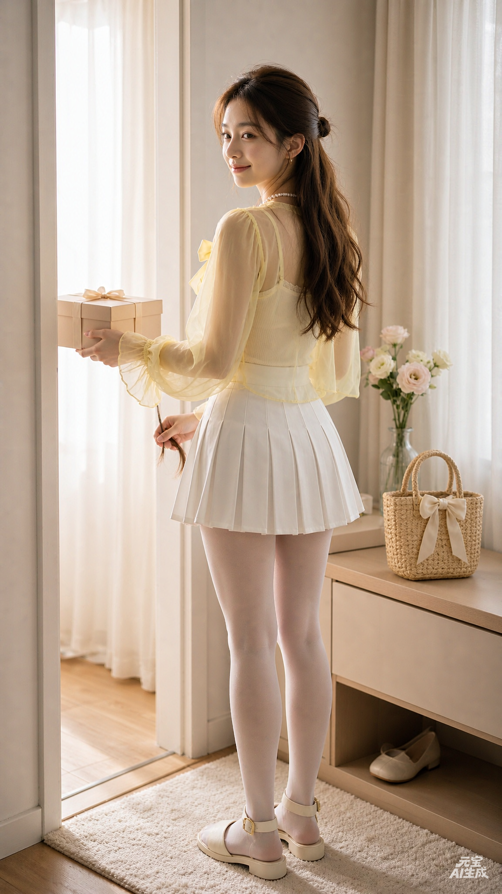
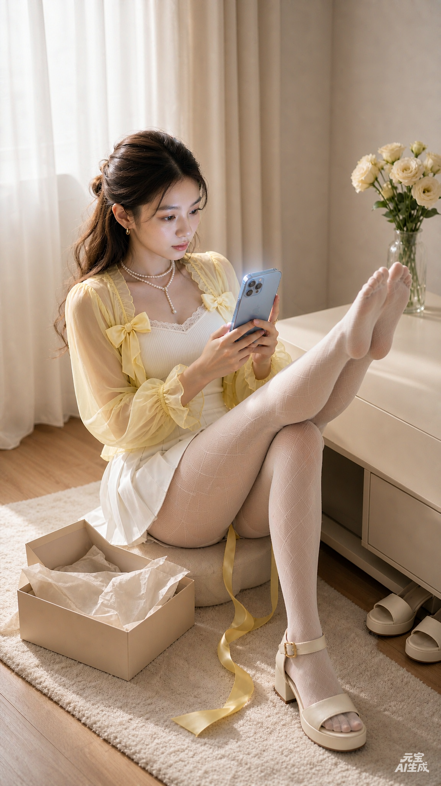
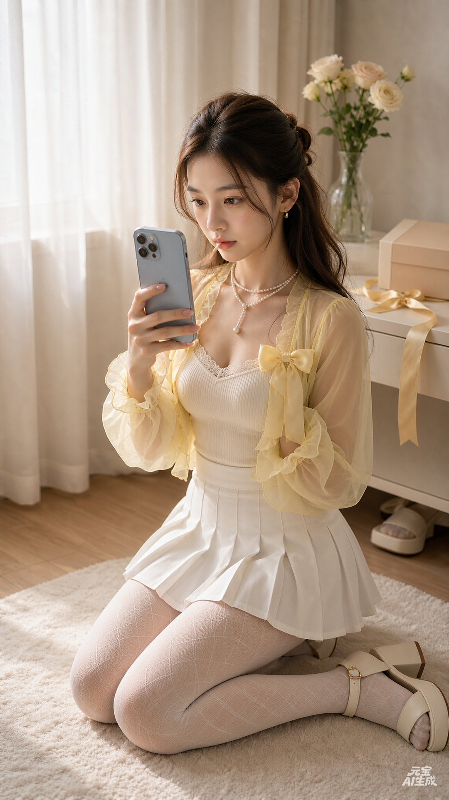

# R020 · 新手机那个上午

- 轮次目录：`20261126t_new-phone-morning`
- 日期：2026-11-26
- 来源：`yuanbao`
- 穿搭：`SPR-0067`
- 发型：半扎发
- 场景标签：其它
- 四张线稿：`full_single_P022`、full_single_P013`、full_sexy_P063`、full_sexy_P039`
- 画幅：1080×1920（9:16），纯画面

## 四张

| 序 | 机位 | 图 | 终稿提示词 |
|---|---|---|---|
| 01 | front |  | [01_front.md](01_front.md) |
| 02 | side |  | [02_side.md](02_side.md) |
| 03 | seat |  | [03_seat.md](03_seat.md) |
| 04 | close |  | [04_close.md](04_close.md) |

## 这一段说了什么

1. 谁气啦，我早没气了。盒子递过来呀，别杵门口，我手都伸半天了，你倒是放进来。
2. 这颜色倒会挑。我嘴上还拧着呢手先认了，缎带先别收，垂着好看，回头给我系包上。
3. 别动，第一张就拍你。拍糊了也不许删，谁让你刚才哄我的时候眼睛都不敢看我。
4. 看，拍到啦。周末陪我去挑个傻乎乎的手机壳，你敢拿黑的我就自己用，一个也不给你看。

## 现场记录

- 01_front：玄关回眸指尖先勾一下再接盒，嘴上还拧着
- 02_side：拆盒时缎带垂到绒上不扯直，冷白屏光只落脸与指腹
- 03_seat：俯卧举机斜切鼻梁只露一只眼，后半只鞋将掉未掉
- 04_close：跪坐扭身把亮屏举到他眼前，白光收成一点暖金

> 原图 PNG 永不转码、永不覆盖；预览用 `` 缩放原图。
