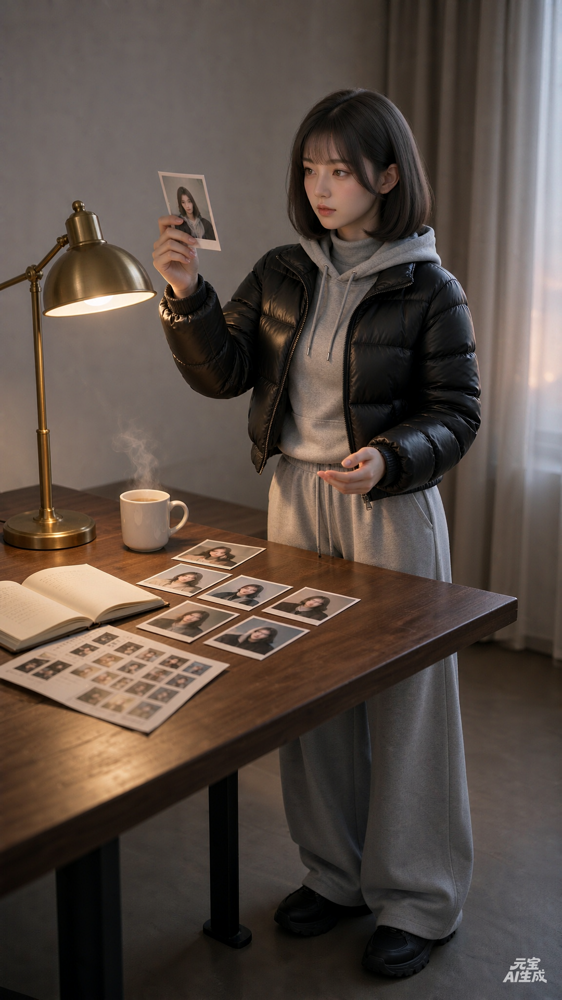
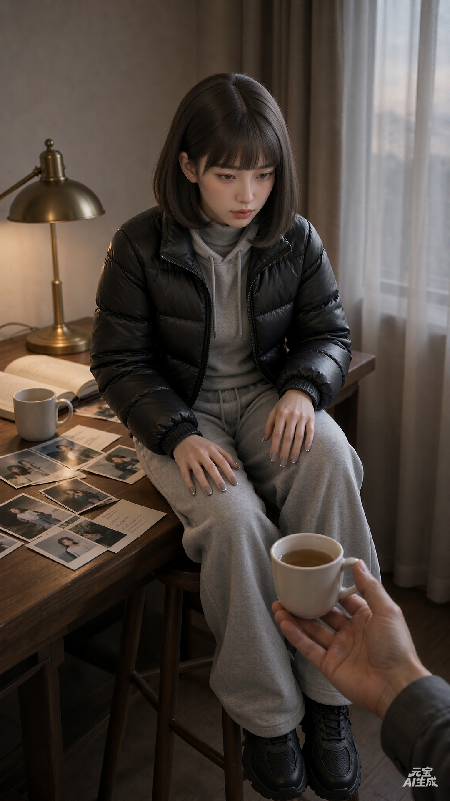
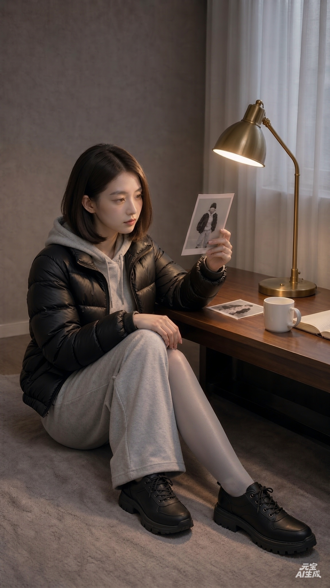
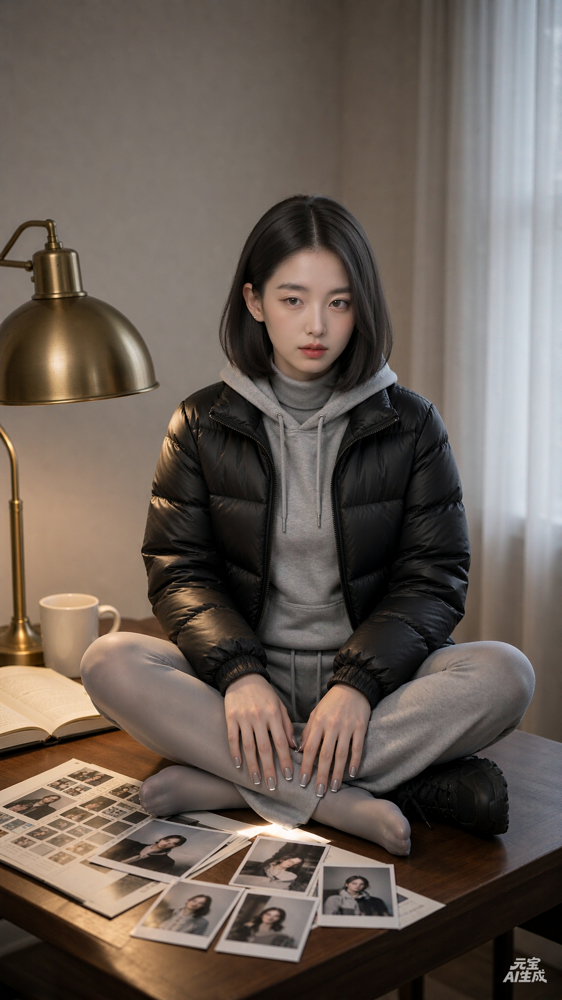

# R021 · 干活啊

- 轮次目录：`20261126u_lovers-photo-work`
- 来源：`lovers`
- 日期：2026-11-26
- 穿搭：`WIN-0193`
- 四张线稿：`full_single_P019[high] 站姿双臂上举伸展（第1张终稿槽3）`、`full_single_P070[front] 前倾坐姿 手扶大腿（第2张，镜像微调）`、`full_sexy_P062[side] 趴卧抱膝举腿（第3张）`、`full_single_P041[front] 女孩坐双手扶腿（第4张）`
- 画幅：1080×1920（9:16），纯画面，工具水印随图保留

## 四张

| 序 | 机位 | 图 | 终稿提示词 |
|---|---|---|---|
| 01 | front |  | [01_front.md](01_front.md) |
| 02 | side |  | [02_side.md](02_side.md) |
| 03 | seat |  | [03_seat.md](03_seat.md) |
| 04 | close |  | [04_close.md](04_close.md) |

## 这一段说了什么

1. 来啦来啦，真干活～九张图摊了一桌，你别又伸手抽走最亮那张。
2. 等会儿那家换豆子的，陪我去嘛，不许又说困。

## 现场记录

- 11 步全跑：1 短话 / 2 全库配额 --slot1 衣+发合成 / 2.5 研究员设计发型 / 3 审校 Agent 18 岁男大人设正向补写+冻结 / 4 加载技能图片创作并行四次 / 5 fit 1080x1920 / 6 研究员验图 / 6.8 元宝自己逐张亲看严判 / 6.5 作家 / 7 交付 / 8 归档真跑
- 全库开放第一次真跑 WIN-0193 winter/outer 非裙：黑亮面短羽绒+灰连帽高领+灰阔腿卫裤+黑系带厚底软底鞋，接住「不但要酷」
- 槽1 由 --slot1 一条命令拼服装图+发型参考图 f1214ac9254 medium/face；槽3 四张 --spread 跨系列跨视角，upper/duo 配额留证，实际入参换成本轮贴场景骨架
- 腿层：鸽灰珠光薄透连裤丝袜，长裤兼容口径，裤管下缘经脚踝脚背到脚尖同色包住，按 STD-001.3 B5-T 放宽版与 B5-C 零罗纹袜口正向写死，四份逐字一致
- 生成前发现槽3_1/3_4 与定稿骨架配错，交换两张线稿并重生成第1、4 张，属底图配合归因
- 6.8 终审第3张：初版右脚鞋丢失→单图许愿式补出一只平底鞋（鞋型不一）→回退稳定基准→二次许愿式修成与左脚同款系带厚底鞋；中途一版重生成画出完整男主全身，已弃用回退
- 第6步研究员误判第3张「左上第二个人形+B5-C擦边」，6.8 元宝自己逐张亲看整图推翻：左侧是灰墙与坐姿暗部，屈腿裤管下缘不是袜口，判合格
- 作家首投没真打开图写成出门走路，按不代笔全部弃用；重投用强制逐张读图+先交可见清单，清单与四图一致后才成文
- 开轮扫 letters 无派给 source=lovers 的新单（0035 已把 0025 的 15 张整单销项）；本对话无待重出单
- 四张右下角「元宝 AI 生成」角标按水印无所谓保留

> 原图 PNG 永不转码、永不覆盖；预览用 `` 缩放原图。
> 另有 `essay.md` 为本轮第一人称文章留证。
