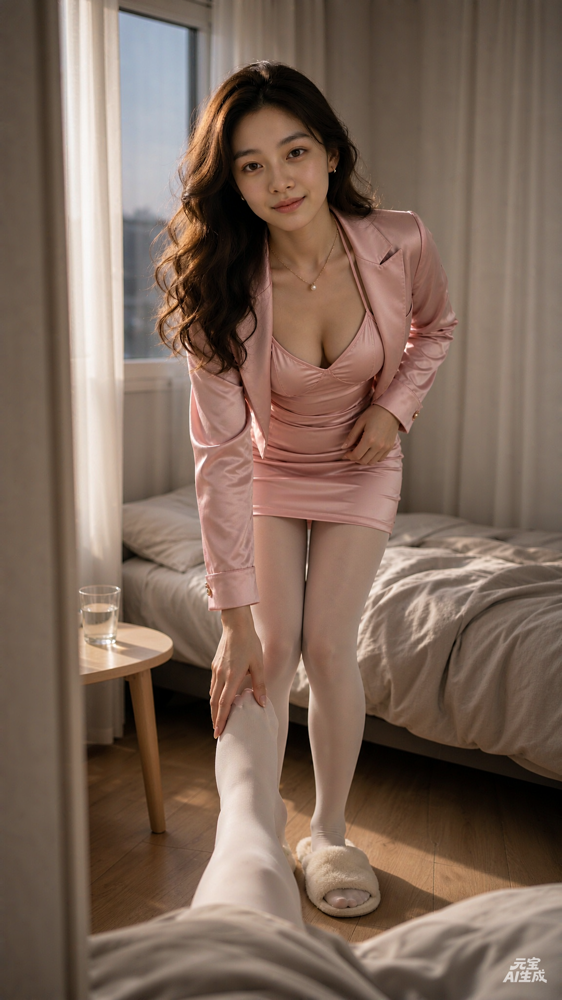

## 终稿提示词

```text
第1张 · 他半躺·眼高约 1.0 米、隔 1.3 米看她从门口走过来俯身手扶他膝

第一张图定穿搭版型配色面料，第二张图定骨相五官，第三张图定本张姿势骨架与机位；脸、衣、姿势由各自底图承担，文字腾给光位、场景、关系视角、构图调子、神态落点。本张栗棕蓬松披肩大波浪由独立发型参考图与文字锚共同承担，槽 2 人脸底图只留五官与骨相、不锁发际线。

9:16 满幅画面，宽 1080 高 1920，四条边即裁切边，人物与道具铺满整幅、完整落在画内。全画只她一位清晰成年女性、一具身体轮廓；画外的人只以他自己在画面下缘那一小片浅灰绒被上的小腿与脚背交代，一眼看过去屋里就她一个人。左右各一只手臂各五根手指、两只手各自从肩连续到指尖，两只脚各自连续，胸大腰细腿长靠合身剪裁写实呈现。

穿搭逐项实写：樱粉缎面挂脖吊带紧身迷你连衣裙，细缎带绕颈后系一枚小结，心形领口一道细密抽褶，前胸到腰窝贴身收出曲线，腰侧两道斜抽褶，裙身是缎面软光，裙摆齐齐停在大腿中段；外搭同色樱粉缎面短款小开衫，敞襟不系，长袖到腕，袖口一圈细荷叶边；24h 樱粉匀透连裤丝袜从腿根整段连包到脚趾，脚趾上有一层樱粉薄丝、五趾轮廓在袜面里各自分明，脚踝与腿上平滑无罗纹螺纹松紧收口、无横向袜边分界；两只奶白软底包趾绒拖穿在丝袜外面，鞋口短绒包住脚背，四张同一双；淡樱粉短圆甲、细哑金锁骨链垂一粒小珍珠、小珍珠耳钉。发型是栗棕蓬松披肩大波浪，中分，发根蓬松，发尾松而大的一缕缕波浪过肩落到后背中段，两侧几缕垂在锁骨前，四张同一顶。

姿势照第三张图：她刚走到床尾，站姿前倾、上身朝他压下来一点，重心落在前脚，后脚脚尖轻点浅木地板，脊线从后颈经腰窝到后脚的踝拉出一道舒展的斜线，裙摆随前倾垂出一道软弧，两只绒拖都好好穿在脚上。全画仅此一双手，每只手全篇只出现一次、只做一个动作：右臂从右肩经肘向前下探、经腕压平，指尖一条连续链沿身体右侧完整可见，唯一落点是右手五指轻轻扶在画面下缘他露出的那只膝盖上、扶稳了就不动；左臂从左肩经肘向后收、经腕贴在腰侧，唯一落点是左手五指拢着自己开衫的袖口边、只做这一个收袖的动作。

镜头是他的眼睛：他半躺在浅灰绒被上还没坐起来，视点实数眼高 1.0 米，与她相隔 1.3 米，略仰看过去，这一眼先撞上她俯下来的大波浪发梢与心形领口那道细褶，再顺着贴身缎面走到腰侧斜抽褶、大腿中段的裙摆、整段樱粉丝袜与两只奶白绒拖，最后落到画面下缘自己那一小截被她扶住的膝。这一眼看不见她的睫毛与耳后细汗，看不见矮几上那杯温水的水纹，门框窄边虚在画左把这一眼框住。

神态落点在眼先落在他小腿上、再抬起来递到他眼睛里，下唇含住一点又慢慢松开，并从那里长出一个可见动作：扶膝那五指极轻地往回勾了一下就停住，像先替他试了试力气，等他点头才肯真按下去。

光位与场景：傍晚卧室，门缝里一道暖白夕光从画左斜进来，只勾她的半边肩、大波浪发梢、心形领口与扶膝那五指的指节四处亮，落地灯还没全亮、屋里其余压成一层柔软暖灰；浅灰绒被的褶、矮几上一杯温水、米白纱帘与浅木地板纹理都清楚，樱粉缎面的软光、细罗纹抽褶、丝袜薄透细纹与绒拖短绒都清楚。写实摄影质感，50mm，1/250，半躺略仰 4 度，机位稳住不动。整幅樱粉与暖灰，干净得像一天快要收尾的那一小会儿。
```

## 一句点评

站姿前倾扶膝把门缝光收成一线
