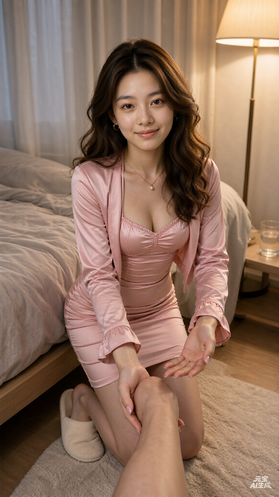

## 终稿提示词

```text
第2张 · 他撑起半身·眼高约 0.9 米、隔 1.0 米看她单膝跪到床沿把他小腿搁上自己膝头

第一张图定穿搭版型配色面料，第二张图定骨相五官，第三张图定本张姿势骨架与机位；脸、衣、姿势由各自底图承担，文字腾给光位、场景、关系视角、构图调子、神态落点。本张栗棕蓬松披肩大波浪由独立发型参考图与文字锚共同承担，槽 2 人脸底图只留五官与骨相、不锁发际线。

9:16 满幅画面，宽 1080 高 1920，四条边即裁切边，人物与道具铺满整幅、完整落在画内。全画只她一位清晰成年女性、一具身体轮廓；画外的人只以他自己在画面下缘那一小截被她托起来的小腿与脚背交代，一眼看过去屋里就她一个人。左右各一只手臂各五根手指、两只手各自从肩连续到指尖，两只脚各自连续，胸大腰细腿长靠合身剪裁写实呈现。

穿搭逐项实写：樱粉缎面挂脖吊带紧身迷你连衣裙，细缎带绕颈后系一枚小结，心形领口一道细密抽褶，前胸到腰窝贴身收出曲线，腰侧两道斜抽褶，裙身是缎面软光，裙摆齐齐停在大腿中段；外搭同色樱粉缎面短款小开衫，敞襟不系，长袖到腕，袖口一圈细荷叶边；24h 樱粉匀透连裤丝袜从腿根整段连包到脚趾，脚趾上有一层樱粉薄丝、五趾轮廓在袜面里各自分明，脚踝与腿上平滑无罗纹螺纹松紧收口、无横向袜边分界；两只奶白软底包趾绒拖穿在丝袜外面，鞋口短绒包住脚背，四张同一双；淡樱粉短圆甲、细哑金锁骨链垂一粒小珍珠、小珍珠耳钉。发型是栗棕蓬松披肩大波浪，中分，发根蓬松，发尾松而大的一缕缕波浪过肩落到后背中段，两侧几缕垂在锁骨前，四张同一顶。

姿势照第三张图：她单膝跪在浅木地板与床沿之间那一小块奶白短绒地毯上，另一条腿屈起当了个稳稳的膝头，上身挺而松地立着，肩线朝他转过来一点，髋线留在床沿，脊线从后颈经腰窝到跪着那只膝拉出一道柔和的弧，大波浪顺着俯身滑到肩前一侧，两只绒拖一只踩实绒面、一只脚尖轻点着地。全画仅此一双手，每只手全篇只出现一次、只做一个动作：右臂从右肩经肘向前下探、经腕翻成掌心朝上，指尖一条连续链完整可见，唯一落点是右手五指稳稳托住画面下缘他那一截小腿的下段、把他小腿轻轻搁到自己屈起的膝头上；左臂从左肩经肘向前拢、经腕放平，唯一落点是左手五指虚虚罩在他膝弯上方半寸、只做这一个护着的动作。

镜头是他的眼睛：他撑起半身、一只手压在绒被上，视点实数眼高 0.9 米，与她相隔 1.0 米，平看略俯，这一眼先看见她跪下来时裙摆挤出的那道软褶与托着小腿的五指，再顺着她肩前滑下来的大波浪走到低着的眼、心形领口细褶、腰侧斜抽褶与整段樱粉丝袜，最后落到自己被搁稳的那一小截脚背。这一眼看不见她袖口细荷叶边里的针脚，看不见矮几上温水杯沿反的那粒亮点，床沿浅灰绒被的边虚在画右把这一眼框住。

神态落点在低着眼先量一量该从哪儿按起、眉心平着，单侧嘴角先翘起一点点，并从那里长出一个可见动作：托着小腿的右手往上抬了半寸把腿放得更稳、抬完停住不收，像替他把这一整天的沉都接过去了。

光位与场景：傍晚卧室，落地灯的暖黄已经亮起来，从画右斜铺到她的肩、大波浪发梢、托腿那五指的指节与他自己那一小截小腿四处，门缝那道夕光退成很薄的一线，屋里其余压成柔软暖灰；浅灰绒被的褶、奶白短绒地毯、矮几上一杯温水、米白纱帘与浅木地板纹理都清楚，樱粉缎面软光、细抽褶、丝袜薄透细纹与绒拖短绒都清楚。写实摄影质感，50mm，1/250，撑起半身平看略俯 3 度，机位稳住不动。整幅樱粉与暖黄，安静得像一句话轻轻放下来。
```

## 一句点评

单膝跪托稳小腿落地灯暖黄铺到肩
