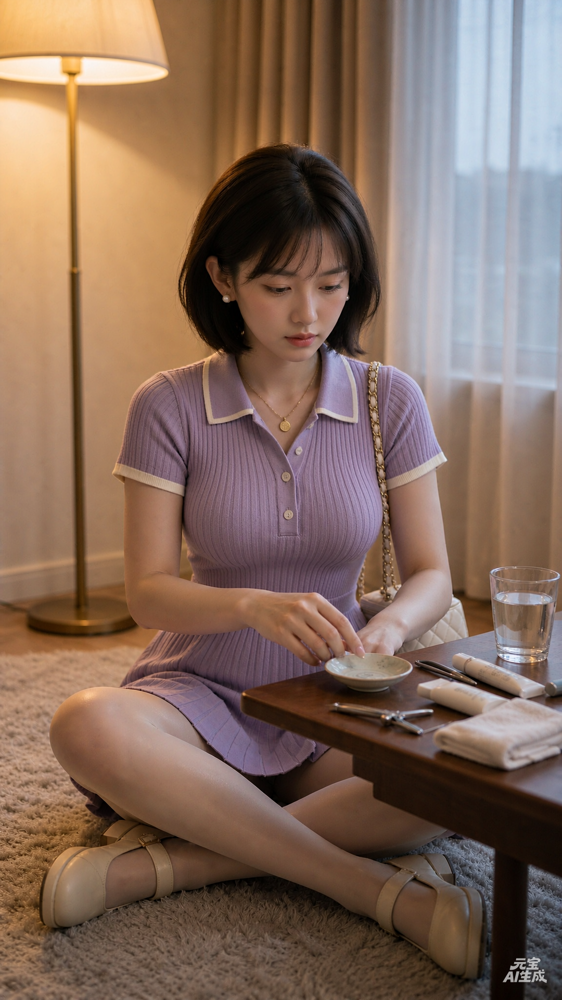

## 终稿提示词

```text
第一张图定本轮整套穿搭的版型、配色、面料与配饰，第二张图定骨相五官与同一张脸，第三张图定本张的骨架、重心、脊线肩髋与四肢折角；脸、衣、发型、姿势由各自底图承担，第三张图的双手落点按本文重摆。本张是自家客厅落地窗前傍晚的一段，画内只有她一位清晰成年人物，镜头是他的眼睛，他刚夸她挺漂亮有气质。

9:16 竖版满画幅，画面从顶到底由人物、道具与光填满，整套画面连贯铺满，四条边即裁切边。

自家客厅落地窗前傍晚，画左一盏暖黄落地灯把米白光斜斜推过来，画右玻璃窗是夜蓝、远处几粒城市灯点起来、窗玻璃映出一小片暖光，浅灰沙发一角、矮几上一只细口白瓷瓶插一支白玉兰、木地板沉进暖灰褐里；低饱和三色：深孔雀绿、暖黄、夜蓝。

唐唐的脸：鹅蛋脸、骨相柔和、鼻梁细直、眼尾微微上扬、唇形饱满、眉色浅棕，四张同一张脸；一位唐唐，成年头身比，曲线从 V 领经交叉裹身、缎带收腰到胯一线清楚，斜裁裙摆顺着腿线垂下去、开衩处腿线修长，侧身转头时颈肩线平顺连续；一具身体轮廓，左右各一只手臂、各五根手指，两条腿各自连续，两只脚各自完整。

她站在落地窗框边，左手轻搭被暖黄灯描出金边的窗框、五指各自分开，右手垂在髋侧轻贴缎面裙摆、五指分开，重心落左腿、胯部轻轻侧顶成柔和 S 形、右脚尖轻轻内扣点地，头轻轻转回约三十度看向镜头、回眸眼尾弯着、唇轻轻抿一点；搭窗框那只手腕与锁骨整段落进暖黄灯里，开衩那道长柔亮从腰胯一路走到膝侧。镜头离地 158cm、距约 3.5m，平视全身，从马尾顶到两只凉鞋完整入画，青灰薄丝从开衩下经膝、小腿、脚背连续到凉鞋鞋口里的脚尖。

深孔雀绿真丝缎面斜裁吊带及膝裹身连衣裙，细肩带、V 领交叉裹身，腰间同色缎带松松系一个结、两条短带垂在胯侧，裙身顺着身体曲线垂坠到膝下、右侧一道开衩到膝上两指，缎面在腰胯与斜裁裙摆上有长长一道柔亮；整套连衣裙完整覆盖，肌肤由衣物遮住；颈上一枚细哑金小圆牌，耳垂一对细哑金小圈耳环；奶白圆甲、甲缘一道极细孔雀绿弧线。
青灰珠光薄透连裤丝袜，细密哑光织纹，从髋经膝、小腿、脚背连续包到脚尖，膝前与脚背有一层很浅的柔亮，脚尖由同色袜面完整包住，五趾轮廓在薄层里各自分明，与深孔雀绿缎面踝带细高跟露趾凉鞋的鞋口平顺衔接；两只深孔雀绿踝带细高跟凉鞋都好好穿在脚上、踝带一圈细金扣绕到脚背、四张同一双。
低扎马尾束在颈后正中、束点压一枚雾灰缎面大蝴蝶结只露出两片软翅，马尾一刀齐垂到肩胛骨下两指、发尾齐平不带卷，正中骨缝中分从发际点直推到头顶顶点，两侧各留一指宽鬓角碎发自然贴着颊骨垂到下颌、完整露出两只耳朵与耳垂，耳垂一对细哑金小圈耳环，后颈碎发收得干净，发色雾感深栗棕、底色压到四度、发中到发尾再褪半度成沾了层孔雀绿冷光的墨茶褐，在每一张里完全相同。
四张同一套连衣裙、同一款发型、同一款美甲、同一双鞋、同一层腿部覆盖、同一张脸。
```

## 一句点评

盘腿坐地毯把小瓷碟指甲刀指甲锉护手霜小毛巾排成一小排，抬眼往他这边看了一眼
