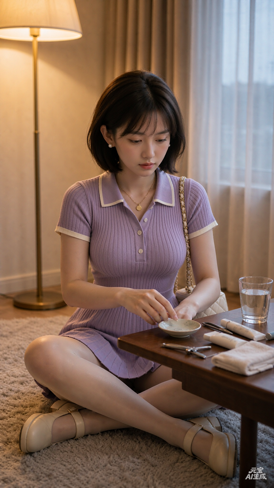
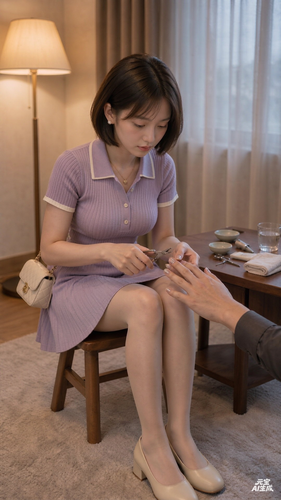
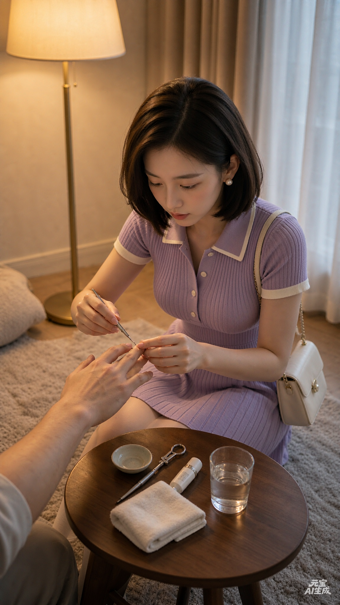
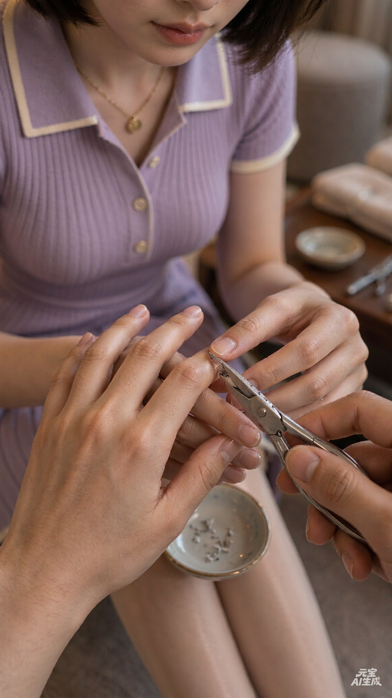

# R023 · 唐唐来给我剪指甲

- 轮次目录：`20261126w_lovers-nail-trim`
- 来源：`lovers`
- 日期：2026-11-26
- 穿搭：`SPR-0057`
- 四张线稿：`代码手绘 slot3_1.png：far 盘腿坐地毯、两臂前伸、右下男主手入画框下沿`、`代码手绘 slot3_2.png：mid 矮凳俯身、双手在中央、画框下沿男主一只手`、`代码手绘 slot3_3.png：mid-near 上缘裁下颌、双手交叠中央、下沿男主手指前景`、`代码手绘 slot3_4.png：near 两双手极近特写、上缘一线下颌、指甲刀压甲缘、小瓷碟接屑`
- 画幅：1080×1920（9:16），纯画面，工具水印随图保留

## 四张

| 序 | 机位 | 图 | 终稿提示词 |
|---|---|---|---|
| 01 | front |  | [01_front.md](01_front.md) |
| 02 | side |  | [02_side.md](02_side.md) |
| 03 | seat |  | [03_seat.md](03_seat.md) |
| 04 | close |  | [04_close.md](04_close.md) |

## 这一段说了什么

1. 手伸过来呀，别躲～我剪得可慢了，十根都修圆，你那杯水也就刚好凉到能喝。
2. 等会儿陪我挑指甲油嘛，柜子最上层那排，不许又说困。

## 现场记录

- 11 步全跑：1 短话 / 2 --coverage＋--slot1 衣发合成＋四张槽3 / 2.5 研究员设计发型 / 3 审校 Agent 18 岁男大人设正向补写＋冻结 / 4 加载技能图片创作并行四次 / 5 fit 1080x1920 / 6 研究员连底图逐张验 / 6.8 元宝自己逐张亲看严判 / 6.5 作家 / 7 交付 / 8 归档真跑
- 全库配额本轮取 SPR-0057 spring/top 非裙（丁香紫短袖 Polo 翻领收腰百褶连衣裙），发型参考 fabda96af65 short/styling 拼进槽 1；按用户「别管审查员的派单了」不领单、不回 @图审·鉴、不附自检表，0040 是审查员下岗道别信，无派给 source=lovers 的新单
- 槽 3 四张 --spread 跨系列跨视角库图实挑后亲看不贴剪指甲场景（咆哮手势／双人相拥／桌面式顶胯／单臂上伸），按「库图不合适就手搓」整组换成代码手绘四张 POV 取景线稿，机位景别裁切前景全交底图，库图留证 slots/_backup/
- 腿层：奶白珠光薄透连裤丝袜，从腿根经膝小腿脚背到脚尖同色包住、五趾在袜面里各自分明、平顺连进米色玛丽珍鞋口，四份逐字一致；按 STD-001.3 B5-T 放宽版与 B5-C 零罗纹袜口正向写死
- 男主局部：第 1 张无，第 2/3/4 张各一只手（天然短甲素甲、深灰衬衫袖口、头脸画外），四份逐字定；A2-M 重点核过，银亮只落在她甲缘与剪刃
- 6.8 终审两次许愿式：第 4 张收紧到两双手极近特写；第 2 张把画右下那只手的指甲压成天然短甲素甲、去掉与她甲缘同色系的细亮反光（第 6 步研究员判 A2-M 边缘风险）。两处均单图一条许愿式、不传三槽、不重写定稿、不整批重发，修后逐张亲看合格
- 第 6 步研究员判 1/3/4 通过、第 2 张挂 A2-M 边缘风险；6.8 元宝自己复看后按许愿式修第 2 张，四张全合格才收口
- 作家首投即为逐张读图版，但「四张可见清单」把第 2/3/4 张「谁给谁剪」读反（写成别人替她修）；文章正文未沿用该误读，仍是第一人称「我替他把指甲修圆」，按不代笔不改文口径保留，文中「碎屑落进他掌心托着的小碟」与图里小碟落在桌面略有出入，如实留证
- 第 2 张指甲刀与甲缘留了一点距离，按「托手待剪」的瞬间收，未返工；四张右下角「元宝 AI 生成」角标按水印无所谓保留
- 第 7 步交付与本轮回复同发，第 8 步在发之前真跑完并独立复核，汇报带执行清单收口行

> 原图 PNG 永不转码、永不覆盖；预览用 `` 缩放原图。
> 另有 `essay.md` 为本轮第一人称文章留证。
