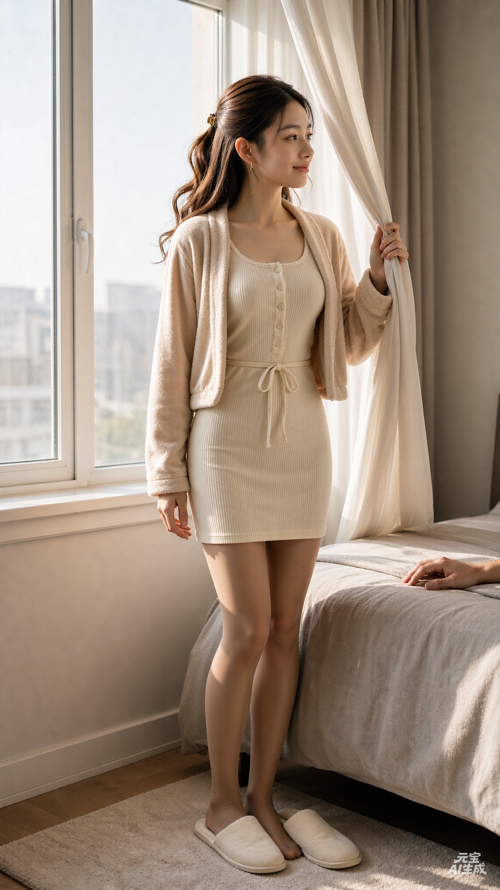

## 终稿提示词

```text
第1张 · 他半躺·眼高约 0.9 米、隔 1.3 米看她已经站在窗边把窗帘拉开一线、晨光铺到床尾

三槽分工：第一张输入图定本轮整套穿搭、丝光腿层与右上那张发型参考小图只定发型，第二张输入图定她的五官骨相，第三张输入图定本张的站姿骨架与重心；文字只写光位、场景、关系视角、构图调子、神态落点与可见动作。第一张输入图右上角的发型参考小图只用来长出同一种发型，不生成第二个人，成图全画只一位唐唐。

9:16 竖版满画幅，画面从顶到底由人物、窗、床尾与一条晨光填满，四条边即裁切边，人物与道具完整落在画内。一位成年女性，一具完整身体轮廓，左右各一只手臂、各五根手指，两只手各自从肩经肘腕到指尖连成一条链、各只做一个动作；两只脚各自连续，胸大腰细腿长由合身剪裁写实呈现。

她穿燕麦奶白色细罗纹贴身长袖连衣裙，方领、前排五颗小圆扣从领口排到胸下、裙长齐大腿中段、腰间一道同色细抽绳；外搭浅杏色薄绒短开衫，敞襟不系、袖口一圈细绒边，晨光里细罗纹织纹与薄绒绒面各亮各的。腿上是一层从髋部经膝到脚尖连续不断的浅茶色匀透连裤丝袜，袜面无罗纹螺纹松紧收口、无横向袜边分界，脚趾由同色袜面完整包住、五趾在袜面里各自分明，脚背上那层丝光与小腿连成同一片；两只奶白软底包趾绒拖真穿在脚上，丝袜脚背连进拖鞋口，踩在床边短绒地毯上。奶白短圆甲，细哑金小耳圈各一只。发型是半扎发：栗棕头发上半区往后梳拢、在头顶偏后收成一小束，一枚哑金小抓夹松松固定，束起的发尾卷成两三道松卷垂到后颈，其余从耳侧披下越过肩胛、发尾松而大的微卷一缕一缕分得清，左侧一缕别到耳后、右侧留两缕细软碎发垂在颊边；四张同一款。

她的右手从右肩经肘腕到指尖连成一条链，唯一落点是半合的窗帘布边，五指捏着往侧拉开一线、指节微微弯着，布面被带出一道柔软的竖褶；左手从肩经肘腕到指尖连成一条链，唯一落点是垂在身侧的开衫绒边，指尖虚虚捻着那一小圈绒、不拉不扯。脊线从后颈经腰窝到站立的那只脚踝拉成一道柔和的直，左髋微微送出，重心落在后脚，前脚脚尖朝窗那侧轻踏半步。她把脸从肩头侧回一半，眼从低处抬起来正对这一眼，眼角带一点「我先醒了哦」的得意，下唇含住一点又松开，嘴角只挑起一线，没有笑满。

场景是清晨的卧室：浅灰薄毯铺到床沿，两只枕头并排，床头柜上一只白瓷小杯与一本合起的书，窗帘原是半合的，窗外是淡青白的天光，被她拉开那一线之后晨光铺成一条斜带、一直落到床尾被角。画外人只以他自己那一小片入画：被角近处露出他刚睁眼时搁在薄毯上的一只手背，不入头脸、不多出第二个人。远景里这一眼看不清的是他半躺着的整段身体与窗外的楼影，近处看得清的是她捏窗帘的指尖、发顶那枚小抓夹、绒拖口里连到趾尖的浅茶丝光。

柔白晨光从窗那侧斜进来，落在她的眼尾、下唇角、锁骨、捏布边的指尖与脚背，屋里其余还留着一点夜的暖灰，两种光在她肩头交界。去除输入参考图右下角的「元宝 AI 生成」水印，画面不保留任何输入参考图自带的文字与边框；成图自带工具水印原样留在右下角。
```

## 一句点评

窗边拉开一线晨光铺到床尾
