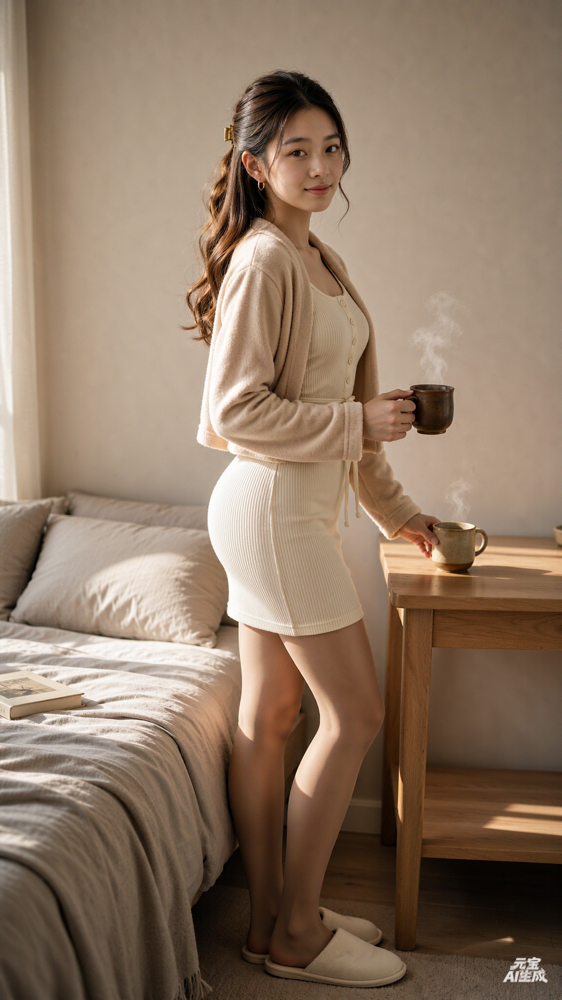

## 终稿提示词

```text
第2张 · 他半躺·眼高约 0.85 米、隔 1.0 米看她端着两只粗陶小杯回到床边小桌、侧身放下回头看他

三槽分工：第一张输入图定本轮整套穿搭、丝光腿层与右上那张发型参考小图只定发型，第二张输入图定她的五官骨相，第三张输入图定本张的侧身站姿骨架与重心；文字只写光位、场景、关系视角、构图调子、神态落点与可见动作。第一张输入图右上角的发型参考小图只用来长出同一种发型，不生成第二个人，成图全画只一位唐唐。

9:16 竖版满画幅，画面从顶到底由人物、床边小桌、薄毯与一条晨光填满，四条边即裁切边，人物与道具完整落在画内。一位成年女性，一具完整身体轮廓，左右各一只手臂、各五根手指，两只手各自从肩经肘腕到指尖连成一条链、各只做一个动作；两只脚各自连续，胸大腰细腿长由合身剪裁写实呈现。

她穿燕麦奶白色细罗纹贴身长袖连衣裙，方领、前排五颗小圆扣从领口排到胸下、裙长齐大腿中段、腰间一道同色细抽绳；外搭浅杏色薄绒短开衫，敞襟不系、袖口一圈细绒边；侧身时细罗纹顺着腰窝收出一道紧弧。腿上是一层从髋部经膝到脚尖连续不断的浅茶色匀透连裤丝袜，袜面无罗纹螺纹松紧收口、无横向袜边分界，脚趾由同色袜面完整包住、五趾在袜面里各自分明；两只奶白软底包趾绒拖真穿在脚上，丝袜脚背连进拖鞋口，前脚踩在短绒地毯上、后脚脚尖轻轻点着木地板。奶白短圆甲，细哑金小耳圈各一只。发型是半扎发：栗棕上半区往后收成一小束、哑金小抓夹固定，束起的发尾两道松卷垂到后颈，其余从耳侧披下越过肩胛、发尾松而大的微卷，左侧一缕别耳后、右侧两缕细碎软发垂在颊边；四张同一款。

她的右手从右肩经肘腕到指尖连成一条链，唯一落点是床边小桌上一只粗陶小杯的杯壁，五指稳稳托着杯身、拇指贴着杯沿下方，杯口浮着一点极薄的白汽；左手从肩经肘腕到指尖连成一条链，唯一落点是小桌上另一只粗陶小杯的杯托，指尖刚把杯底放平、还没松开。两只杯子一深一浅，浅的那只朝他这侧摆。脊线从后颈经腰窝到前脚脚踝拉成一道柔缓的弧，肩往他这侧转过来半寸，髋留在后，重心稳在两脚之间。她先低头看杯沿有没有放稳，再抬眼把目光从肩上方递过来，下颌收一点，眼尾压下来，眉梢只提起一半就停住，像早知道他一直没出声。

场景是清晨的卧室：窗帘拉开一线的那一小片还亮着，晨光铺成斜带落到床尾，浅灰薄毯、两只并排的枕头、床头柜上合起的书都还在；床边小桌是浅木色，桌面两道木纹在光里浮出来。画外人只以他自己那一小片入画：被角近处露出他搁在薄毯上的一截手腕与袖口，不入头脸、不多出第二个人。

柔白晨光落在她托杯的指尖、放杯的那只手、低头发顶那枚小抓夹、以及绒拖口里连到趾尖的浅茶丝光上；屋里其余还留一点夜的暖灰，安静得像水刚温好还没人说话。去除输入参考图右下角的「元宝 AI 生成」水印，画面不保留任何输入参考图自带的文字与边框；成图自带工具水印原样留在右下角。
```

## 一句点评

端两只粗陶杯回床边浅杯朝他摆
