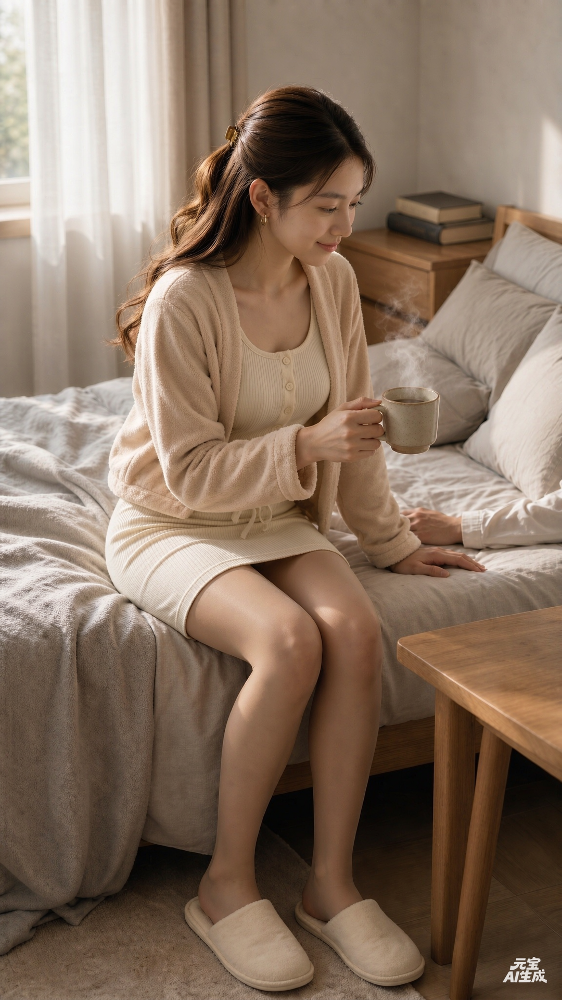

## 终稿提示词

```text
第3张 · 他撑起·眼高约 0.8 米、隔 0.55 米看她坐到床沿俯身把温杯递到他近前、另一只手撑在枕侧

三槽分工：第一张输入图定本轮整套穿搭、丝光腿层与右上那张发型参考小图只定发型，第二张输入图定她的五官骨相，第三张输入图定本张的坐姿骨架与重心；文字只写光位、场景、关系视角、构图调子、神态落点与可见动作。第一张输入图右上角的发型参考小图只用来长出同一种发型，不生成第二个人，成图全画只一位唐唐。

9:16 竖版满画幅，画面从顶到底由人物、枕被、温杯与晨光填满，四条边即裁切边，人物与道具完整落在画内。一位成年女性，一具完整身体轮廓，左右各一只手臂、各五根手指，两只手各自从肩经肘腕到指尖连成一条链、各只做一个动作；两只脚各自连续，胸大腰细腿长由合身剪裁写实呈现。

她穿燕麦奶白色细罗纹贴身长袖连衣裙，方领、前排五颗小圆扣从领口排到胸下、裙长齐大腿中段、腰间一道同色细抽绳；外搭浅杏色薄绒短开衫，敞襟不系、袖口一圈细绒边；坐下时细罗纹在膝头堆出几道软褶。腿上是一层从髋部经膝到脚尖连续不断的浅茶色匀透连裤丝袜，袜面无罗纹螺纹松紧收口、无横向袜边分界，脚趾由同色袜面完整包住、五趾在袜面里各自分明；两只奶白软底包趾绒拖真穿在脚上，丝袜脚背连进拖鞋口，一只脚尖轻轻点着床边短绒地毯，另一只脚收在床沿下。奶白短圆甲，细哑金小耳圈各一只。发型是半扎发：栗棕上半区往后收成一小束、哑金小抓夹固定，束起的发尾两道松卷垂到后颈，其余从耳侧披下越过肩胛、发尾松而大的微卷，俯身时几缕从肩头滑下来扫过锁骨；四张同一款。

她的右手从右肩经肘腕到指尖连成一条链，唯一落点是那只浅色粗陶小杯的杯身，五指托稳、杯沿朝他这侧微微倾出一点，杯口那层极薄的白汽刚好升到他眼前，不递到唇上、留半寸；左手从肩经肘腕到指尖连成一条链，唯一落点是他枕侧那一小片薄毯，五指分开把俯下去的身子撑稳，腕子压出一点好看的凹。侧坐在床沿，脊线从后颈经腰窝到点地的那只脚踝拉成一道柔缓的 S，肩往前送、髋留在后，重心落在撑毯的手与坐着的膝之间。她低头先看杯沿那点白汽一拍，才抬眼把目光递过来，眼尾压下来正对这一眼，下唇含住一点又松开，嘴角挑起极轻的一线，像在等他先认一句醒了。

场景是清晨的卧室：窗帘拉开一线，晨光斜带铺到床尾，浅灰薄毯拉到他腰际，两只枕头并排，床头柜上合起的书与另一只深色粗陶杯都还在；床边小桌空出一只杯的位置。画外人只以他自己那一小片入画：他撑起身子时搁在薄毯上的一截手腕与睡衣前襟一小片，就在她撑毯那只手旁边，不入头脸、不多出第二个人、不出现带美甲的手。

柔白晨光落在她的眼尾、下唇角、托杯的五根指尖、杯口白汽、发顶那枚小抓夹与绒拖口里连到趾尖的浅茶丝光上；别处还留一点夜的暖灰，安静得像一句话说到一半。去除输入参考图右下角的「元宝 AI 生成」水印，画面不保留任何输入参考图自带的文字与边框；成图自带工具水印原样留在右下角。
```

## 一句点评

坐床沿递温杯画外只留一截手腕
