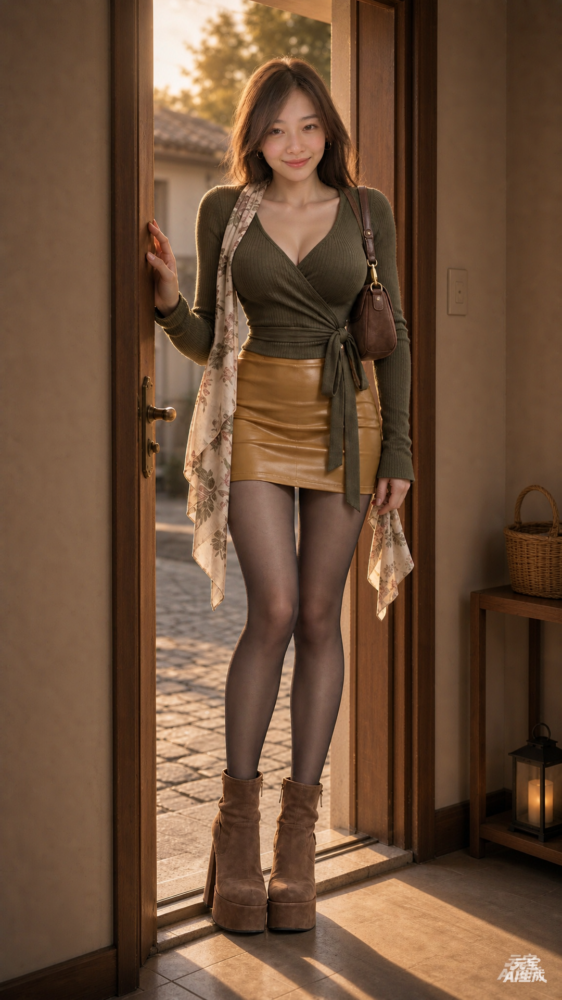

## 终稿提示词

```text
第1张 · 他背靠玄关墙站着·视点 1.65 米、隔 1.3 米看她已经站在半开的木门边回身催他出门

三张输入图分工：第一张定本轮整套穿搭的版型、配色、面料、丝袜、短靴与随这套衣服落下的栗棕偏分中长发；第二张定她的五官骨相；第三张定本张的站姿骨架与重心；光位、场景、关系视角、构图调子、神态落点与可见动作逐项落满画面。全画只一位清晰成年女性人物，一具完整身体轮廓，左右各一只手臂、各五根手指，两只手各自从肩经肘腕到指尖连成一条链、各只做一个动作；两只脚各自连续，胸大腰细腿长靠合身剪裁写实呈现。

9:16 竖版满画幅，画面从顶到底由人物、半开的木门、门槛石与一条黄昏光填满，四条边即裁切边，人物与道具完整落在画内。橄榄绿罗纹针织深 V 交叉裹身长袖上衣，腰侧系带收出一道柔软的蝴蝶结；焦糖棕光面皮革迷你包臀裙，裙摆停在大腿中段；米杏底色花卉印花薄丝巾绕颈垂到腰侧；棕褐色细肩带斜挎小包贴在右髋。一层烟灰薄透连裤丝袜从腿根连包到脚趾，脚趾由同色袜面完整包住、五趾在袜面里各自分明，袜面从小腿到脚背连成平顺同一片，丝袜脚背连进靴口；一双棕麂皮厚底及踝短靴穿在丝袜外面，粗跟与防水台在门槛石上落得稳稳的。奶白短圆甲，细哑金小耳圈各一只。栗棕偏分中长发，松而大的微卷一路披到肩胛以下，发尾一缕一缕分得清，左侧一缕别到耳后露出耳廓，右侧两缕细软碎发垂在颊边；四张同一顶。

她的右手从右肩经肘腕到指尖连成一条链，唯一落点是半开的木门边缘，五指贴着门板把门又推开一寸、指节微微弯着；左臂收到身后，左手从肩经肘腕到指尖连成一条链，唯一落点是收在背后的丝巾尾端，五指轻轻拢住那一角薄印花。双手背在身后挺胸的站姿，脊线从后颈经腰窝到踩稳的脚踝拉成一道柔和的直，重心落在后脚，前脚脚尖朝门槛那侧轻踏半步。她把脸从肩头侧回一半，眼从低处抬起来正对这一眼，眼角带一点「我先换好啦」的得意，下唇含住一点又松开，嘴角只挑起一线。

场景是黄昏的玄关：木门半开，门外青石巷被夕照染成蜜色，门槛石两道细纹在光里浮出来，门内鞋柜上搁着一只藤编小篮与一盏熄着的纸灯笼，浅木地板上落着一条斜进来的暖光。画面左上木门内侧落着他搭在门框上的一截自然素手，指节松松地贴着木纹，就在她推门那五根指尖旁边。远景里这一眼看清的是她贴门板的五根指尖、发顶那道偏分缝与靴口连到脚踝的烟灰丝光，巷子深处与门内整段走廊落进柔软的蜜灰里。

蜜色夕照从门外斜进来，落在她的眼尾、下唇角、锁骨、推门的指尖与靴面，门内鞋柜、纸灯笼与地板近处覆一层屋里的暖灰，与门外蜜色夕照在她肩头交成一道清晰的明暗缝。成图自带工具水印原样留在右下角。
```

## 一句点评

她背靠玄关站着隔1.3米看她推门回身催他出门
