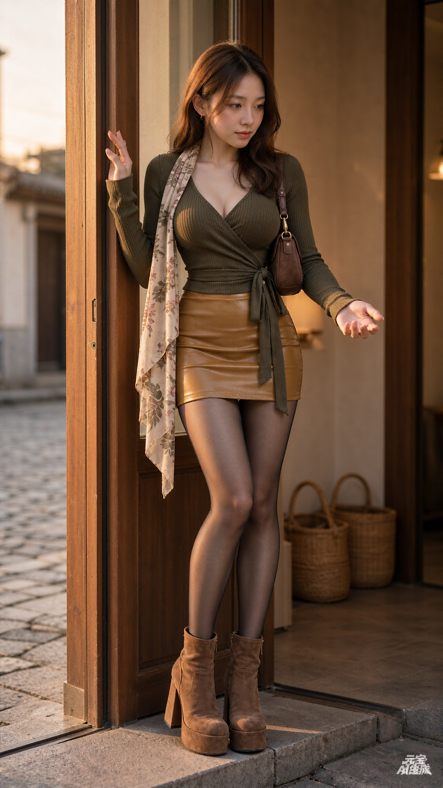

## 终稿提示词

```text
第2张 · 他跨到门槛·视点 1.1 米微仰、隔 1.0 米看她一手扶门框、上身朝他探过来

三张输入图分工：第一张定本轮整套穿搭的版型、配色、面料、丝袜、短靴与随这套衣服落下的栗棕偏分中长发；第二张定她的五官骨相；第三张定本张的站姿骨架与重心；光位、场景、关系视角、构图调子、神态落点与可见动作逐项落满画面。全画只一位清晰成年女性人物，一具完整身体轮廓，左右各一只手臂、各五根手指，两只手各自从肩经肘腕到指尖连成一条链、各只做一个动作；两只脚各自连续，胸大腰细腿长靠合身剪裁写实呈现。

9:16 竖版满画幅，画面从顶到底由人物、门框、门槛石与门外第一级青石阶填满，四条边即裁切边，人物与道具完整落在画内。橄榄绿罗纹针织深 V 交叉裹身长袖上衣，腰侧系带收出一道柔软的蝴蝶结；焦糖棕光面皮革迷你包臀裙，裙摆停在大腿中段；米杏底色花卉印花薄丝巾绕颈垂到腰侧；棕褐色细肩带斜挎小包贴在右髋。一层烟灰薄透连裤丝袜从腿根连包到脚趾，脚趾由同色袜面完整包住、五趾在袜面里各自分明，袜面从小腿到脚背连成平顺同一片，丝袜脚背连进靴口；一双棕麂皮厚底及踝短靴穿在丝袜外面，粗跟与防水台在门槛石上落得稳稳的。奶白短圆甲，细哑金小耳圈各一只。栗棕偏分中长发，松而大的微卷一路披到肩胛以下，发尾一缕一缕分得清，左侧一缕别到耳后露出耳廓，右侧两缕细软碎发垂在颊边；四张同一顶。

她的右手从右肩经肘腕到指尖连成一条链，唯一落点是门框外侧那道木棱，五指分开扶稳、腕子压出一点好看的凹；左手从肩经肘腕到指尖连成一条链，唯一落点是朝他摊开的掌心，五指微张、掌心朝上，掌心停在与那截棕鞋尖相贴的高度、稳稳托住夕光。手扶门框、胯微侧顶的站姿，脊线从后颈经腰窝到前脚脚踝拉成一道柔缓的 S，肩往他这侧送过来半寸，髋留在后，重心稳在两脚之间。她先看自己摊开的掌心一拍，下颌再压半分，眼尾抬起一线把目光斜斜送向画外掌心下方，眉梢维持半提。

场景是黄昏的门槛：木门敞着，门外青石巷被夕照染成蜜色，门槛石与第一级石阶两道细纹在光里浮出来，门内鞋柜上那只藤编小篮与熄着的纸灯笼都还在原位。画面右下门槛石上落着他跨进来的一截棕鞋尖，鞋尖正对她摊开的掌心底下。

蜜色夕照从门外斜进来，落在她扶框的五根指尖、摊开的掌心、低头发顶那道偏分缝与靴口连到脚踝的烟灰丝光上；门内其余还留一点屋里的暖灰，安静得像一句话说到一半。成图自带工具水印原样留在右下角。
```

## 一句点评

他跨到门槛隔1.0米看她扶框摊掌探身
