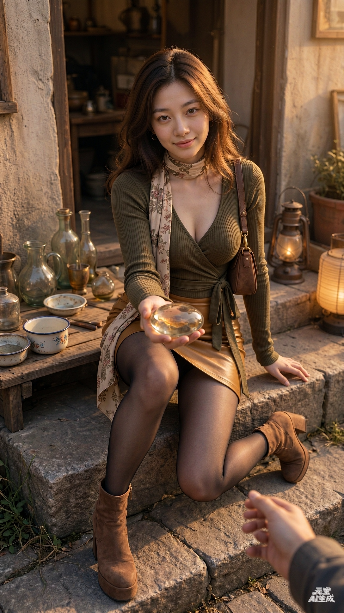

## 终稿提示词

```text
第3张 · 他俯身·视点 0.45 米平视微仰、隔 0.55 米看她单膝跪在巷口石阶上、掌心托一只旧玻璃镇纸递到他近前

三张输入图分工：第一张定本轮整套穿搭的版型、配色、面料、丝袜、短靴与随这套衣服落下的栗棕偏分中长发；第二张定她的五官骨相；第三张定本张的单膝跪姿骨架与重心；光位、场景、关系视角、构图调子、神态落点与可见动作逐项落满画面。全画只一位清晰成年女性人物，一具完整身体轮廓，左右各一只手臂、各五根手指，两只手各自从肩经肘腕到指尖连成一条链、各只做一个动作；两只脚各自连续，胸大腰细腿长靠合身剪裁写实呈现。

9:16 竖版满画幅，画面从顶到底由人物、巷口青石阶、旧物摊矮木板与一条蜜色夕照填满，四条边即裁切边，人物与道具完整落在画内。橄榄绿罗纹针织深 V 交叉裹身长袖上衣，腰侧系带收出一道柔软的蝴蝶结；焦糖棕光面皮革迷你包臀裙，裙摆停在大腿中段；米杏底色花卉印花薄丝巾绕颈垂到腰侧；棕褐色细肩带斜挎小包贴在右髋。一层烟灰薄透连裤丝袜从腿根连包到脚趾，脚趾由同色袜面完整包住、五趾在袜面里各自分明，袜面从小腿到脚背连成平顺同一片，丝袜脚背连进靴口；一双棕麂皮厚底及踝短靴穿在丝袜外面，粗跟与防水台在青石阶上落得稳稳的。奶白短圆甲，细哑金小耳圈各一只。栗棕偏分中长发，松而大的微卷一路披到肩胛以下，俯身时几缕从肩头滑下来扫过锁骨；四张同一顶。

她的右手从右肩经肘腕到指尖连成一条链，唯一落点是掌心朝上托着的一只旧玻璃镇纸，五指稳稳兜住底沿、拇指贴着玻璃弧面，玻璃里封着半片蜜色黄昏，整只递到离他半寸的地方；左手从肩经肘腕到指尖连成一条链，唯一落点是身侧那级青石阶，五指分开把俯下去的身子撑稳，腕子压出一点好看的凹。单膝跪在石阶上，另一条腿屈起踩稳下一级，脊线从后颈经腰窝到跪着的膝头拉成一道柔缓的弧，肩往前送、髋留在后，重心落在撑阶的手与跪着的膝之间。她低头先看玻璃里那半片黄昏一拍，才抬眼把目光递过来，眼尾压下来正对这一眼，下唇含住一点又松开，嘴角挑起极轻的一线。

场景是巷口的黄昏旧物摊：三级青石阶被夕照染成蜜色，矮木板上并排搁着两三只旧玻璃器、一只搪瓷小碟与一盏熄着的纸灯笼，木板边缘一道木纹在光里浮出来；石缝里几茎细草被风带得微微一斜。画面右下角石阶边入画一截他的手腕与袖口，素手皮肤本色，接住她撑阶那只手的视线。

蜜色夕照收成一小片，落在她的眼尾、下唇角、托玻璃的五根指尖、玻璃里那半片黄昏与靴口连到脚踝的烟灰丝光上；别处化成柔软的蜜灰，安静得像整条巷子都放轻了脚步。成图自带工具水印原样留在右下角。
```

## 一句点评

他俯身隔0.55米看她单膝跪石阶托旧玻璃镇纸递到近前
