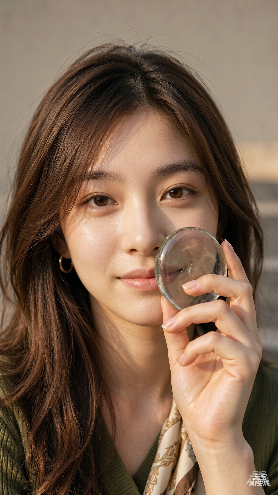

## 终稿提示词

```text
第4张 · 他凑近·眼高约 0.9 米、隔 0.3 米看她只留眼尾到嘴角那半张脸、指尖把凉玻璃贴在他掌心

两张输入图分工：第一张定她的五官骨相，第二张定本轮随这套衣服落下的发型；本张是极近特写，文字落在他这一眼正对着的眼尾到嘴角那半张脸，夕照与指尖的细亮都贴着这半张脸走。全画只一位清晰成年女性人物，一具身体轮廓，脸年轻柔和、神态松弛；画顶裁到眉骨以上，画底收到下颌线以下，眼尾到嘴角那一线全给了他，眉眼以下那道柔和的下颌线只露一线。全画唯一一只手是她的右手，从右肩经肘腕到指尖连成一条链、五根手指各各分明、只做一个动作。

她的右手从画面右下角伸进来，唯一落点是他摊开的掌心，食指与拇指捏着那只旧玻璃镇纸的底沿，把凉凉的玻璃轻轻贴上去就停住，指尖就搁在那儿；其余三指自然收拢，腕子松松的，奶白短圆甲在夕照里反出一点细亮。她的眼尾压下来，从垂下来的几缕栗棕碎发缝里正对这一眼，睫毛一眨一眨扫过那道浅影；下唇含住一点又慢慢松开，下唇松开那一瞬眼尾先弯一下，视线正压住他掌心那点凉，带一点「接稳了哦」的小得意，又留一点等他先说话的软。

发型仍是栗棕偏分中长发，松而大的微卷一路披到肩胛以下，这一张里只在耳侧留几缕细碎软发垂到肩头，发梢被夕照勾出一线绒光；细哑金小耳圈在耳垂那一点反一粒极小的亮。橄榄绿罗纹针织深 V 领口边缘在画底露出一小截，罗纹织纹与米杏印花丝巾的一角在同一道蜜光里各亮各的。

场景是巷口石阶的黄昏：背景是一整片柔软蜜灰，石阶棱角融进蜜灰里成一层暖雾，夕照收成清清亮亮的一小片，落在眼尾、下唇角、耳圈、玻璃里那半片黄昏与那根搁着的指尖上。画面下缘正中留他摊开掌心的一小片素色掌面托在玻璃底下。成图自带工具水印原样留在右下角。
```

## 一句点评

他凑近隔0.3米看她半张脸把凉玻璃贴在他掌心
