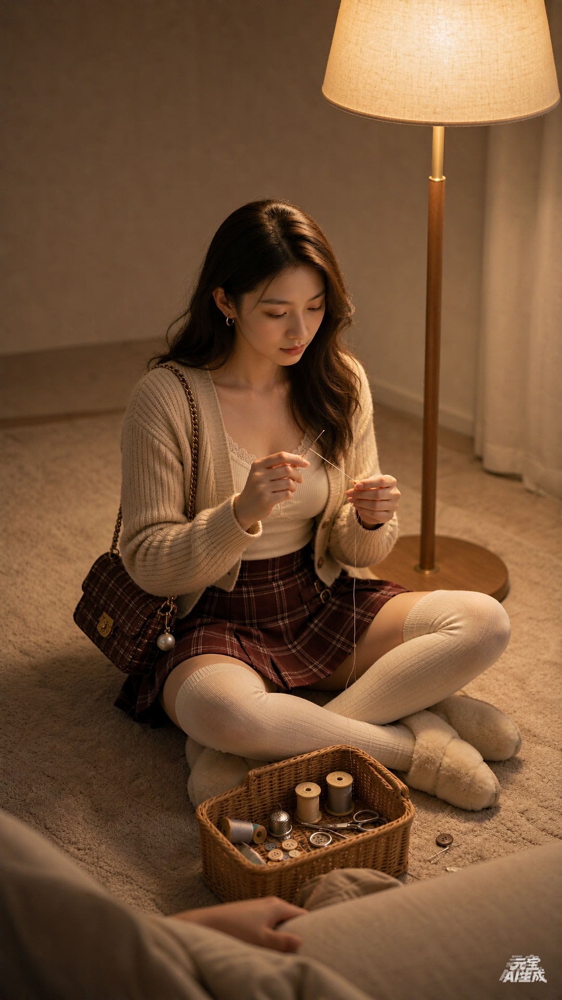

## 终稿提示词

```text
第1张 · 他半躺在沙发扶手上·视点 0.95 米、隔 1.3 米看她已经盘腿坐在落地灯下的短绒地毯上、低头把线穿进针眼

三张输入图分工：第一张定本轮整套穿搭的版型配色面料、丝袜、绒拖与随这套衣服落下的深棕偏分中长发；第二张定她的五官骨相；第三张定本张的盘腿坐姿骨架与重心；光位、场景、关系视角、构图调子、神态落点与可见动作逐项落满画面。全画只一位清晰成年女性人物，一具完整身体轮廓，左右各一只手臂、各五根手指，两只手各自从肩经肘腕到指尖连成一条链、各只做一个动作；两只脚各自连续，胸大腰细腿长靠合身剪裁写实呈现。

9:16 竖版满画幅，画面从顶到底由人物、落地灯、短绒地毯、针线笸箩与一条暖黄灯光填满，四条边即裁切边，人物与道具完整落在画内。燕麦米白粗罗纹针织开衫，V 领，前排五颗小圆扣，长袖，袖口一圈罗纹；内搭象牙白细蕾丝边吊带背心，心形领口压着一道细抽褶；酒红格纹百褶迷你裙，裙摆停在大腿中段，前侧两枚哑金扣襻；斜挎一只格纹小包，金链条搭在左肩，包角坠一粒小珍珠。一层浅杏薄透连裤丝袜从腿根连包到脚趾，脚趾由同色袜面完整包住、五趾在袜面里各自分明，袜面从小腿到脚背连成平顺同一片，丝袜脚背连进拖口；两只奶白软底包趾绒拖穿在丝袜外面，短绒贴着脚背。奶白短圆甲，细哑金小耳圈各一只。深棕偏分中长发，松而大的微卷一路披到肩胛以下，额前几缕细软碎发，发尾一缕一缕分得清，左侧一缕别到耳后露出耳廓；四张同一顶。

她的右手从右肩经肘腕到指尖连成一条链，唯一落点是捏着一根细针的针尾，拇指与食指把针举到落地灯前；左手从肩经肘腕到指尖连成一条链，唯一落点是拈起的一段浅杏色棉线，五指把线头搓得细细的、凑向针眼。盘腿坐在地毯上，脊线从后颈经腰窝到交叠的脚踝拉成一道柔缓的弧，肩往前送一点，重心稳在坐骨与两只绒拖之间。她先垂眼看着针眼一拍，才把眼尾抬起来递向这一眼，下唇含住一点又松开，嘴角只挑起一线。

场景是秋夜的客厅一角：纸罩落地灯立在画面右上，暖黄从灯罩纸纹里铺下来，在短绒地毯上落成一小片圆光；她膝边摊着一只藤编针线笸箩，里头并排搁着几只木线轴、一枚顶针、一把小剪刀与两三颗备用纽扣，笸箩沿一道藤纹在光里浮出来；画面下缘落着他搁在沙发边的一截手腕与袖口，素手皮肤本色，就在她交叠的脚踝那一侧。远景里这一眼看清的是她举针的五根指尖、发顶那道偏分缝、格纹裙褶与绒拖口连到脚踝的浅杏丝光，落地灯之外的整间屋子化成柔软的暖灰。

暖黄灯光落在她的眼尾、下唇角、举针的指尖、针身那一线细亮与格纹裙的酒红折光上，笸箩里几颗纽扣各自反一粒小亮。成图自带工具水印原样留在右下角。
```

## 一句点评

他半躺沙发扶手隔1.3米看她盘腿在灯下把线穿进针眼
