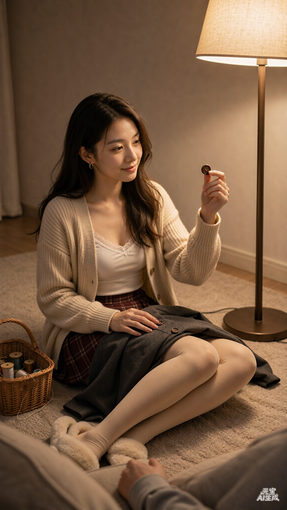

## 终稿提示词

```text
第2张 · 他撑起身子·视点 1.1 米、隔 1.0 米看她把他的外套摊在膝头、指尖捏着那颗松掉的扣子朝他晃

三张输入图分工：第一张定本轮整套穿搭的版型配色面料、丝袜、绒拖与随这套衣服落下的深棕偏分中长发；第二张定她的五官骨相；第三张定本张的侧坐姿态骨架与重心；光位、场景、关系视角、构图调子、神态落点与可见动作逐项落满画面。全画只一位清晰成年女性人物，一具完整身体轮廓，左右各一只手臂、各五根手指，两只手各自从肩经肘腕到指尖连成一条链、各只做一个动作；两只脚各自连续，胸大腰细腿长靠合身剪裁写实呈现。

9:16 竖版满画幅，画面从顶到底由人物、摊开的外套、短绒地毯与纸罩落地灯填满，四条边即裁切边，人物与道具完整落在画内。燕麦米白粗罗纹针织开衫，V 领，前排五颗小圆扣，长袖，袖口一圈罗纹；内搭象牙白细蕾丝边吊带背心，心形领口压着一道细抽褶；酒红格纹百褶迷你裙，裙摆停在大腿中段，前侧两枚哑金扣襻；斜挎一只格纹小包，金链条搭在左肩，包角坠一粒小珍珠。一层浅杏薄透连裤丝袜从腿根连包到脚趾，脚趾由同色袜面完整包住、五趾在袜面里各自分明，袜面从小腿到脚背连成平顺同一片，丝袜脚背连进拖口；两只奶白软底包趾绒拖穿在丝袜外面，短绒贴着脚背。奶白短圆甲，细哑金小耳圈各一只。深棕偏分中长发，松而大的微卷一路披到肩胛以下，额前几缕细软碎发，左侧一缕别到耳后露出耳廓；四张同一顶。

她的右手从右肩经肘腕到指尖连成一条链，唯一落点是拇指与食指捏着的一颗深棕木纹纽扣，五指把扣子举到落地灯下朝这一眼轻轻晃了半下，扣面四孔里各反一点暖黄；左手从肩经肘腕到指尖连成一条链，唯一落点是摊在膝头的那件深灰外套前襟，五指分开把第二颗扣位那一小片布按平，腕子压出一点好看的凹。侧坐在地毯上，双腿斜向右侧叠放，一只绒拖半挂在脚尖一晃一停，脊线从后颈经腰窝到点地的脚踝拉成一道柔缓的 S，肩往他这侧送过来半寸，髋留在后，重心稳在坐骨与撑地的手之间。她先看自己捏着的那颗扣子一拍，晃扣的手顶进画面下三分之一，扣面四孔里的暖黄正对他眼；才抬眼把目光递过来，下颌压低，眼尾压下来从上方看住他，眉梢只提起一半就停住。

场景是秋夜的客厅一角：纸罩落地灯立在画面右上，暖黄铺成一小片圆光，短绒地毯的织纹在光里浮出一层细绒；深灰外套摊在她膝头，前襟第二颗扣位留着一小圈浅色缝线圆痕，线脚细密清楚；膝边那只藤编针线笸箩里几只木线轴、一枚顶针与一把小剪刀都还在原位。画面下缘落着他搁在沙发边的一截手腕与袖口，素手皮肤本色，就在她半挂的绒拖那一侧。

暖黄灯光落在她捏扣的五根指尖、扣面四孔、按平外套的那只手背、发顶那道偏分缝与绒拖口连到脚踝的浅杏丝光上；灯圈之外化成柔软的暖灰，安静得像一句话说到一半。成图自带工具水印原样留在右下角。
```

## 一句点评

他撑起身子隔1.0米看她膝头摊外套捏扣朝他晃
