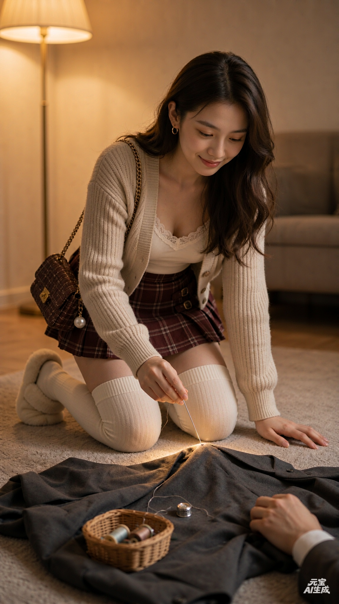

## 终稿提示词

```text
第3张 · 他俯身·视点 0.55 米、隔 0.55 米看她单膝跪起把针尖抵在扣眼上、另一只手撑在他膝侧

三张输入图分工：第一张定本轮整套穿搭的版型配色面料、丝袜、绒拖与随这套衣服落下的深棕偏分中长发；第二张定她的五官骨相；第三张定本张的单膝跪姿骨架与重心；光位、场景、关系视角、构图调子、神态落点与可见动作逐项落满画面。全画只一位清晰成年女性人物，一具完整身体轮廓，左右各一只手臂、各五根手指，两只手各自从肩经肘腕到指尖连成一条链、各只做一个动作；两只脚各自连续，胸大腰细腿长靠合身剪裁写实呈现。

9:16 竖版满画幅，画面从顶到底由人物、他膝头摊开的深灰外套、短绒地毯与一小片暖黄灯光填满，四条边即裁切边，人物与道具完整落在画内。燕麦米白粗罗纹针织开衫，V 领，前排五颗小圆扣，长袖，袖口一圈罗纹；内搭象牙白细蕾丝边吊带背心，心形领口压着一道细抽褶；酒红格纹百褶迷你裙，裙摆停在大腿中段，前侧两枚哑金扣襻；斜挎一只格纹小包，金链条搭在左肩，包角坠一粒小珍珠。一层浅杏薄透连裤丝袜从腿根连包到脚趾，脚趾由同色袜面完整包住、五趾在袜面里各自分明，袜面从小腿到脚背连成平顺同一片，丝袜脚背连进拖口；两只奶白软底包趾绒拖穿在丝袜外面，短绒贴着脚背。奶白短圆甲，细哑金小耳圈各一只。深棕偏分中长发，松而大的微卷一路披到肩胛以下，俯身时几缕从肩头滑下来扫过锁骨，额前细软碎发垂在光里；四张同一顶。

她的右手从右肩经肘腕到指尖连成一条链，唯一落点是捏着细针把针尖正正抵在深灰外套第二颗扣位那一圈浅色缝线圆痕的中央，针尖与布面相触处反一点极细的亮，线痕绕着针尖走成一小圈，拇指与食指稳稳夹住针身，一段浅杏棉线从针眼垂下来在光里拉成一道细弧；左手从肩经肘腕到指尖连成一条链，唯一落点是撑在他膝侧那一小片短绒地毯上，五指分开把俯下去的身子稳住，腕子压出一点好看的凹。左膝落地跪稳，右腿屈起、脚掌平踩短绒地毯踩稳，脊线从后颈经腰窝到跪着的膝头拉成一道柔缓的弧，肩往前送、髋留在后，重心落在撑地的手与跪着的膝之间。她低头先看针尖那一拍，才抬眼把目光递过来，眼尾压下来正对这一眼，下唇含住一点又松开，嘴角挑起极轻的一线。

场景是秋夜的客厅一角：深灰外套摊在他膝头并铺到她跪着的膝前一片，第二颗扣位那一圈浅色线痕正落在她针尖底下、两下相触；纸罩落地灯的暖黄收成一小片，落在她俯下去的肩、撑地的手背、针身与那道棉线细弧上；膝边藤编针线笸箩里几只木线轴与一枚顶针在灯圈边缘各自反一粒小亮。画面右下角落着他搁在膝侧的一截手腕与袖口，素手皮肤本色，接住她撑地那只手的视线。

暖黄灯光收在她眼尾、下唇角、抵针的五根指尖、针尖那一点细亮与绒拖口连到脚踝的浅杏丝光上；画面四周收拢成一层柔软暖灰，把中央那片光托出来，安静得像整间屋子都放轻了呼吸。成图自带工具水印原样留在右下角。
```

## 一句点评

他俯身隔0.55米看她单膝跪起把针尖抵在扣位
