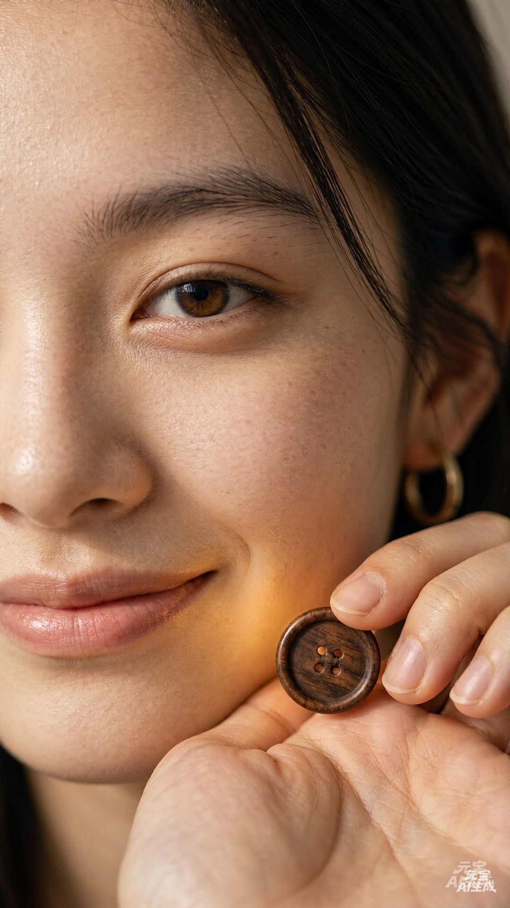

## 终稿提示词

```text
第4张 · 他凑近·视点 0.3 米、隔 0.3 米看她只留眼尾到嘴角那半张脸、指尖把缝好的扣子贴在他掌心

两张输入图分工：第一张定她的五官骨相，第二张定本轮整套穿搭的版型配色面料与随这套衣服落下的深棕偏分中长发；本张是极近特写，文字落在他这一眼正对着的眼尾到嘴角那半张脸，暖黄与指尖的细亮都贴着这半张脸走。全画只一位清晰成年女性人物，一具身体轮廓，脸年轻柔和、神态松弛；画面是一张极紧的半脸特写，发顶、肩线、脖颈与领口全在画框之外，画顶紧贴眉骨上沿裁断，画底紧贴下颌线下沿裁断，整幅从眉骨到下颌线这一条横带装满她的眼尾、睫毛、鼻梁侧影与嘴角，眼尾到嘴角那一线全给了他。画面里落着她的右手一只，从右肩经肘、腕到指尖连成一条链，五指各各分明，捏扣贴进他掌心这一个落点。

她的右手从画面右下角伸进来，唯一落点是画面下缘正中他摊开掌心的一小片素色掌面，拇指与食指捏着那颗刚缝回去又拆下来给他看的深棕木纹纽扣，扣面平贴在那片掌面上、扣底与掌纹相触反一点暖黄，指尖就搁在那儿；其余三指自然收拢，腕子松松的，奶白短圆甲在暖黄里反出一点细亮。她的眼尾压下来，从垂下来的几缕深棕碎发缝里正对这一眼，睫毛一眨一眨扫过那道浅影；下唇含住一点又慢慢松开，下唇松开那一瞬眼尾先弯一下，视线正压住他掌心那颗扣子，带一点「收好了哦」的小得意，又留一点等他先说话的软。

发型仍是深棕偏分中长发，松而大的微卷一路披到肩胛以下，这一张里只在耳侧与画框两侧留几缕细软碎发，发梢被暖黄勾出一线绒光；细哑金小耳圈在耳垂那一点反一粒极小的亮，耳圈下方一小片柔和下颌线贴着画底收住。

场景是秋夜灯下的近前：背景是一整片柔软暖灰，纸罩落地灯的光收成清清亮亮的一小片，落在眼尾、下唇角、耳圈、扣面四孔与那根搁着的指尖上。画面下缘正中留他摊开掌心的一小片素色掌面托在纽扣底下。成图自带工具水印原样留在右下角。
```

## 一句点评

他凑近隔0.3米看她半张脸把扣子贴进他掌心
