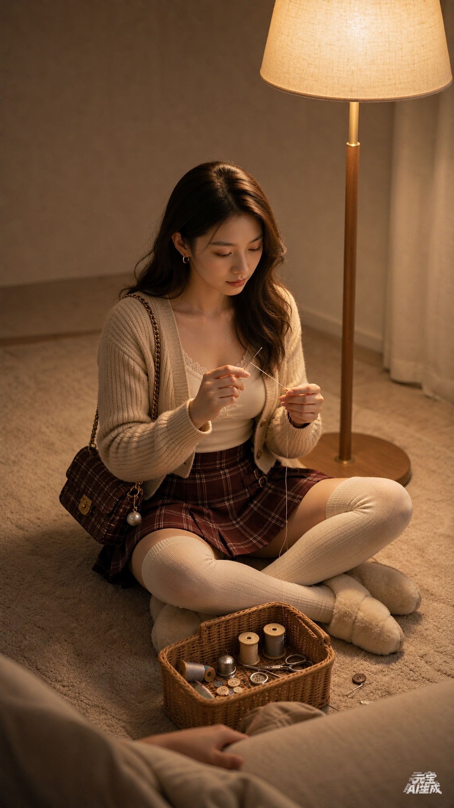
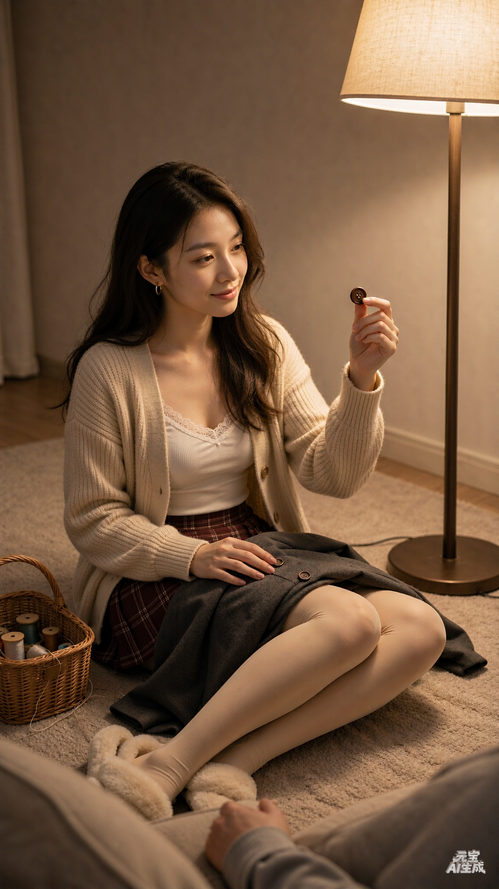
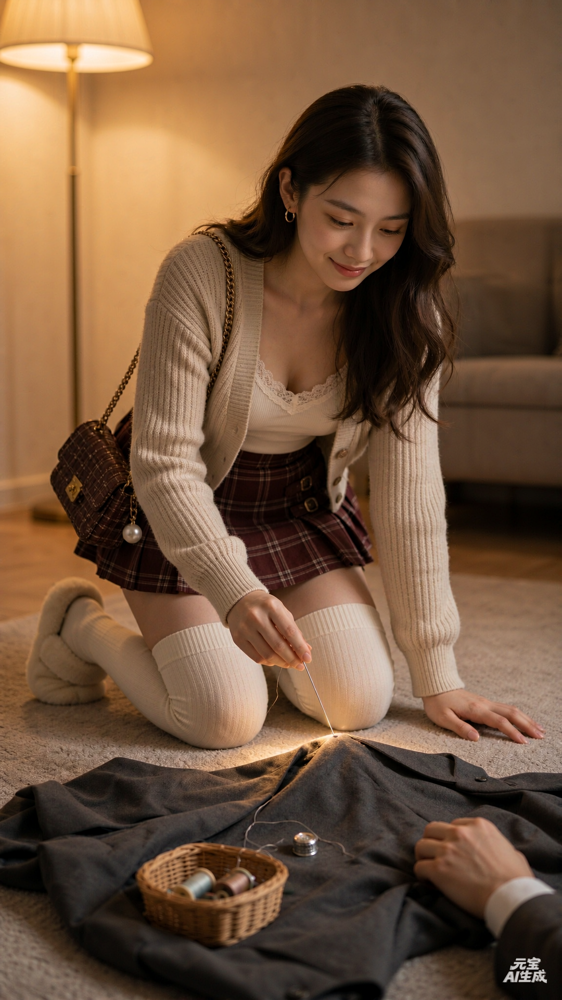

# R031 · 继续自主推进 秋夜灯下替他缝外套上松掉的扣子

- 轮次目录：`20261127ac_night-sewing-button`
- 日期：2026-11-27
- 来源：`yuanbao`
- 穿搭：`AUT-0013`
- 发型：未标注
- 场景标签：沙发
- 四张线稿：`full_single_P041`、full_single_P045`、full_single_P033`、full_single_P046`
- 画幅：1080×1920（9:16），纯画面

## 四张

| 序 | 机位 | 图 | 终稿提示词 |
|---|---|---|---|
| 01 | front |  | [01_front.md](01_front.md) |
| 02 | side |  | [02_side.md](02_side.md) |
| 03 | seat |  | [03_seat.md](03_seat.md) |
| 04 | close |  | [04_close.md](04_close.md) |

## 这一段说了什么

1. 别动呀，线头还咬在我嘴里呢。你外套第二颗扣子松了三天都不肯说，我可早看见了，装什么没事。
2. 喏，就是这颗。我捏着呢，灯底下四孔都亮了，你坐好别晃，针尖认生，扎着我你可得负责哄。
3. 我跪近点比一比位置，缝歪了算你的，谁让你刚才偷看我穿线，眼都不带眨一下，我记着呢。
4. 看够了没，扣子还搁我指尖呢。明早陪我把衣柜顶那只空饼干盒够下来装线团，敢说不用我就自己搬凳子。

## 现场记录

- 01_front：他半躺沙发扶手隔1.3米看她盘腿在灯下把线穿进针眼
- 02_side：他撑起身子隔1.0米看她膝头摊外套捏扣朝他晃
- 03_seat：他俯身隔0.55米看她单膝跪起把针尖抵在扣位
- 04_close：他凑近隔0.3米看她半张脸把扣子贴进他掌心

> 原图 PNG 永不转码、永不覆盖；预览用 `` 缩放原图。
