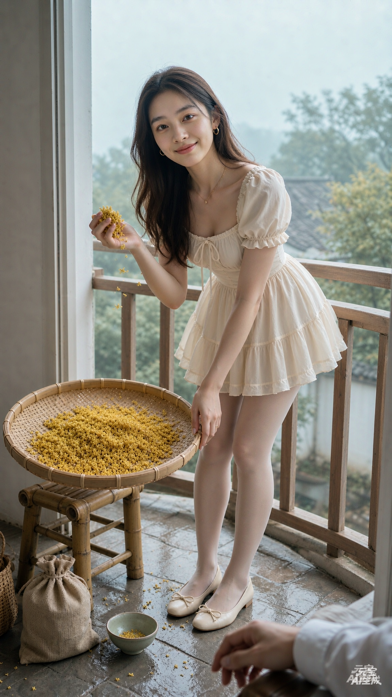

## 终稿提示词

```text
第1张 · 他站在阳台门口·视点 1.15 米、隔 1.3 米看她已站在竹筛边俯身回身、指尖拈起一小把桂花朝他递

三张输入图分工：第一张定本轮整套穿搭的版型配色面料、丝袜、平底鞋与随这套衣服落下的深棕偏分长发；第二张定她的五官骨相；第三张定本张的站姿俯身骨架与重心；光位、场景、关系视角、构图调子、神态落点与可见动作逐项落满画面。全画一位清晰成年女性人物，一具完整身体轮廓，左右各一只手臂、各五根手指，两只手各自从肩经肘腕到指尖连成一条链、各只做一个动作；两只脚各自连续，胸大腰细腿长靠合身剪裁写实呈现。

9:16 竖版满画幅，画面从顶到底由人物、竹筛、矮竹凳、浅木栏杆与一片淡青白晨光填满，四条边即裁切边，人物与道具完整落在画内。奶油白方领泡泡短袖收腰迷你连衣裙，方领口，胸前抽褶系带结成一枚小蝴蝶结，短泡泡袖，束腰压褶，双层荷叶边蓬裙摆停在大腿中段；一层米杏薄透连裤丝袜从腿根连包到脚趾，脚趾由同色袜面完整包住、五趾在袜面里各自分明，袜面从小腿到脚背连成平顺同一片，丝袜脚背连进鞋口；两只米白浅口平底鞋穿在丝袜外面，鞋头各一枚同色小蝴蝶结。半月形奶白小手提包挎在左腕，细金项链坠一粒小金珠，奶白短圆甲，细哑金小耳圈各一只。深棕偏分长发，额前一层薄刘海，松而大的长微卷一路披到肩下，发尾一缕一缕分得清，耳侧几缕细软碎发；四张同一顶。

她的右手从右肩经肘腕到指尖连成一条链，唯一落点是拇指与食指拈起的一小把金黄桂花，五指把花举到晨光里朝这一眼轻轻一扬，几粒细花从指缝落回筛面；左手从肩经肘腕到指尖连成一条链，唯一落点是扶着竹筛边沿，五指分开把筛面稳住，腕子压出一点好看的凹。站在铺着青石地砖的小阳台上，上身朝他这侧俯身回过来一点，脊线从后颈经腰窝到两只平底鞋拉成一道柔缓的弧，重心稳在前脚掌与扶筛的手之间。她先看自己指尖那一小把桂花一拍，才抬眼把目光递过来，眼尾抬起来，下唇含住一点又松开，嘴角挑起一线。

场景是秋晨的小阳台：青石地砖被露水润出一层深色，画面左下摊着一只圆竹筛，筛里薄薄一层刚落了一夜的金黄桂花，筛沿一道竹篾纹在晨光里浮出来；旁边一只矮竹凳、一只素麻小袋、一只青瓷小碟各安其位；浅木栏杆外是淡青白的晨光，窗台一盆绿叶垂下一两片；画面下缘落着他搁在门框边的一截手腕与袖口，素手皮肤本色。远景里这一眼看清的是她拈花的五根指尖、发顶那道偏分缝、蓬裙摆的双层荷叶边与平底鞋口连到脚踝的米杏丝光；栏杆之外的院子铺满柔软淡青白晨光，瓦檐与树影在光里轮廓柔和。

淡青白晨光落在她的眼尾、下唇角、拈花的指尖、那把桂花细碎的金黄、蓬裙的奶油白折光与青瓷小碟的釉面上，筛里几粒桂花各自反一点小亮。成图自带工具水印原样留在右下角。
```

## 一句点评

他站在阳台门口隔1.3米看她拈起一小把桂花朝他递
