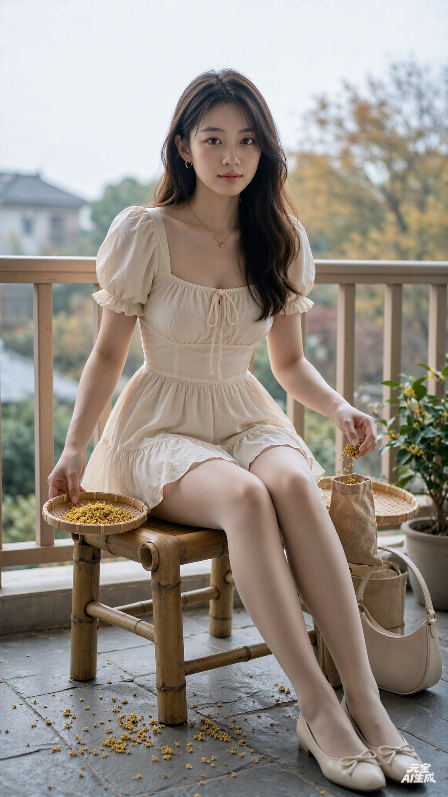

## 终稿提示词

```text
第2张 · 他走近·视点 1.05 米、隔 1.0 米看她坐在矮竹凳上把桂花拨进素麻小袋、抬眼朝他晃了晃袋口

三张输入图分工：第一张定本轮整套穿搭的版型配色面料、丝袜、平底鞋与随这套衣服落下的深棕偏分长发；第二张定她的五官骨相；第三张定本张的坐姿前撑骨架与重心；光位、场景、关系视角、构图调子、神态落点与可见动作逐项落满画面。全画一位清晰成年女性人物，一具完整身体轮廓，左右各一只手臂、各五根手指，两只手各自从肩经肘腕到指尖连成一条链、各只做一个动作；两只脚各自连续，胸大腰细腿长靠合身剪裁写实呈现。

9:16 竖版满画幅，画面从顶到底由人物、矮竹凳、圆竹筛、素麻小袋与一片淡青白晨光填满，四条边即裁切边，人物与道具完整落在画内。奶油白方领泡泡短袖收腰迷你连衣裙，方领口，胸前抽褶系带结成一枚小蝴蝶结，短泡泡袖，束腰压褶，双层荷叶边蓬裙摆停在大腿中段；一层米杏薄透连裤丝袜从腿根连包到脚趾，脚趾由同色袜面完整包住、五趾在袜面里各自分明，袜面从小腿到脚背连成平顺同一片，丝袜脚背连进鞋口；两只米白浅口平底鞋穿在丝袜外面，鞋头各一枚同色小蝴蝶结。半月形奶白小手提包搁在矮凳脚边，细金项链坠一粒小金珠，奶白短圆甲，细哑金小耳圈各一只。深棕偏分长发，额前一层薄刘海，松而大的长微卷一路披到肩下，低头时几缕从肩头滑下来扫过锁骨；四张同一顶。

她的右手从右肩经肘腕到指尖连成一条链，唯一落点是三根指尖并拢拈起竹筛里一小撮金黄桂花，那一撮花正悬在素麻小袋圆口上方一厘米、几粒细花已经落进袋里，指腹沾着两点细花，这条从筛面到袋口的倾倒线在晨光里连成一道细弧；左手从肩经肘腕到指尖连成一条链，唯一落点是捏着素麻小袋的袋口边沿、左腕向外旋开，五指把袋口张成一个正对这一眼的小小圆，圆口里看得见袋底薄薄一层金黄，袋身垂在膝侧。坐在矮竹凳上，双腿斜向右侧叠放，脊线从后颈经腰窝到点地的脚踝拉成一道柔缓的 S，肩往前送、髋留在后，重心稳在坐骨与两只平底鞋之间。她先低头看袋口那一小圆一拍，才抬眼把目光递过来，下颌收一点，眼尾压下来，眉梢只提起一半就停住。

场景是秋晨的小阳台：青石地砖被露水润出一层深色，圆竹筛摊在她膝前，筛里薄薄一层金黄桂花，筛沿一道竹篾纹在晨光里浮出来；素麻小袋的织纹在光里一格一格分明，袋口垂下一小截本白棉绳；浅木栏杆外是淡青白的晨光，窗台一盆绿叶垂下一两片。画面下缘落着他走近时搁在矮凳边的一截手腕与袖口，素手皮肤本色，就在她半侧的两只平底鞋那一侧。

淡青白晨光落在她拨花的三根指尖、袋口那一小圆、撑袋的手背、发顶那道偏分缝与平底鞋口连到脚踝的米杏丝光上；栏杆之外的院子铺满柔软淡青白晨光，树影屋檐在光里轮廓柔和，袋口那一小圆正对这一眼，安静得像一句话说到一半。成图自带工具水印原样留在右下角。
```

## 一句点评

他走近隔1.0米看她坐矮竹凳把桂花拨进素麻小袋
