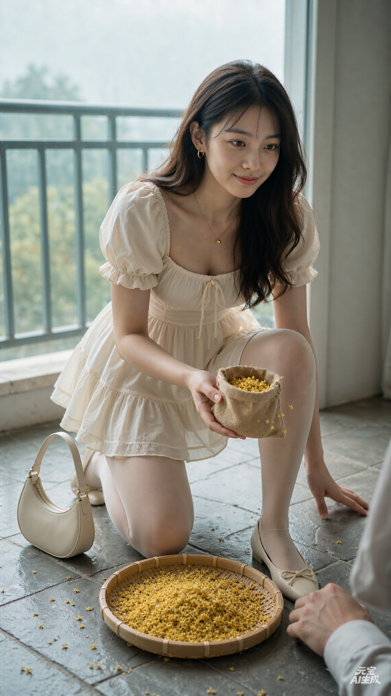

## 终稿提示词

```text
第3张 · 他俯身·视点 0.35 米、隔 0.4 米看她单膝跪起把素麻小袋凑到他鼻尖前、另一只手撑在他膝侧

三张输入图分工：第一张定本轮整套穿搭的版型配色面料、丝袜、平底鞋与随这套衣服落下的深棕偏分长发；第二张定她的五官骨相；第三张定本张的单膝跪姿骨架与重心；光位、场景、关系视角、构图调子、神态落点与可见动作逐项落满画面。全画一位清晰成年女性人物，一具完整身体轮廓，左右各一只手臂、各五根手指，两只手各自从肩经肘腕到指尖连成一条链、各只做一个动作；两只脚各自连续，胸大腰细腿长靠合身剪裁写实呈现。

9:16 竖版满画幅，画面从顶到底由人物、盛着桂花的素麻小袋、圆竹筛、青石地砖与一小片晨光填满，四条边即裁切边，人物与道具完整落在画内。奶油白方领泡泡短袖收腰迷你连衣裙，方领口，胸前抽褶系带结成一枚小蝴蝶结，短泡泡袖，束腰压褶，双层荷叶边蓬裙摆停在大腿中段；一层米杏薄透连裤丝袜从腿根连包到脚趾，脚趾由同色袜面完整包住、五趾在袜面里各自分明，袜面从小腿到脚背连成平顺同一片，丝袜脚背连进鞋口；两只米白浅口平底鞋穿在丝袜外面，鞋头各一枚同色小蝴蝶结。半月形奶白小手提包搁在竹筛边，细金项链坠一粒小金珠，奶白短圆甲，细哑金小耳圈各一只。深棕偏分长发，额前一层薄刘海，松而大的长微卷一路披到肩下，俯身时几缕从肩头滑下来扫过锁骨；四张同一顶。

她的右手从右肩经肘腕到指尖连成一条链，唯一落点是托着那只盛了半袋金黄桂花的素麻小袋，肩往前送、右肘向外开，把敞开的袋口顶到画面右下那截手腕上方一拳处，几粒桂花几乎蹭到画边，袋口轻轻抵在他鼻尖前，棉绳与桂花粒的细影落在他上唇一线，五指稳稳兜住袋底，袋口一小截本白棉绳垂在光里；左手从肩经肘腕到指尖连成一条链，唯一落点是撑在他膝侧那一小片青石地砖上，五指分开把跪起来的身子稳住，腕子压出一点好看的凹。左膝落地跪稳，右腿屈起、脚掌平踩青石地砖踩稳，脊线从后颈经腰窝到跪着的膝头拉成一道柔缓的弧，肩往前送、髋留在后，重心落在撑地的手与跪着的膝之间。她先看袋口那一拍，才抬眼把目光递过来，眼尾压下来正对这一眼，下唇含住一点又松开，嘴角挑起极轻的一线。

场景是秋晨的小阳台：青石地砖被露水润出一层深色，圆竹筛摊在她跪着的膝前，筛里还剩薄薄一层金黄桂花；素麻小袋的织纹在晨光里一格一格分明，几粒桂花从袋口沿沾在她指腹上；浅木栏杆外是淡青白的晨光，窗台一盆绿叶垂下一两片。画面右下角实有一截他自然素色的手腕与一线衬衫袖口压在青石地砖边沿，腕骨与袖口边缘完整清晰，接住她撑地那只手的视线。

淡青白晨光落在她眼尾、下唇角、托袋的五根指尖、袋口那一小圈金黄、棉绳的细影与平底鞋口连到脚踝的米杏丝光上；画面四周收拢成一层柔软淡青白，把中央那片光托出来，安静得像整座院子都放轻了呼吸。成图自带工具水印原样留在右下角。
```

## 一句点评

他俯身隔0.4米看她单膝跪起把桂花袋凑到鼻尖前
