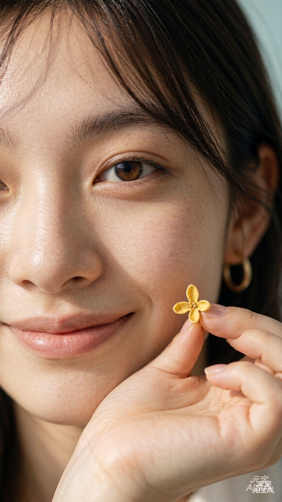

## 终稿提示词

```text
第4张 · 他凑近·视点 0.3 米、隔 0.3 米看她眼尾到嘴角那半张脸装满画面、指尖拈一朵桂花贴在他掌心

两张输入图分工：第一张定她的五官骨相，第二张定本轮整套穿搭的版型配色面料与随这套衣服落下的深棕偏分长发；本张是极近特写，文字落在他这一眼正对着的眼尾到嘴角那半张脸，晨光与指尖的细亮都贴着这半张脸走。全画一位清晰成年女性人物，一具身体轮廓，脸年轻柔和、神态松弛；画面是一张极紧的半脸横带特写，整幅画框就是眉骨上沿到下颌线下沿这一条横带，画顶紧贴眉骨上沿裁断，画底紧贴下颌线下沿裁断，横带里装满她的眼尾、睫毛、鼻梁侧影与嘴角，耳侧两缕深棕碎发压住上下两条裁切边，耳垂那一点细哑金小耳圈在横带边缘反一粒极小的亮，眼尾到嘴角那一线全给了他。画面里落着她的右手一只，从右肩经肘、腕到指尖连成一条链，五指各各分明，拈花贴进他掌心这一个落点。

她的右手从画面右下角伸进来，唯一落点是画面下缘正中他摊开掌心的一小片素色掌面，一朵四瓣的金黄桂花平贴在那片掌纹里、花心一点赭黄正落在掌纹交处，她的拇指与食指刚刚松开那朵花、两指腹还挨着一片花瓣，指尖就搁在那儿；中指、无名指、小指三指并拢轻曲，指腹贴着拈花那手的腕侧，腕子松松的，奶白短圆甲在晨光里反出一点细亮。她的眼尾弯下来，从垂在额前的薄刘海与几缕深棕碎发缝里正对这一眼，睫毛一眨一眨扫过那道浅影；下唇尖抵住一粒晨光亮点，眼尾先弯、视线压着掌心那朵花往下沉半分，嘴角提起一个等他先开口的弧度，带一点「香不香呀」的小得意，又留一点等他先说话的软。

发型仍是深棕偏分长发，额前一层薄刘海，松而大的长微卷一路披到肩下，这一张里只在耳侧与画框两侧留几缕细软碎发，发梢被晨光勾出一线绒光；细哑金小耳圈在耳垂那一点反一粒极小的亮，耳圈下方一小片柔和下颌线贴着画底收住。

场景是秋晨灯下的近前：背景是一整片柔软淡青白，画面左侧一片清亮晨光斜落，照亮眼尾、下唇角、耳圈、四瓣桂花与搁在掌心的那截指尖。画面下缘正中留他摊开掌心的一小片素色掌面托在那朵桂花底下。成图自带工具水印原样留在右下角。
```

## 一句点评

他凑近隔0.3米看她半张脸把一朵桂花贴进他掌心
