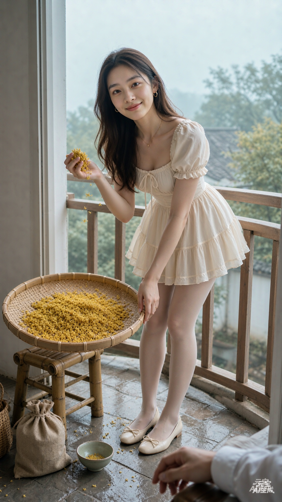
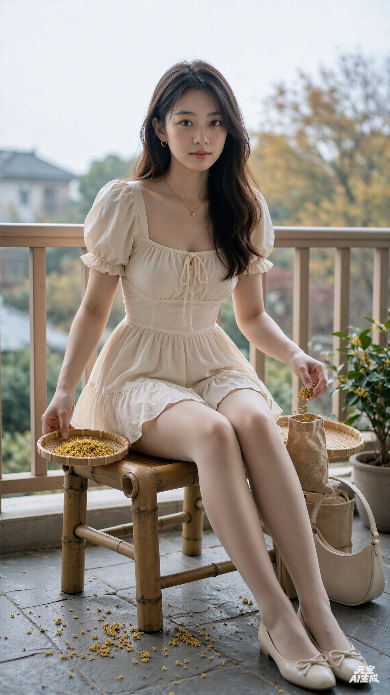
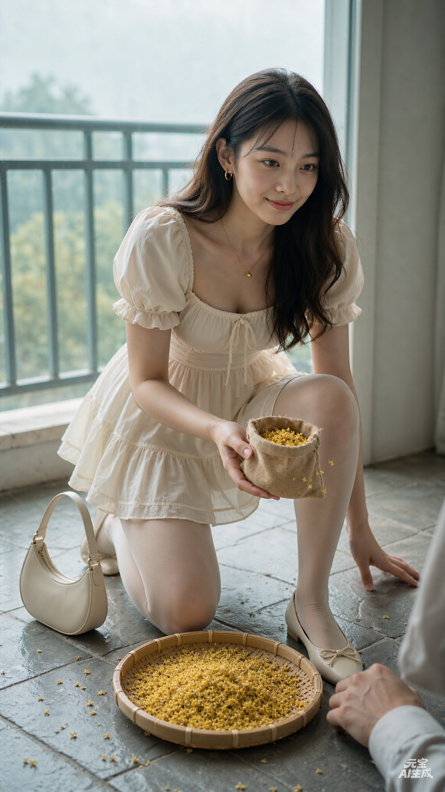
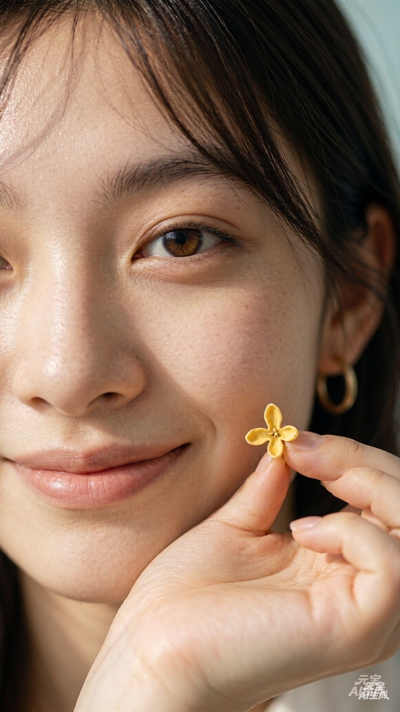

# R032 · 继续推进剧情 秋晨阳台收一夜落下的桂花

- 轮次目录：`20261127ad_osmanthus-morning`
- 日期：2026-11-27
- 来源：`yuanbao`
- 穿搭：`SPR-0151`
- 发型：未标注
- 场景标签：其它
- 四张线稿：`full_single_P021`、full_single_P042`、full_single_P037`、full_single_P048`
- 画幅：1080×1920（9:16），纯画面

## 四张

| 序 | 机位 | 图 | 终稿提示词 |
|---|---|---|---|
| 01 | front |  | [01_front.md](01_front.md) |
| 02 | side |  | [02_side.md](02_side.md) |
| 03 | seat |  | [03_seat.md](03_seat.md) |
| 04 | close |  | [04_close.md](04_close.md) |

## 这一段说了什么

1. 醒啦？我天没亮就蹲阳台了，一夜落了半筛桂花，你倒睡得比花还沉，我都没舍得叫。
2. 喏，最黄这一小把归我。你坐矮凳别动，筛子轻，风一吹全落你衣领里，我替你一朵朵拈回来。
3. 我跪近点给你闻，香不香？敢说一般，我就把整筛子都倒你膝上，看你装不装得住。
4. 看够了没，指尖还拈着一朵呢。晌午陪我去巷口称半斤新米蒸糕，敢说不用我自己拎。

## 现场记录

- 01_front：他站在阳台门口隔1.3米看她拈起一小把桂花朝他递
- 02_side：他走近隔1.0米看她坐矮竹凳把桂花拨进素麻小袋
- 03_seat：他俯身隔0.4米看她单膝跪起把桂花袋凑到鼻尖前
- 04_close：他凑近隔0.3米看她半张脸把一朵桂花贴进他掌心

> 原图 PNG 永不转码、永不覆盖；预览用 `` 缩放原图。
