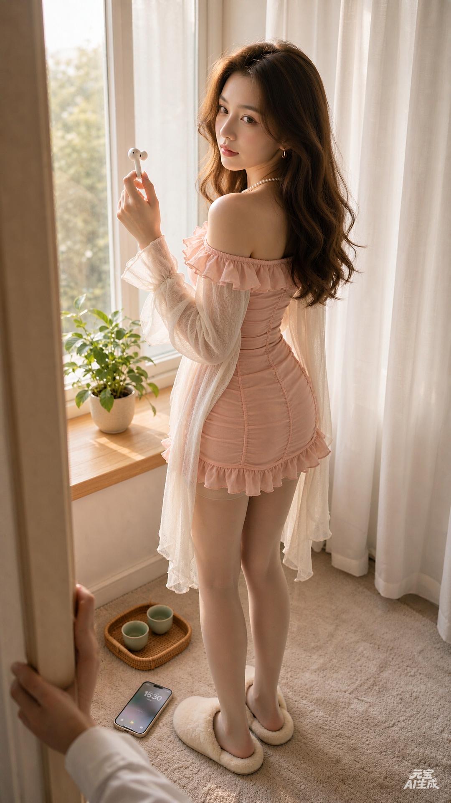

## 终稿提示词

```text
第1张 · 他倚着门框站·视点 1.2 米、隔 1.3 米看她已站在窗边短绒地毯上回过身、一手举着奶白耳机朝他递

三张输入图分工：第一张定本轮整套穿搭的版型配色面料、丝袜、绒拖与随这套衣服落下的栗棕偏分长发；第二张定她的五官骨相；第三张定本张的站姿回身骨架与重心；光位、场景、关系视角、构图调子、神态落点与可见动作逐项落满画面。全画一位清晰成年女性人物，一具完整身体轮廓，左右各一只手臂、各五根手指，两只手各自从肩经肘腕到指尖连成一条链、各只做一个动作；两只脚各自连续，胸大腰细腿长靠合身剪裁写实呈现。

9:16 竖版满画幅，画面从顶到底由人物、亮屏手机、短绒地毯、藤编小托盘与一片白纱滤过的午后暖光填满，四条边即裁切边，人物与道具完整落在画内。藕粉色一字肩荷叶边束身迷你连衣裙，一字领口一圈细荷叶边，胸前抽褶系带结成一枚小蝴蝶结，束身压褶，裙摆一圈木耳边停在大腿中段；外搭象牙白细纱长开衫，纱纹清晰可辨，喇叭长袖，袖口一层荷叶边，前襟两片细纱沿胸前抽褶两侧垂到膝下、叠在连衣裙外；珍珠细项链坠一粒小珍珠，奶油白半月形小手提包挎在左腕。一层米杏薄透连裤丝袜从腿根连包到脚趾，脚趾由同色袜面完整包住、五趾在袜面里各自分明，袜面从小腿到脚背连成平顺同一片，丝袜脚背连进拖口；两只奶白软底包趾绒拖穿在丝袜外面，短绒贴着脚背。奶白短圆甲，细哑金小耳圈各一只。栗棕偏分长发，松而大的长波浪卷一路披过胸，额前与耳侧几缕细软碎发，发尾一缕一缕分得清；四张同一顶。

她的右手从右肩经肘腕到指尖连成一条链，唯一落点是拇指与食指捏着的一只奶白耳机，五指把耳机举到窗光里朝这一眼轻轻一递，耳机线垂成一道细弧；左手从肩经肘腕到指尖连成一条链，唯一落点是扶着搁在短绒地毯上那部手机的边沿，五指指腹实实在在压住机身边框把手机稳住，手机正面亮屏正对这一眼、屏面一块干净的暖白亮光顺着指缝铺到地毯绒面上。她站在窗边短绒地毯上，上身朝他这侧回过来一点，脊线从后颈经腰窝到两只绒拖拉成一道柔缓的弧，重心稳在前脚掌与扶手机的手之间。她先看自己指尖那只耳机一拍，才抬眼把目光递过来，眼尾抬起来，下唇含住一点又松开，嘴角挑起一线。

场景是秋日午后的室内一角：燕麦色短绒地毯的织纹在暖光里浮出一层细绒，浅木窗台一盆绿叶垂下一两片，白纱帘把日光滤成软软的一片；她脚边一只藤编小托盘上并排放着两只青瓷小茶杯，杯口各浮一点温热的光；画面下缘落着他倚在门框边的一截手腕与袖口，素手皮肤本色。远景里这一眼看清的是她举耳机的五根指尖、发顶那道偏分缝、束身裙的藕粉折光与绒拖口连到脚踝的米杏丝光，窗外的院子化成柔软的暖白。

午后暖光落在她的眼尾、下唇角、举耳机的指尖、耳机壳那一线细亮、亮屏手机的暖白屏面与青瓷杯口的釉光上。成图自带工具水印原样留在右下角。
```

## 一句点评

他倚着门框隔1.3米看她站在窗边回身举耳机递他
