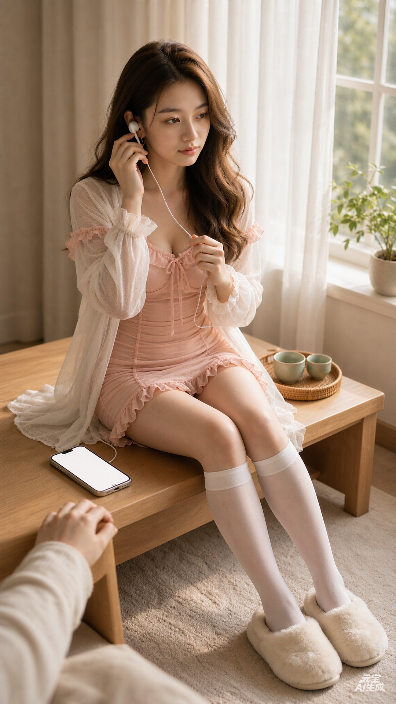

## 终稿提示词

```text
第2张 · 他走近坐下·视点 1.05 米、隔 1.0 米看她侧坐在矮榻边把另一只耳机贴到自己耳廓、指尖绕着耳机线

三张输入图分工：第一张定本轮整套穿搭的版型配色面料、丝袜、绒拖与随这套衣服落下的栗棕偏分长发；第二张定她的五官骨相；第三张定本张的侧坐姿态骨架与重心；光位、场景、关系视角、构图调子、神态落点与可见动作逐项落满画面。全画一位清晰成年女性人物，一具完整身体轮廓，左右各一只手臂、各五根手指，两只手各自从肩经肘腕到指尖连成一条链、各只做一个动作；两只脚各自连续，胸大腰细腿长靠合身剪裁写实呈现。

9:16 竖版满画幅，画面从顶到底由人物、矮榻、亮屏手机、短绒地毯与一片白纱滤过的午后暖光填满，四条边即裁切边，人物与道具完整落在画内。藕粉色一字肩荷叶边束身迷你连衣裙，一字领口一圈细荷叶边，胸前抽褶系带结成一枚小蝴蝶结，束身压褶，裙摆一圈木耳边停在大腿中段；外搭象牙白细纱长开衫，纱纹清晰可辨，喇叭长袖，袖口一层荷叶边，前襟两片细纱沿胸前抽褶两侧垂到膝下、叠在连衣裙外；珍珠细项链坠一粒小珍珠，奶油白半月形小手提包搁在矮榻脚边。一层米杏薄透连裤丝袜从腿根连包到脚趾，脚趾由同色袜面完整包住、五趾在袜面里各自分明，袜面从小腿到脚背连成平顺同一片，丝袜脚背连进拖口；两只奶白软底包趾绒拖穿在丝袜外面，短绒贴着脚背，一只绒拖半挂在脚尖。奶白短圆甲，细哑金小耳圈各一只。栗棕偏分长发，松而大的长波浪卷一路披过胸，低头时几缕从肩头滑下来扫过锁骨；四张同一顶。

她的右手从右肩经肘腕到指尖连成一条链，唯一落点是拇指与食指把另一只奶白耳机轻轻贴在自己右耳廓上，五指把耳机扶稳，几缕栗棕长发从耳侧垂下来搭在腕上；左手从肩经肘腕到指尖连成一条链，唯一落点是拈着那道从耳机垂下来的细白线，五指把线在食指上绕了松松一圈，线尾搭在膝头。侧坐在矮榻边，双腿斜向右侧叠放，脊线从后颈经腰窝到点地的脚踝拉成一道柔缓的 S，肩往他这侧送过来半寸，髋留在后，重心稳在坐骨与两只绒拖之间。她先垂眼听了一拍，才抬眼把目光递过来，下颌收一点，眼尾压下来，眉梢只提起一半就停住。

场景是秋日午后的室内一角：那部手机立在矮榻边沿、屏面正对画面外你坐的那一侧斜出一点角度，手机正面亮屏正对这一眼、屏面一块干净的暖白亮光扫到她膝头并铺到地毯绒面上；矮榻一角搁着藤编小托盘与两只青瓷小茶杯，杯口各浮一点温热的光；浅木窗台一盆绿叶垂下一两片，白纱帘把日光滤成软软的一片。画面下缘落着他走近坐下时搁在矮榻边的一截手腕与袖口，素手皮肤本色，就在她半挂的绒拖那一侧。

午后暖光落在她贴耳机的五根指尖、耳机壳那一线细亮、绕线的食指、发顶那道偏分缝与绒拖口连到脚踝的米杏丝光上；窗外的院子化成柔软的暖白，安静得像一句话说到一半。成图自带工具水印原样留在右下角。
```

## 一句点评

他走近坐下隔1.0米看她侧坐把耳机贴自己耳廓
