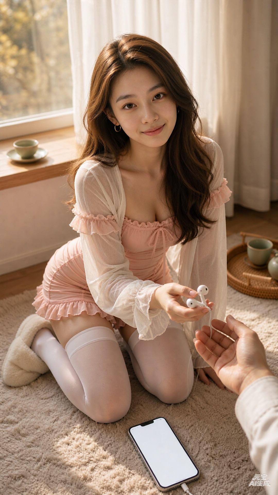

## 终稿提示词

```text
第3张 · 他俯身·视点 0.5 米、隔 0.55 米看她单膝跪起把耳机递到你搁在薄毯上的手腕上方、另一只手撑在他膝侧

三张输入图分工：第一张定本轮整套穿搭的版型配色面料、丝袜、绒拖与随这套衣服落下的栗棕偏分长发；第二张定她的五官骨相；第三张定本张的单膝跪姿骨架与重心；光位、场景、关系视角、构图调子、神态落点与可见动作逐项落满画面。全画一位清晰成年女性人物，一具完整身体轮廓，左右各一只手臂、各五根手指，两只手各自从肩经肘腕到指尖连成一条链、各只做一个动作；两只脚各自连续，胸大腰细腿长靠合身剪裁写实呈现。

9:16 竖版满画幅，画面从顶到底由人物、奶白耳机、亮屏手机、短绒地毯与一小片午后暖光填满，四条边即裁切边，人物与道具完整落在画内。藕粉色一字肩荷叶边束身迷你连衣裙，一字领口一圈细荷叶边，胸前抽褶系带结成一枚小蝴蝶结，束身压褶，裙摆一圈木耳边停在大腿中段；外搭象牙白细纱长开衫，纱纹清晰可辨，喇叭长袖，袖口一层荷叶边，前襟两片细纱沿胸前抽褶两侧垂到膝下、叠在连衣裙外；珍珠细项链坠一粒小珍珠，奶油白半月形小手提包搁在地毯边。一层米杏薄透连裤丝袜从腿根连包到脚趾，脚趾由同色袜面完整包住、五趾在袜面里各自分明，袜面从小腿到脚背连成平顺同一片，丝袜脚背连进拖口；两只奶白软底包趾绒拖穿在丝袜外面，短绒贴着脚背。奶白短圆甲，细哑金小耳圈各一只。栗棕偏分长发，松而大的长波浪卷一路披过胸，俯身时几缕从肩头滑下来扫过锁骨；四张同一顶。

她的右手从右肩经肘腕到指尖连成一条链，唯一落点是托着那只奶白耳机把耳塞朝下再往前送一拳、耳塞头正压在画面右下那截腕骨正上方，肩往前送、右肘向外开，耳机线在光里垂成一道细弧，五指稳稳兜住耳机壳；左手从肩经肘腕到指尖连成一条链，唯一落点是撑在他膝侧那一小片燕麦色短绒地毯上，五指分开把跪起来的身子稳住，腕子压出一点好看的凹。左膝落地跪稳，右腿屈起、脚掌平踩短绒地毯踩稳，脊线从后颈经腰窝到跪着的膝头拉成一道柔缓的弧，肩往前送、髋留在后，重心落在撑地的手与跪着的膝之间。她先看自己掌心里那只耳机一拍，随即抬眼把目光递过来，眼尾压下来正对这一眼，下唇含住一点又松开，嘴角挑起极轻的一线。

场景是秋日午后的室内一角：燕麦色短绒地毯的织纹在暖光里浮出一层细绒，那部手机搁在她跪着的膝前，手机正面亮屏正对这一眼、屏面一块干净的暖白亮光铺到地毯绒面上；藤编小托盘上两只青瓷小茶杯各浮一点温热的光；浅木窗台一盆绿叶垂下一两片，白纱帘把日光滤成软软的一片。画面右下角实有一截他自然素色的手腕与一线衬衫袖口压在短绒地毯边沿，腕骨与袖口边缘完整清晰，接住她撑地那只手的视线。

午后暖光落在她眼尾、下唇角、托耳机的五根指尖、耳机壳那一线细亮、那道细白线弧与绒拖口连到脚踝的米杏丝光上；画面四周收拢成一层柔软暖白，把中央那片光托出来，安静得像整间屋子都放轻了呼吸。成图自带工具水印原样留在右下角。
```

## 一句点评

他俯身隔0.55米看她单膝跪起把耳机递到你手腕上方
