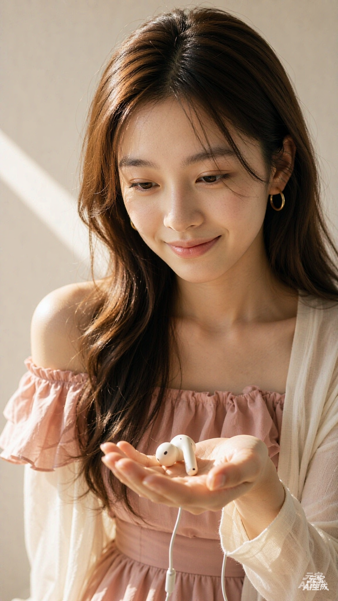

## 终稿提示词

```text
第4张 · 他凑近·视点 0.3 米、隔 0.3 米看她凑到眼前把耳机搁进你摊开的掌心

一张输入图分工：这张底图定她的五官骨相；本轮藕粉荷叶边束身迷你连衣裙、象牙白细纱长开衫与栗棕偏分长发由本段文字锚点写死。本张是 0.3 米近景，文字落在他这一眼正对着的她那张脸上，午后暖光与指尖的细亮都贴着这张脸走。全画一位清晰成年女性人物，脸年轻柔和、神态松弛。画面是一张一气连成的连续近景：她整张脸占满画面上半，额前几缕栗棕碎发、眼尾、睫毛、鼻梁侧影、嘴角与一小片柔和下颌线从上到下连续落进画里；她的右手从画面右下角伸进来、近大远小，五指各各分明，拇指与食指刚刚松开一只奶白耳机，把耳机平搁在画面下缘正中你摊开掌心的一小片素色掌面上，耳机壳一点奶白细亮正落在掌纹交处，中指、无名指、小指三指并拢轻曲，腕子松松的，奶白短圆甲在暖光里反出一点细亮。一道细白耳机线从耳机壳垂下来，松松搭在你那截手腕上，线尾落进画底那一小片暖光里。她的栗棕长发从画面上半一路垂到右下那只手，藕粉一字肩荷叶边束身裙的一线领口与象牙白细纱开衫的纱纹边缘在画底各亮各的；上下同一片柔软暖白背景、同一道从画面左侧斜落的清亮午后光、同一片柔和皮肤，整幅从额前碎发一直连到摊开的掌心，中间由垂落的长发与同一道暖光连成一片。

她的眼尾弯下来，从垂在额前的栗棕碎发缝里正对这一眼，睫毛一眨一眨扫过那道浅影；下唇尖抵住一粒暖光亮点，眼尾先弯、视线压着掌心那只耳机往下沉半分，嘴角提起一个等你先开口的弧度，带一点「好听吧」的小得意，又留一点等你先说话的软。细哑金小耳圈在耳垂那一点反一粒极小的亮。

发型仍是栗棕偏分长发，松而大的长波浪卷一路披过胸，额前一层薄碎发，发梢被暖光勾出一线绒光；四张同一顶。

场景是秋日午后的近前：背景是一整片柔软暖白，画面左侧一片清亮午后光斜落，照亮眼尾、下唇角、耳圈、奶白耳机与搁在掌心的那截指尖。画面下缘正中留你摊开掌心的一小片素色掌面托在那只耳机底下，你那截自然素色的手腕与一线衬衫袖口贴着画底，接住她递来的耳机。成图自带工具水印原样留在右下角。
```

## 一句点评

他凑近隔0.3米看她把耳机搁进你摊开的掌心
