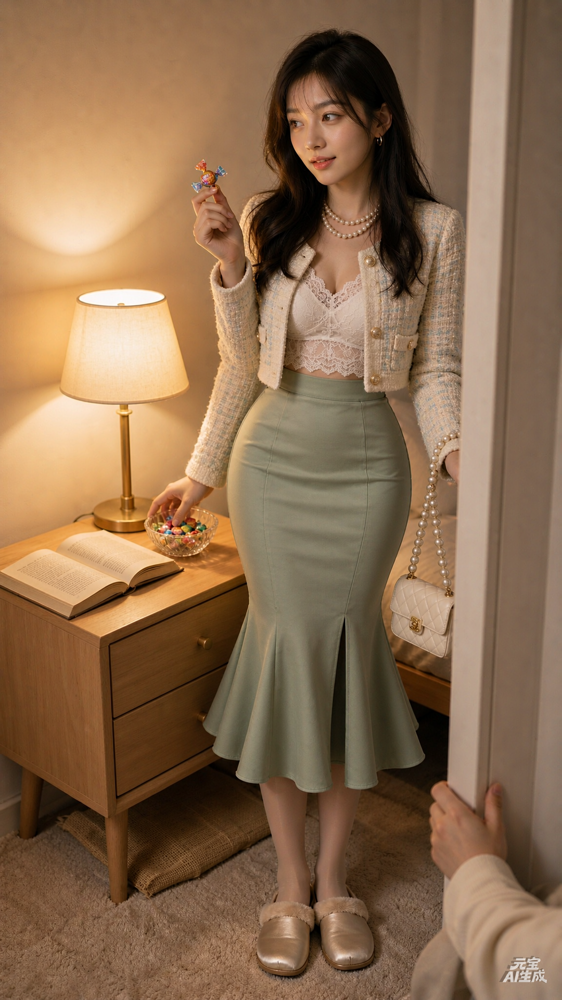

## 终稿提示词

```text
第1张 · 他倚着卧室门框站·视点 1.2 米、隔 1.3 米看她已站在床头柜边回过身、指尖拈起一颗水果糖朝他晃

三张输入图分工：第一张定本轮整套穿搭的版型配色面料、丝袜、绒拖与随这套衣服落下的深茶棕偏分长发；第二张定她的五官骨相；第三张定本张的站姿回身骨架与重心；光位、场景、关系视角、构图调子、神态落点与可见动作逐项落满画面。全画一位清晰成年女性人物，一具完整身体轮廓，左右各一只手臂、各五根手指，两只手各自从肩经肘腕到指尖连成一条链、各只做一个动作；两只脚各自连续，胸大腰细腿长靠合身剪裁写实呈现。

9:16 竖版满画幅，画面从顶到底由人物、玻璃糖碟、浅木床头柜、暖黄床头小灯与一片暖黄灯光填满，四条边即裁切边，人物与道具完整落在画内。象牙白粗花呢短款小香风开衫，圆领，前排金色小圆扣，四个贴袋，长袖袖口各一粒金扣，衣长齐腰；内搭白色蕾丝细肩带吊带束身衣，蕾丝花纹一路铺到下摆蕾丝边；鼠尾草绿缎面高腰鱼尾中长裙，前中一道开衩，裙长到小腿，鱼尾摆一层一层散开；双层珍珠项链贴着锁骨，奶白菱格珍珠链小包挎在左腕。一层浅香槟薄透连裤丝袜从腿根连包到脚趾，脚趾由同色袜面完整包住、五趾在袜面里各自分明，袜面从小腿到脚背连成平顺同一片，丝袜脚背连进拖口；两只香槟缎面软底包趾绒拖穿在丝袜外面，鞋口一圈细短绒贴着脚背。奶白短圆甲，细哑金小耳圈各一只。深茶棕偏分长发，额前一层薄空气碎刘海，松而大的长微卷一路披过胸，发尾一缕一缕分得清，耳侧几缕细软碎发；四张同一顶。

她的右手从右肩经肘腕到指尖连成一条链，唯一落点是拇指与食指拈着的一颗裹彩色糖纸的水果硬糖，五指把糖举到床头灯下朝这一眼轻轻一晃，糖纸在光里反出一点橙红与浅青的彩亮；左手从肩经肘腕到指尖连成一条链，唯一落点是扶着浅木床头柜上那只玻璃糖碟的边沿，五指指腹实实在在压住碟沿把糖碟稳住，碟里几颗糖各自裹着彩纸。她站在燕麦色短绒地毯上，上身朝他这侧回过来一点，脊线从后颈经腰窝到两只绒拖拉成一道柔缓的弧，重心稳在前脚掌与扶碟的手之间。她先看自己指尖那颗糖一拍，随即抬眼把目光递过来，眼尾抬起来，下唇含住一点又松开，嘴角挑起一线。

场景是入夜的卧室床头一角：燕麦色短绒地毯的织纹在暖光里浮出一层细绒，浅木床头柜上并排摊着一本翻开的旧书与那只玻璃糖碟，书页压着一小片糖纸；暖黄床头小灯罩着一圈布边，灯光柔柔地铺到柜面与地毯上；素麻小垫搁在柜脚边。画面下缘落着他倚在门框边的一截手腕与袖口，素手皮肤本色。远景里这一眼看清的是她拈糖的五根指尖、发顶那道偏分缝、缎面鱼尾裙的鼠尾草绿折光与绒拖口连到脚踝的浅香槟丝光，卧室深处那一小片墙色化成柔软暖黄。

暖黄灯光落在她的眼尾、下唇角、拈糖的指尖、糖纸那一点彩亮、玻璃糖碟的釉光与双层珍珠项链的珠面上。成图自带工具水印原样留在右下角。
```

## 一句点评

他倚着卧室门框隔1.3米看她站在床头柜边回身拈起一颗水果糖朝他晃
